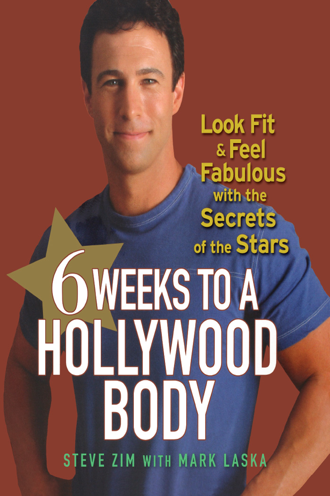

# 6 Weeks to a Hollywood Body

### Look Fit and Feel Fabulous with the Secrets of the Stars

**Steve Zim and Mark Laska**

---

*In memory of Cookie Zimelman*

---

## Contents

- [Acknowledgments](#acknowledgments.html)
- [Introduction: What Is the Hollywood Body?](#introduction.html)
- [1 Hollywood Body Goals and Motivation](#chapter01.html)
- [2 Secrets of the Stars](#chapter02.html)
- [3 Hollywood Nutrition Principles](#chapter03.html)
- [4 Hollywood Heart Principles](#chapter04.html)
- [5 Hollywood Sculpt Principles](#chapter05.html)
- [6 Your Hollywood Body Initiation—the First Two Weeks](#chapter06.html)
- [7 What's Your Hollywood Body Type?](#chapter07.html)
- [8 Four Weeks to an Ectomorph Hollywood Body](#chapter08.html)
- [9 Four Weeks to a Mesomorph Hollywood Body](#chapter09.html)
- [10 Four Weeks to an Endomorph Hollywood Body](#chapter10.html)
- [11 The Final Cut: The Hollywood Body Lifestyle](#chapter11.html)
- [12 What Next?](#chapter12.html)

---

[]{#acknowledgments.html}

## []{#acknowledgments.html#page_viii}[]{#acknowledgments.html#page_ix}Acknowledgments {.h2fm}

------------------------------------------------------------------------

Thanks to my editor, Tom Miller, for shepherding this book; to Mark
Laska, for making my words and ideas clear so that people can change
their lives; and to Maria Yip for all the hard production work she puts
into the fitness segments we do on NBC's *Weekend Today* show, which has
helped spread the word of fitness to millions of people and has allowed
me a forum to educate Americans on being healthier. To the gym
crew---Salter Giddens, the gym's "fashion king"; Todd Bresler (or TT, as
we call him); Chris Yackley; Diana Oliveira; and Kim Halcomb---thank you
for always doing your best. Thanks also to Dennis Weiss for being a
sounding board and keeping the gym healthier with all your fruit. Thanks
to Chuck Dalaklis, Teresa McKeown, and the Brokaw brothers---your
support has meant a lot to me. Thanks to Mel Berger and everyone at
William Morris for finding us a good match. I also want to thank Dr.
Abraham Zimelman---my dad and medical adviser for my fitness
segments---and Dr. Alice Zimelman, Irv Rubinstein, and Shirley
Rubinstein for being more than family and always coming up with ideas
for me to do on the show. Thanks to my wife, Jodi, for everything she
does---too much to list; to Carli and Taylor, my youngest workout
buddies; and to Humphrey, my four-legged jogging partner. Thanks to
Tom's editorial assistant, Juliet Grames; the book's production editor,
Lisa Burstiner; and the copy editor, Mary Dorian. And finally, thanks to
the models featured in the book who allowed us to show you the way:
Ilana Zimelman, Marie Cavanaugh, Alyson Sanders, Amy Ruka, and Jodi
Zimelman.[]{#acknowledgments.html#page_x}

[]{#introduction.html}

## []{#introduction.html#page_1}Introduction: What Is the Hollywood Body? {.h2fm1}

------------------------------------------------------------------------

Within these pages you will learn the secrets of transforming your body
into a Hollywood body. I have helped so many people through this
process---people of all ages, shapes, and sizes---that it has been honed
into a scientific formula that I am honored to share with you.

Around the world, Hollywood projects images of beautiful people,
glamour, and star power. But the reality is somewhat different. People
in southern California are blessed with one thing many other people are
not: nice weather. People who visit Hollywood from Saskatchewan,
Wisconsin, Maine, and North Dakota learn that they can actually enjoy
being outdoors in February. In fact, most people in Hollywood are not
that much better looking than people anywhere else in the world; we're
just more active.

The Hollywood body is a product of an active lifestyle and a Hollywood
body mindset. When you engage in activity, there is a
[]{#introduction.html#page_2}natural release of hormones, enzymes, and
chemicals that delivers instant feelings of well-being. Activity results
in an immediate relief of stress; you will feel refreshed, energized,
clearheaded, and buoyant---that is the Hollywood body mindset. These are
the feelings that will drive you to become more active, and
consequently, adopt an active lifestyle.

An active lifestyle will equate to a happy life. Happiness is actually
the realization that you would not choose to be anyone or anything else.
That is really the goal here. The point is not to look like your
favorite celebrity, but to make the most of what you have. This book
will help you change your body into the best that it can be---and be
satisfied with who and what you are.

Let's be real: most of us do not look like supermodels or compete in
bodybuilding contests. Recent studies conducted by scientific and
medical institutions point out that less than 10 percent of the U.S.
population exercises regularly. The Centers for Disease Control recently
stated that more than 30 percent of the population is obese and more
than 60 percent of all Americans are overweight. So Hollywood might not
be the best litmus test for what your body could or should look like.
During the press tour for the film *Bridget Jones: The Edge of Reason*,
Renee Zellweger talked about "ballooning up" to 135 pounds. To put that
in perspective, the average American woman weighs 162 pounds.

This book does not contain some unrealistic method to take a woman who
is currently a size 26 and turn her into a size 2, or reduce a man's
42-inch waist to 28 inches. This book is designed for the great majority
of people who do not exercise and would like to turn their lives around.
If this is you, you are in the right place.

I have been an ardent fitness devotee my entire life and have been
helping people transform their bodies for almost twenty years. I first
began to take the transformation process seriously when I was in
college. After watching people exercise next to me in the gym day after
day and year after year, I began to notice that they looked no different
from the way they did when I first met them. I began to question why and
how these people could be so committed and
[]{#introduction.html#page_3}not get any payoff for all their sweat and
effort. I dissected the traditional exercises most of us are familiar
with and became increasingly determined to discover the answer to why my
gym mates were not getting results.

I began to study physiology; I delved into the function of supportive
muscle groups, the skeletal system, kinesiology, and human performance.
At a college in Boston, I was lucky enough to be allowed to observe some
astounding scientific experimentation with next-generation magnetic
resonance imaging (MRI) and infrared imaging that are considered
cutting-edge technology. With advanced MRI technology, I could see how
our muscles connect to the skeletal system and better understand their
functions. On a hunch, I asked to see what muscles looked like during
traditional exercises using infrared technology. It was clear that only
a small portion of designated muscles were radiating enough heat to be
seen. With this technology, it became evident that only 20 to 30 percent
of the working muscle was actually being utilized.

Finally, I saw scientific proof that solved the mystery of why
traditional exercises were not helping people transform their bodies. I
began to modify traditional exercises and experiment with the creation
of entirely new exercises to maximize muscular output, and I brought
these new exercises back into the laboratory. The infrared images from
the new exercises showed me that I could call upon 100 percent of
muscular output. Theoretically, the new exercises provided a method to
work the entire muscle and rebuild the musculature from its deepest
point, giving exercisers a method to completely transform their
appearance. When used in conjunction with proper nutritional guidelines
and cardiovascular activity, the new exercises could result in a
complete physical transformation in the shortest possible time.

After experimenting on myself and experiencing astounding results, I
began working with high-level college athletes using these new
techniques and methods. By anyone's definition, their results were off
the charts. When I moved to Los Angeles, I began using these same
techniques with professional and Olympic athletes. The
[]{#introduction.html#page_4}system I developed has helped dozens of
minor leaguers break into the majors, and it has propelled a handful of
major league players to become all-stars. It has helped boxers to become
world champions and amateur athletes to become national champions and
Olympic medalists. It has enabled people to reach higher levels of
performance after career-threatening injuries. In the sports world, the
secret is definitely out, and several teams and organizations have
instituted this system.

I own and operate a low-key private training center in Los Angeles. My
clientele is an interesting mix of celebrities, professional athletes,
and everyday folks who live in the neighborhood, including homemakers,
merchants, civil servants, white-collar professionals, and entertainment
executives, old and young. In this unpretentious environment, a
sixty-year-old fire chief can stand next to a young ballplayer and say
to himself, "If I work really hard, I can look like that." It is a place
where a national champion figure skater will encourage a woman who has
just had her second child to push herself on the next set of exercises.
The majority of athletes I train are not seven feet tall and don't look
like the Incredible Hulk; rather, they have well-toned and highly
trained bodies. For the noncelebrities and nonathletes who come into my
facility to make significant appearance- or health-related changes, the
improvement happens rapidly and dramatically.

For the last few years, I have been talking publicly about the Hollywood
body system. I have written over a hundred articles for magazines such
as *Glamour, Cosmopolitan, Men's Fitness, Elle, Self, Redbook, Muscle &
Fitness, Marie Claire, Oxygen*, and *ESPN*. I am the regular fitness
expert on NBC's *Weekend Today* show, where I discuss fitness trends and
health-related advances. On other networks, I have done dozens of
nationally broadcast makeover features taking famous and not-so-famous
people through the process of physical transformation on such shows as
*Extra* and *Entertainment Tonight* and on VH1 and the Discovery
Channel. The dramatic before-and-after stories of these celebrities have
generated greater interest in this system, which I now have the
privilege of bringing to you. []{#introduction.html#page_5}While these
celebrities and athletes come into my gym to get a Hollywood body, I
have designed this book so that you can get similar results in the
privacy of your own home.

The Hollywood body workouts are designed to get you optimal results in
the quickest possible time. Most people who stop exercising do so
because they do not see results, but with the Hollywood body workouts
your results are guaranteed. After just one workout you will feel the
difference, after three workouts you will see the difference, and after
only two weeks your friends and loved ones will notice the difference.
After you have completed my six-week program, it is likely you will get
a jaw-dropping reaction from everyone.

*6 Weeks to a Hollywood Body* is designed to take you from where you are
to the results you have only dreamed about. I truly hope you will use
this book, get the results you want, and feel comfortable enough to go
to the beach and the gym, partake in fun and healthy activities, and
take your fitness to the next level. By changing your body, I believe
you will change your self-perception, your self-image, and your level of
self-empowerment. Keep this in mind: changing your body will change your
entire life!

Are you ready to get your own Hollywood body? Let's get started.

[]{#chapter01.html}

## []{#chapter01.html#page_6}[]{#chapter01.html#page_7}1 {.chnum}

## Hollywood Body Goals and Motivation {.h2}

------------------------------------------------------------------------

[]{#chapter01.html#page_8}[]{#chapter01.html#page_9}We spend significant
portions of our free time watching television and movies. We gawk at the
stunning female and male beauties on the screen. Film and television
have defined our sense of beauty, and they powerfully project those
standards and ideals. Whether or not we are conscious of it, celebrities
are the very people with whom we compare and contrast our appearance.
This book is devoted to the journey of how you get from where you are
today to the body you would like to have in the future. That road can be
littered with potholes and detours, and I will do my best to make sure
you avoid these road hazards.

### {.middle} Unrealistic Expectations {.h3}

------------------------------------------------------------------------

A Hollywood body is not a *perfect* body. Trying to achieve a perfect
body is the biggest and most common trap you can fall into; there is no
such thing. Although a person's body can be beautifully sculpted and
toned, no one has a perfect body. Even celebrities will blushingly point
out their shortcomings---at least as they perceive them. The perfect
body is impossible to achieve; it's simply unattainable.

[]{#chapter01.html#page_10}Trying to achieve an unattainable goal is an
exercise in futility. Although I would love to be 6\'7\", I will never
be taller than 5\'11\". That is just the way it is. The point of this
book is *not* about becoming someone else. There is no power in that.
There is, however, power in becoming the best you can be. By merely
*attempting* to make what you have the best it can be, you will become
empowered.

### {.middle} Immediate Results {.h3}

------------------------------------------------------------------------

Improving your appearance, becoming fit, and being more physically
active are the quickest and most surefire ways to increase your
confidence, self-esteem, and self-worth. That is your ultimate payoff.

You need to make the payoff more immediate than a smaller dress size or
the ability to run a marathon. This system of exercise must make you
feel so incredibly good and so good about yourself that you would never
even consider missing a workout. If you get a payoff each and every time
you exercise, if you get many results every day, you will stick with it
long enough to reach that final destination.

### {.middle} Positive Addiction {.h3}

------------------------------------------------------------------------

I want you to get something profound, something that will rock your
world, every day. To do that, this program has a built-in mechanism to
provide you with moment-to-moment results. As you will discover in the
chapters that follow, the road map for a Hollywood body is a three-part
system. I will give you a prescription for nutrition, cardiovascular
exercise, and specific sculpting routines for your individual body type.
At the beginning of each day, you will set yourself up to achieve many
small personal victories. Every time you follow my nutritional
guidelines, for example, you will have accomplished something
tangible---it will become a personal victory.
[]{#chapter01.html#page_11}When you do your cardiovascular exercises,
you will get many immediate results that include greater levels of
energy, improved concentration, and feelings of well-being that may be
more effective than antidepressants. These are personal victories as
well. Throughout your sculpting routines you will be completely focused
on each exercise repetition; each repetition that is performed to
perfection is a personal victory. At the end of any given session, you
will have achieved hundreds of minivictories.

These victories are the basis for your physical and personal
transformation. Accumulating them daily gives you immediate results and
the momentum to carry you through the day. This positive momentum
propels you forward. No matter what is happening at home, in the office,
or in your relationships, this positive momentum will affect almost
every aspect of your life. It will compel you and drive you. In creating
this incredibly positive force, you will have found the ultimate reason
to use this system day after day. After only a week or two, instead of
asking, "How can I find the time?" you will be saying, "How can I *not*
find the time?"

### {.middle} Allowing Yourself Time {.h3}

------------------------------------------------------------------------

Forming a habit takes a specific amount of time. Behavioral scientists
and 12-step programs have determined that it takes at least three weeks
to break a negative habit and form a good one. This program is designed
specifically to enable you to develop this habit.

To begin your personal journey of positive addiction, you need to set
aside 45 minutes of your day three times a week. Before we go any
further, get out your organizer, consult the nearest calendar, or log
onto your computerized scheduling device. Simply reserve three 45-minute
blocks of time during your first week. Now schedule in week two. The
ancient Chinese philosopher Lao-tzu said, "The journey of a thousand
miles begins with one step." Congratulate yourself because you just made
that first step.

It will also take a certain amount of time to reach your goal and
[]{#chapter01.html#page_12}to attain your version of a Hollywood body.
If you have a body that resembles Camryn Manheim's, chances are you may
never look like Calista Flockhart, but with effort and time you may
indeed be able to attain a shape and size that could resemble those of
Catherine Zeta-Jones. Such a transformation will not occur overnight,
nor should it. The luxury of time is essential in not only changing the
way your body looks but in changing your own self-image. I have coached
many clients through the process of losing a great deal of body fat, and
many who have shed in excess of 100 pounds of fat. Being comfortable in
their new bodies took significant mental adjustment. With the luxury of
time you will be mentally and emotionally equipped to accept the
physical changes that are coming your way.

How long will *your* transformation take? It depends on what you are
striving for.

If your goal is weight loss, you are in luck. The majority of my
personal clients are celebrities who need to look their best in the
shortest possible time. Weight loss generally boils down to a simple
math problem, however, and you can only lose so much weight safely. Most
experts agree that at best you can lose only 2 pounds of fat per week.
To do this you really have to push yourself and be extremely active. It
is much more reasonable to strive for 1 pound of fat loss per week.
Although it may not seem dramatic, even a modest fat reduction of 1
pound per week becomes astounding when done consistently over time. If
you can lose 1 pound of fat per week, you can be over 50 pounds lighter
in one year, and over two years you could lose more than 100 pounds.
Small, steady progress can add up to nearly miraculous results if you
are patient and consistent.

### {.middle} Time Management {.h3}

------------------------------------------------------------------------

To get the greatest results and use your time wisely, it is essential
that you begin using a scheduling aid. It doesn't matter what you
use---it can be the electronic variety on your computer or hand-held,
[]{#chapter01.html#page_13}the paper variety in one of those leather
binders, or an inexpensive spiral-bound calendar. I actually prefer the
least expensive option, paper, and use a calendar that displays an
entire week over two open pages, where each column is a day.

When the weekend comes, I strongly suggest that you set aside a few
minutes on Saturday or Sunday to plan out your upcoming week. In your
weekly schedule, you should block out time to do your grocery shopping
and an afternoon or evening when you will prepare food for the coming
week so that your food is ready to be warmed up when you need it.

Then schedule the times you will do your cardiovascular exercise and
workouts. After you have made these entries you can pencil in regular
appointments, chores, and meetings. When you are finished with these
entries you can then take a "big picture" look at the week before you.
You are prepared to see the holes in your schedule, so go about filling
those time slots. Perhaps you would like to get in some additional
activity---maybe you would like to play a round of golf, go for a
bicycle ride, take a hike, or have a game of tennis. Remember, the more
active you are, the more active you will become, and it is essential to
push yourself.

With this organizing tool, you can easily see what you have to do on any
given day, and clearly see that you could fit in even more. This simple
tool will enable you to become more accountable to yourself, provide a
disciplined system to support your new goals and priorities, give you
greater control each day, and help you to become much more efficient and
effective.

### {.middle} Before You Begin {.h3}

------------------------------------------------------------------------

Preparation is key. Before you begin, you will need some basic
equipment. Make sure the listed items are available to you before you
read [chapter 6](#chapter06.html).

[]{#chapter01.html#page_14}**Your Hollywood Body Shopping List**

::: {style="margin-top:0.5em;"}
:::

::: list-m
{.middle}[An exercise (therapy)
ball.]{.space}

{.middle}[Two sets of dumbbells or one set
with adjustable weights. Women should have a pair each of three-pound
and five-pound dumbbells. Men should have a set of ten-pound and
twenty-pound dumbbells.]{.space}

{.middle}[A set of ankle weights. You want
the variety of ankle weights that can be adjusted. Women should have a
pair that can accommodate 1 to 5 pounds. Men should have a pair that can
accommodate 5 to 10 pounds.]{.space}

{.middle}[A fairly thick exercise mat (not a
yoga mat).]{.space}

{.middle}[A heart-rate monitor
(optional).]{.space}

{.middle}[A good pair of cross-training
athletic shoes.]{.space}

{.middle}[Comfortable clothing that you can
move in.]{.space}

{.middle}[A spiral-bound weekly schedule, day
planner, or electronic scheduling aid.]{.space}

{.middle}[A good-quality
multivitamin.]{.space}

{.middle}[A 32-ounce water bottle.]{.space}
:::

### {.middle} Starting the Program {.h3}

------------------------------------------------------------------------

The Hollywood body system begins with a two-week initiation. During this
initiation you are going to reset your metabolism, establish a level of
endurance, and increase your strength.

We'll start off slow and step up ever so slightly each day. By the end
of the initiation, you will have trimmed inches, improved your physique,
and achieved a fairly dramatic level of overall fitness and stamina.

The second portion of my program, which lasts four weeks, is where you
will see the most dramatic physical changes. The four-week portion helps
you get a Hollywood body for your personal body type.

[]{#chapter01.html#page_15}There are three basic body types: the
ectomorph, the mesomorph, and the endomorph. Each of these types faces
unique challenges. For instance, an ectomorph has a hard time putting on
weight, whether fat or muscle. Typically a thin, wiry type of build,
this person can eat almost anything in any quantity and not gain an
ounce. A mesomorph can generally put on muscle very easily. She or he
has more of an athletic build: broad shoulders, wide back, and thick
thigh muscles. This person has to watch what she eats and train very
specifically or she will be adding fat onto her body. An endomorph only
has to look at food and he gains weight---and not the right kind of
weight. Some possible characteristics are narrow shoulders and a
pear-shaped body.

I will help you identify which type best describes you, then we'll go to
work on shaping and sculpting your problem areas. In six short weeks,
you will have completely changed your shape and appearance---by the end
of the month, your personal body type will be much more of a combination
of the three. Then you can go to work on fine-tuning.

To complete your total-body makeover, I have created Final Cut, a
revolutionary system to get you truly stunning results quickly, just
like your favorite star. By the time you finish Final Cut, you too will
be ready for the red carpet.

[]{#chapter02.html}

## []{#chapter02.html#page_16}[]{#chapter02.html#page_17}2 {.chnum}

## Secrets of the Stars {.h2}

------------------------------------------------------------------------

[]{#chapter02.html#page_18}[]{#chapter02.html#page_19}Many people have
been lured into buying a magazine because they saw a celebrity's photo
on the cover and were pitched a how-to exercise story on how you can get
that star's well-rounded butt. I know that I just can't resist those
magazines, and I've even written my fair share of those articles. Do you
really want to know how celebrities look so great? They work extremely
hard to get those hard bodies. So let's cut to the chase---stars' bodies
look like that because stars are dedicated, they watch what they eat,
and they exercise intensely and often. You probably knew that, but what
you may not know is that they really do have secrets to looking their
best quickly. They do things in a very particular way, in a specific
order, and there are special exercises to sculpt specific body parts to
create an overall look. If they can do it, you can do it, and I'm here
to help you.

Let's get very specific about what you most admire about the Hollywood
body and how you want yours to look so that your efforts have a focus.
The Hollywood bodies you most admire are the sum of many parts---that
is, the backs of the arms, the derriere, the sculpted chest, the
well-defined obliques, and the highly toned legs
[]{#chapter02.html#page_20}that all contribute to an overall look. You
may notice one or two of these body parts as your favorite celebrity
glides down the red carpet in a revealing designer outfit. Merely losing
a certain amount of weight will not make you look like your favorite
celebrity. However, if while losing that amount of weight you work to
create proper muscular balance and definition, you will indeed look
great. Throughout this book, I will teach you to take what you have and
improve it into the best that it can be so that you achieve a total look
that more closely resembles the body of your favorite star.

### {.middle} Spot Toning {.h3}

------------------------------------------------------------------------

Spot toning is truly the secret of attaining a Hollywood body. The next
time you are watching your favorite celebrities walking down the red
carpet or being interviewed on television, examine their various body
parts. Focus on the small details and take in how and why certain areas
of their bodies stand out. Look at the body parts containing large
muscle groups, such as the legs, the back, the arms, the chest, and the
abdomen. All of these muscle groups are the sum of many parts as well.

In examining the large muscle groups of the celebrity body, you will
begin to see traits that you admire and may want to emulate. If you look
closely enough, many things may begin to stick out. You will notice a
certain symmetry that is dazzling. You will see balance between the
upper and lower halves of the Hollywood body. Look closer and you will
see that the right and left arms are the same size. The right and left
legs are equally toned and muscular. The biceps are just about as large
as the calves. As you begin, balance will be your primary focus.

It is not uncommon for most people to be out of balance. When we drive,
we get out of the car by placing our left foot on the ground, and that
leg supports our entire weight as we stand. As a consequence, the left
thigh is generally stronger and larger than the right thigh. Also, we
all have a dominant arm, and we use that arm
[]{#chapter02.html#page_21}most of the time. This dominant arm is
probably stronger and larger than the other arm. This imbalance may
extend to other body parts. Perhaps one of your shoulders is larger or
higher, or one side of your back is more developed than the other. The
muscles in your lower back may not be as strong or developed as your
abdominal musculature. Aside from disrupting proper posture, these
imbalances take away from looking fit.

##### Legs {.h5}

Pay particular attention to your legs. When you are doing your sculpting
exercises, you should strive to work your legs very hard. The harder you
work them, the greater the results will be throughout the rest of your
body. There should be a balance between the strength and size of the
front and back of the thigh. Commonly, even with well-defined thighs,
the rear of the thigh is not well developed. When the back of the thigh
(hamstring) is bowed rather than flat, it will create a better line to
accentuate the curvature of the buttocks, providing you with a more
athletic and toned appearance.

There are some large muscles in the front of the thigh. Creating greater
definition in this area will have fantastic payoffs. Achieving a line
appearance down the side of the thigh provides the ultrafit, hard-body
look that seems to be in vogue. For women especially, well-defined
calves are the secret to looking your best and strutting your stuff.
Other than being tortuous, high heels are designed to provide the calf
with a certain flex, making it appear well defined and accentuating the
muscle.

##### Buttocks {.h5}

When you work on your gluteus maximus---your butt---you will need to
develop the point of demarcation where the rear of the thigh meets the
bottom of the buttocks. Strengthen the muscles on each cheek so that
they have a rounded rather than flat appearance. Creating this kind of
definition will help offset whatever effects gravity and
[]{#chapter02.html#page_22}genetics have had. The next priority,
especially for men, is to develop the edges of the muscle, providing you
with the "dimple" or hollow just outside the joint where your thigh and
pelvic bone meet.

##### Back {.h5}

The back is made up of a very large group of muscles that greatly
accentuate your overall appearance. There are three celebrity secrets
that can make the back truly stunning. First, there are the shoulder
blades. You will be striving to achieve a well-defined musculature on
the inside of each shoulder blade. Second, you will develop the
trapezius (traps) muscles that look as if they sit on top of the actual
shoulder blade. For both men and women, the development of these muscles
makes the back sexier. Shaping these muscles will help the shoulder
blades pull closer together. This will positively affect your posture,
lifting your chest and rolling back your shoulders (the opposite of
hunching your shoulders). Not only will you appear to be standing
straighter and more lifted, but the musculature running down either side
of the spine will be accentuated, providing you with an even more
defined look. Third, and perhaps most important, you will strengthen the
latissimus dorsi (lats) muscles. These winglike muscles begin in the
center of your rib cage and reach up toward your armpits. Depending on
your body type, you can develop these muscles to deemphasize a thick
waist, create an hourglass figure, appear extremely athletic, or make
your torso appear longer to emphasize your shoulders rather than your
hips, or to appear extremely thin.

##### Chest {.h5}

A developed chest can make men appear more virile and powerful, and for
women it can be far more enhancing than plastic surgery. The strategy to
achieve a Hollywood chest is remarkably similar for both men and women.
Basically the chest muscle is shaped like a horseshoe. We will focus on
developing and accentuating the outer []{#chapter02.html#page_23}edges
of the horseshoe. It will then be easier to fill in the horseshoe and
give the chest a more balanced look. You may notice that many box office
idols have developed the upper portions of their pectoral muscles. Aside
from defining the outer edge, this upper pectoral development is
crucial. Female celebrities spend an even greater amount of time working
this area. They concentrate on the upper pectoral area to enhance
cleavage and make the collarbone more pronounced; however, they work the
bottom half just as hard for lift, and they pay even closer attention to
the inner edge of the pectoral muscle for breast separation as well as
to accentuate the ribs connecting to the sternum.

##### Arms {.h5}

The development and sculpting of the shoulder muscles can create a
stunningly beautiful arm as well as proper posture. Read the next few
sentences, then put this book down to determine if you have muscular
imbalance. Simply stand up, extend your arms to the sides, release them,
and let them fall. Let them bounce and come to a stop. Take notice of
which way your palms are facing.

Chances are that your palms are facing behind you and your knuckles are
facing forward (to some degree). If not, you represent 2 percent of the
general population and probably do some kind of heavy manual labor such
as working with a handsaw. The reason your knuckles are facing forward
is that the rear portion of your shoulder is weaker than the front
portion of the muscle. There are very few activities that will develop
the rear portion of the shoulder, and it is precisely this section that
is the coup de grace of the most stunning Hollywood bodies. Take a close
look at your favorite female star wearing a sleeveless dress. Notice how
there is a well-defined point of demarcation that separates the back of
the shoulder and the tricep. For both men and women, that will be our
focus for shoulder sculpting, as it is the most-prized secret of the
stars.

Men and women have very different needs and goals for their arms. Women
look to create a well-defined but decidedly feminine-looking
[]{#chapter02.html#page_24}arm, while most men shoot for size. For men,
this area of the body is of singular importance. Men's biceps are a
symbol of power and strength---an expression of manliness. While our
intention will be to create a certain amount of bulk and definition, men
should take a look at some celebrity biceps. This is a very simple
muscle. It is connected to the skeletal system in just two places, and
the only function of this muscle is to contract. Therefore, it becomes
easy to have a very short little ball of a bicep.

While watching some celebrity arms, notice how long and relatively full
their biceps are. While creating some bulk and a whole lot of definition
in the biceps, one of our primary concerns is to develop an elongated
bicep. But the biceps are only half of the arm. The main focus is to
develop the two sides of the tricep muscle and strive for separation
between them. Men should try to achieve a relative balance between the
size of the biceps and triceps, and women should try to tone and cut the
triceps. For women, the more defined the triceps---the more muscle
separation you can achieve here---the better your arms will look.

##### Abdominals {.h5}

The muscles that comprise the majority of the abdominal section of your
body are like eight little boxes. In the gym, people refer to them as a
six-pack, and if they are really defined, an eight-pack. Everyone has an
eight-pack. Most of us, though, have subcutaneous fat (the fat
underneath the skin) that prevents these muscles from being seen. If you
can see muscle definition on the tummies of your favorite celebrities it
is not because they have big abdominal muscles---it is because they have
a very low body fat percentage.

### {.middle} The Hollywood Body Triangle {.h3}

------------------------------------------------------------------------

When the three elements of the Hollywood body system are put together
into a comprehensive program, your results are guaranteed.
[]{#chapter02.html#page_25}With Hollywood nutrition, you will be feeding
lean muscle and burning fat. With Hollywood heart, you will improve your
circulation, strengthen your heart, increase your endurance, become more
physically fit, and most important, you will be using stored fat to fuel
your activity. With Hollywood sculpt, you will be reshaping each muscle
from its deepest point. When all three sides of this training triangle
are in place, nothing can prevent you from attaining a Hollywood body.

By bringing all three sides of the training triangle together, you
create a momentum. Your nutritional program supports your cardiovascular
program. Your sculpting program supports your cardiovascular activity
and your diet. As each day passes, the three elements of your
transformation take a firmer hold. You begin feeling the changes and
seeing the changes when you look in the mirror. When your aerobic
training, weight training, and diet are all working to complement one
another, something magical happens. You begin coasting downhill. You do
not have to work as hard, but your transformation unfolds rapidly.
Changes occur faster, dramatically affecting the way you look and feel.

No matter what level of exercise you currently enjoy, whether you are
just beginning or have practiced these three disciplines all your life,
you should carefully read the next three chapters. If you are just
beginning, use this information as if it were a one-on-one session with
your personal trainer. You will learn the philosophy and the scientific
principles that are the basis for your transformation. If you have been
exercising for years, attempt to rethink your currently held
convictions. You will pick up at least a few precious gems that will
take your level of fitness to heights previously unknown to you.

[]{#chapter03.html}

## []{#chapter03.html#page_26}[]{#chapter03.html#page_27}3 {.chnum}

## Hollywood Nutrition Principles {.h2}

------------------------------------------------------------------------

[]{#chapter03.html#page_28}[]{#chapter03.html#page_29}Dieting has become
an American obsession. Diet and nutrition are *the* most talked about
topics in our popular culture. You cannot walk through a grocery store,
turn on the TV, listen to the radio, or open your e-mail without being
bombarded with the latest fad diet that promises a thinner you.

Weight is an issue for almost everyone. Some of us really have to watch
every bite that we eat; with much suffering and sacrifice, we are able
to lose a little. Some of us have tried every diet, but nothing works.
There are also people at the other extreme---who have to try very hard
to maintain their weight. Too much work or running around, and they are
dropping weight like nobody's business. For them, gaining weight would
be a dream come true. Most of us are somewhere between these two
extremes. You must understand both ends of the spectrum to figure out
what will work best for you.

### {.middle} Body Fat {.h3}

------------------------------------------------------------------------

Your goal is to eliminate body fat. You will need the proper method to
determine if your program is working. Your scale does not provide
[]{#chapter03.html#page_30}a clear picture of what is happening to your
body. Your weight on the scale is only a small factor of this total
picture. Before you begin, take measurements of your waist, hips, chest,
each bicep, and thigh. This will provide valuable information to not
only mark your progress but also to determine and concentrate your
efforts.

While the easiest method to determine results will be to monitor how
your clothes are fitting, most of us need a more telling measurement. In
addition to taking measurements of various body parts, I recommend you
determine your body fat percentage. This measurement will be your new
guide and key indicator of your progress. It will provide you with a
clear picture of what percentage of your total body weight is made up of
fat and what percentage is made up of water, hair, bone, and lean muscle
mass. Your goal is to create more bone and muscular density and reduce
the percentage of fat.

##### How to Measure Your Body Fat {.h5}

There are many ways to measure your body fat, such as hydrostatic
weighing and bioimpedance, and there is a cost associated with taking
these measurements. While going into a local gym and having a trained
professional take a few measurements with skinfold calipers might cost
\$15, some other (and very accurate) methods might cost thousands. In
truth, you can get a fairly good idea of your own body fat percentage in
the privacy of your own home, at absolutely no cost. You will need a
scale, a tape measure (a new cloth or metal tape is preferable), a
calculator, and perhaps an assistant.

::: bor
BODY FAT FORMULA FOR WOMEN

::: blist
1.[Step on the scale and weigh yourself.]{.space}

::: {style="margin-top:0.5em;"}
:::

Your body weight \_\_\_\_\_\_\_\_ × 0.732 + 8.987 = \_\_\_\_\_\_\_\_

::: {style="margin-top:0.5em;"}
:::

2.[Measure your wrist at the fullest point.]{.space}

::: {style="margin-top:0.5em;"}
:::

Your wrist measurement \_\_\_\_\_\_\_\_ ÷ 3.140 = \_\_\_\_\_\_\_\_

::: {style="margin-top:0.5em;"}
:::

[]{#chapter03.html#page_31}3.[Measure your waist at your navel.]{.space}

::: {style="margin-top:0.5em;"}
:::

Your waist measurement \_\_\_\_\_\_\_\_ × 0.157 = \_\_\_\_\_\_\_\_

::: {style="margin-top:0.5em;"}
:::

4.[Measure your hips at the fullest point.]{.space}

::: {style="margin-top:0.5em;"}
:::

Your hip measurement \_\_\_\_\_\_\_\_ × 0.249 = \_\_\_\_\_\_\_\_

::: {style="margin-top:0.5em;"}
:::

5.[Measure your forearm at the fullest point.]{.space}

::: {style="margin-top:0.5em;"}
:::

Your forearm measurement \_\_\_\_\_\_\_\_ × 0.434 = \_\_\_\_\_\_\_\_
:::

Now calculate your body fat. On your calculator:

Add the totals for 1 and 2.

Subtract the total for 3.

Subtract the total for 4.

Add the total for 5.

This number is your lean body mass (muscle, bones, organs, hair, etc.).

Subtract your lean body mass from your total weight

Total body weight \_\_\_\_\_\_ -- lean body mass \_\_\_\_\_\_ =
\_\_\_\_\_\_

This number is the weight of your body fat.

Body fat weight \_\_\_\_\_ × 100 = \_\_\_\_\_ ÷ Total body weight =
\_\_\_\_\_

This number is your body fat percentage.
:::

::: bor
BODY FAT FORMULA FOR MEN

::: blist
1.[Step on the scale and weigh yourself.]{.space}

::: {style="margin-top:0.5em;"}
:::

Your body weight \_\_\_\_\_\_\_\_ × 1.082 + 94.42 = \_\_\_\_\_\_\_\_

::: {style="margin-top:0.5em;"}
:::

2.[Measure your waist.]{.space}

::: {style="margin-top:0.5em;"}
:::

Your waist measurement \_\_\_\_\_\_\_\_ × 4.15 = \_\_\_\_\_\_\_\_
:::

Now calculate your body fat. On your calculator:

Subtract the total for 2 from the total for 1.

Measurement 1 \_\_\_\_\_\_\_\_ -- Measurement 2 = \_\_\_\_\_\_\_\_

This number is your lean body mass.

[]{#chapter03.html#page_32}Subtract your lean body mass from your total
weight.

Total body weight \_\_\_\_\_ -- lean body mass \_\_\_\_\_ = \_\_\_\_\_

This number is the weight of your body fat.

Body fat weight \_\_\_\_ × 100 = \_\_\_\_ ÷ Total body weight = \_\_\_\_

This number is your body fat percentage.
:::

### {.middle} Body Fat Basics {.h3}

------------------------------------------------------------------------

There are some basic rules about body fat. It is stored within fat
cells. You are born with a certain number of those fat cells, which you
essentially inherited from your ancestors. Those with ancestors from
Northern Europe inherit more fat cells than those who are descended from
people nearer to the equator. Until the end of puberty, you can grow
even more fat cells. After puberty, you will not grow any more fat
cells, but the cells you have will either grow or shrink. Any given fat
cell can grow to be as large as your head or shrink so small that
several dozen could fit on the head of a pin.

You have and need a small percentage of fat. If you pinch the skin on
the top of your hand (as opposed to your love handles or "saddle bags")
you can clearly see what "enough" means. For women, this minimal amount
is 12 to 15 percent of your total body weight; for men, it is about 5
percent. Very fit and highly trained people can achieve these low
percentages, but it is much more reasonable for women to be closer to
the 20 percent range. Dip far below this and you might experience a loss
of menstrual cycle, hair loss, and/or a loss of bone density. Men can
strive for a healthy 12 to 14 percent.

Body fat exists for your survival and should be thought of much like a
reserve tank of fuel. It prevents starvation, and this starvation
protection mechanism is hardwired into your system. To eliminate body
fat, you need to outthink your natural starvation protection mechanism.

### []{#chapter03.html#page_33}{.middle} Outthink Your Body {.h3}

------------------------------------------------------------------------

Your starvation protection mechanism is a primal system to ensure your
survival. This system regulates what and how much energy to release to
maintain your most basic bodily functions. The only tool this complex
system uses is the regulation of body fat. In times of extreme hardship
when there are prolonged periods without food, your body's starvation
protection mechanism works overtime---it stores almost every nutrient
you eat within fat cells for later use. It then conserves all the energy
it can and uses the barest minimum to keep your heart beating and your
lungs breathing.

This primal survival system has no idea that it is living in the
twenty-first century. It does not know that food is as close as the
nearest drive-thru window and that going without food does not equate to
starvation. When you go for long periods without food, all this primal
system knows is that you are not being taken care of. Your body equates
not eating regularly with *danger*. When it experiences danger, it
stores all it can within fat cells and releases very little of what is
held in those cells.

If you are not eating enough food for an extended period of time,
something even more significant will occur. Your body needs energy, and
you require energy to perform any activity. So when the starvation
protection mechanism senses danger, it goes into survival mode and shuts
down fat cells. If and when you do eat, most of these nutrients get
stored within fat cells. Aside from fueling enough energy for heart and
lung functions, this mechanism will not let any fat out of these cells.
But you still need to walk from here to there or do whatever you have to
do to get some food. That energy needs to come from someplace. Your body
can easily consume body tissue to get these essential nutrients to fuel
your activity. In the body's starvation mode, muscle tissue, organ
tissue, and brain tissue are literally cannibalized to provide you with
the fuel you need.

When most people go on a diet, they do not lose fat; they lose *random
weight*. Approximately one-third of your weight on the scale
[]{#chapter03.html#page_34}is water, and most diets and diet products
are simply diuretics. If you see products that say you can lose 10
pounds in 48 hours, this kind of water weight is exactly what you will
lose. Diet centers and fad diets, however, will reduce your food
(caloric) intake, and will do so to such a drastic extent that your body
will think it is starving. If the diet is extreme---and most are---you
will step on the scale and see that you have lost weight. But that
weight loss will be water, muscle, and bone, but very little if any fat
loss.

When you can outsmart your natural fat storage system, you can naturally
and effectively eliminate stored fat. To do this, you need to eat
regularly and often. Most people make two serious mistakes: they wait
too long to eat, activating the starvation alarm, or they eat too much,
activating the fat storage system. This results in the body storing
almost all of what we eat as body fat because it fears starvation.

To reduce fat, your starvation protection device needs to be lulled into
a sense of security. This is accomplished by eating a small snack-size
meal every 2½ to 3 hours at approximately the same times every day. When
this becomes a regular pattern---after two weeks or so---your body will
begin to trust that it does not have to be on alert because there are no
danger signs of shortage or starvation. When the starvation protection
device relaxes sufficiently, it will begin releasing the nutrients
stored within your fat cells, since they are no longer needed to ensure
your survival.

Eating small snack-size meals at regular intervals is key, but to attain
the Hollywood body in the shortest amount of time, you must choose
*what* to eat carefully and thoughtfully.

### {.middle} Combining Proteins and Carbohydrates {.h3}

------------------------------------------------------------------------

During the digestive process, the molecular structure of food is broken
down into smaller and smaller bits until these bits are small enough to
pass through the intestinal wall and are released into the bloodstream.
Once set free into the bloodstream, they can be used by the parts of the
body that need them most. Your body ultimately
[]{#chapter03.html#page_35}derives amino acids from eating protein.
Amino acids feed lean muscle. The less fatty the protein, the more
efficiently your lean muscle can utilize the amino acids.

When carbohydrates are digested, they are ultimately broken down into
sugar or glucose. You need a certain amount of glucose to keep the body
functioning properly, but when there is too much glucose in the
bloodstream, it will cause a hormone called insulin to be secreted.
Insulin has one job: to take out all the extra glucose in the
bloodstream and store it within the fat cells just in case it is needed
in the future. Once nutrients are stored away in fat cells the body is
very reluctant to part with what it has stored. It is therefore your
primary objective not to flood the bloodstream with too much glucose.

When choosing a carbohydrate, you will want to eat something that takes
a long period of time to break apart in the digestive process, and you
will find these foods listed in this chapter as primary carbohydrate
selections. Because the molecular chains of these particular
carbohydrates are difficult to break apart, glucose is released into the
bloodstream slowly over a longer period of time. The more difficulty the
body has in breaking apart the molecular chain of the carbohydrate, the
higher the carbohydrate will appear on the list.

I am certain you know what fat is. Fat is butter, oil, lard---the stuff
that hangs over your belt, the stuff you want less of. Fat is essential
for the body. However, almost every living organism on the planet
contains some fat, so it is not necessary to add any extra fat to your
food. When cooking, you should try to eliminate most, if not all, of the
fat you can. Unfortunately, fat does add to the taste of food, so if you
are going to add it, add it by the drop and not by the spoonful or
cupful.

### {.middle} Portion Size {.h3}

------------------------------------------------------------------------

For any given meal, first decide which source of protein you will be
eating, then determine the carbohydrate choice and corresponding
[]{#chapter03.html#page_36}portion size. If you want to rid yourself of
fat, the portion size of your protein should be approximately the size
of your palm. If you want to maintain your present weight, your protein
portion should be the size of your palm extended to first joint of your
fingers. If you would like to gain muscle mass, your protein portion
should be the size of your hand. You will find a food list in this
chapter that outlines which protein choices are best. Good proteins are
found in protein powder, egg whites, most fish, skinless chicken breast,
and turkey breast. These proteins have little inherent fat and are
absorbed most effectively by your body's digestive system.

Secondary protein choices should be cut or very sparingly selected in
your nutritional program. They include choice cuts of beef that are
highly marbled, pork products, sausages, processed meats, cold cuts,
duck, goose, lamb, and cheese. All of these secondary choices contain a
higher proportion of fat and are not absorbed as effectively by the
digestive system.

After your two-week initiation phase (described in [chapter
6](#chapter06.html)), you will combine your foods in a specific manner.
Based on your choice of protein, you will then determine which
carbohydrate and how much of that carbohydrate you should have. For
instance, if you choose to eat one item from the list of primary protein
selections, you can have twice that amount from the list of primary
carbohydrate selections or the exact same-size portion of secondary
carbohydrate selections. If you are eating a skinless chicken breast,
you can have twice the amount of steamed cauliflower (a 1:2 ratio), or
the same-size portion of rice, potato, bread, or pasta (a 1:1 ratio). If
you choose to eat a secondary source of protein, you can have the same
amount of a good carbohydrate or half that amount of a secondary
carbohydrate. If you choose to eat a fatty protein such as beef pot
roast, you can eat that same portion size of steamed vegetables or half
the portion size of your protein in pasta. In addition, there are a
number of free foods that do not count toward the equation, and you may
have as much of them as you like if you are still hungry.

[]{#chapter03.html#page_37}PRIMARY PROTEIN SELECTIONS

+:----------------------+:----------------------+:----------------------+
| Chicken breast (not   | Fish (any)            | Soy burger            |
| processed)            |                       |                       |
|                       | Lean ground beef (15  | Soy hot dog           |
| Cottage cheese        | percent fat or lower) |                       |
| (low-or nonfat)       |                       | Soy sausage           |
|                       | Mock chicken or mock  |                       |
| Egg substitutes       | duck                  | Tempeh                |
|                       |                       |                       |
| Egg whites            | Protein powder (whey) | Tofu                  |
|                       |                       |                       |
| Fat-free cheese       | Shellfish (any)       | Turkey breast (not    |
|                       |                       | processed)            |
+-----------------------+-----------------------+-----------------------+

All others = secondary protein selection, which includes higher-fat red
meats and poultry

PRIMARY CARBOHYDRATE SELECTIONS

  ----------------------------------------------- ------------------------------------------- -----------------------------------------
  [Vegetables]{.sans}                                                                          
  Artichokes                                      Chickpeas                                   Mushrooms
  Asparagus                                       Dried beans (any)                           Navy beans
  Bok choy                                        Eggplant                                    Pinto beans
  Broccoli                                        Green beans                                 Red beans
  Brussels sprouts                                Kale                                        Soy beans
  Butter beans                                    Kidney beans                                Spinach
  Cabbage                                         Lentils                                     Squash
  Cauliflower                                     Lima beans                                  Zucchini
  [Starches]{.sans}                                                                            
  Brown rice                                      Egg noodles                                  
  [Fruits]{.sans}                                                                              
  Apples                                          Grapefruit                                  Plums
  Apricots (dried)                                Oranges                                     Prunes
  Berries (all)                                   Peaches                                     Tomatoes
  Cherries                                        Pears                                        
  [Dairy]{.sans}                                                                               
  Nonfat yogurt with fruit and sugar substitute   Nonfat plain yogurt with sugar substitute   Nonfat fruit-flavored yogurt with sugar
  ----------------------------------------------- ------------------------------------------- -----------------------------------------

[]{#chapter03.html#page_38}SECONDARY CARBOHYDRATE SELECTIONS

  ------------------------------------- -------------- ------------
  [Starches and Carbohydrates]{.sans}                   
  Bread (all)                           Most rice      Most pasta
  Potatoes (all)                        Most cereals    
  [Vegetables]{.sans}                                   
  Beets                                 Corn           Pumpkin
  Carrots                               Peas            
  [Fruits]{.sans}                                       
  Applesauce                            Figs           Papaya
  Apricots                              Grapes         Pineapple
  Bananas                               Kiwi           Raisins
  Cantaloupe                            Honeydew       Watermelon
  Cranberries                           Kumquats        
  Dates                                 Mango           
  ------------------------------------- -------------- ------------

FREE FOODS

+:----------------------+:----------------------+:----------------------+
| Celery                | Lettuce (iceberg,     | Salsa                 |
|                       | romaine, butter       |                       |
| Cucumber              | lettuce, endive,      | Sugar-free ice tea    |
|                       | radicchio)            |                       |
| Crystal Light         |                       | Sugar-free instant    |
|                       | Lime juice            | cocoa                 |
| Garlic                |                       |                       |
|                       | Mustard               | Sugar-free Jell-O     |
| Jicama                |                       |                       |
|                       | Peppers               | Sugar-free popsicles  |
| Kohlrabi              |                       |                       |
|                       | Radishes              | Sugar-free sodas      |
| Lemon juice           |                       |                       |
|                       |                       | Vinegar               |
+-----------------------+-----------------------+-----------------------+

There are a number of ways that you can play with the 1:1/1:2 model. If
you choose an excellent protein source and are craving a piece of bread,
you can fit it into your meal in the following way: Look at the portion
of protein on your plate. Divide that surface area in half. That will be
the portion of your bread. You can have the same-size portion of primary
carbohydrates, and you will have completed the 1:2 meal. I know it is
really more like the 1:1½ meal, but you got the bread and you didn't
make yourself crazy. Still hungry? A small tossed salad is a free food;
it does not count and is []{#chapter03.html#page_39}not part of the
equation unless you have croutons or add a dressing other than vinegar,
lemon, or a little salsa. So you might have a chicken breast, some
vegetables, a little bread, and a salad. That is a really nice meal, and
you wouldn't feel like you were suffering if you did this five times a
day. If you choose a secondary protein, simply have the same-size
portion of primary carbohydrates or half that protein portion size of a
secondary carbohydrate choice. Easy, right?

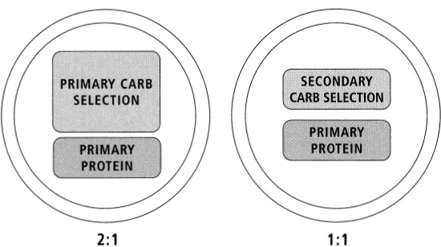

### {.middle} Reminders, Hints, and Tricks {.h3}

------------------------------------------------------------------------

To recap, you should have at least five small meals per day, eating
about every three hours. Have breakfast, lunch, and dinner, and between
these main meals have a snack consisting of a protein bar or shake,
nonfat cottage cheese and fruit, or even a chicken breast with some raw
or lightly steamed vegetables. Choose your protein first, then the
appropriate carbohydrate choice.

If you go out to eat, immediately order a tossed salad with dressing on
the side. The point is to avoid the bread that will be placed on the
table. People dig into this bread as a matter of habit without fully
realizing the amount of carbohydrates they are ingesting. I
[]{#chapter03.html#page_40}attempt to refrain from alcohol, but if you
really need a glass of wine or a mixed drink, go ahead. If you have one
drink---and I do mean *one* glass---this will count as your carbohydrate
for the meal. Your meal might consist of a large dinner salad with
lemon, a nice cut of beef or chicken breast, and a glass of wine.

Occasionally you will have cravings. A great trick is to brush your
teeth right after meals. It has been reported that this curbs the desire
for desserts. You can also curb cravings by choosing one meal each week
where you can eat whatever you like. If you have seven or eight of these
meals per week, chances are you will not see any results. This program
takes some discipline, but it will become second nature after only a
couple of weeks. Give yourself the gift of eating properly for those two
weeks.

You should have a minimum of eight glasses of water a day. The body
operates much better when it is hydrated. You are made up of almost
two-thirds water, so it makes sense that you need to replenish as much
as possible. Water is one of the best ways to rid yourself of fat, and
to feel full even if you are eating less food. Start with eight glasses
a day and work your way up to more. Try drinking a glass before and
after each meal.

Keep a journal. If you have a day planner or an electronic wizard,
record what you ate, when you ate, and how many glasses of water you
drank during the day. This practice will help you in your discipline.
For some reason, when people begin to keep track of what they eat, they
are better able to stick with their program.

Plan ahead. Make certain that you have enough groceries on hand so that
you do not order a pizza or go to the hamburger drive-thru out of
desperation. Know what you are going to be eating. Plan your meals each
day. If you work in an office, keep food in the fridge. Have some
protein bars in your desk. Know which restaurants in your area serve or
deliver the kind of food that you need. Above all, this way of eating
should not involve depriving yourself and should fit into your life
reasonably.

And remember---never eat less than 1,000 calories per day or
[]{#chapter03.html#page_41}your body will shift into starvation mode,
making it impossible to shed body fat.

As you'll see, the Hollywood nutrition portion of the Hollywood body
plan begins with a two-week initiation into a new way of eating. Like
high-protein plans, you will eliminate all simple carbohydrates during
this phase, reduce saturated fats, eat many greens and vegetables, and
limit your intake of caffeine. During these two weeks, you will break
unhealthy patterns, short-circuit your food cravings or food addictions,
and effectively reset your metabolism.

[]{#chapter04.html}

## []{#chapter04.html#page_42}[]{#chapter04.html#page_43}4 {.chnum}

## Hollywood Heart Principles {.h2}

------------------------------------------------------------------------

[]{#chapter04.html#page_44}[]{#chapter04.html#page_45}The great catalyst
for the Hollywood body system and the most addictive and self-gratifying
element of this program is without question cardiovascular activity. It
will give you immediate results: feelings of well-being, reduction of
stress levels, increased energy, clarity of thought, and an increased
ability to focus and to relax more fully.

In the long term, my prescription for cardiovascular activity will
enable you to reach your maximum heart health, and you will reduce the
likelihood of diseases such as diabetes, heart attack, stroke, and even
cancer. While you achieve these very significant gains in overall health
and reduce the risk of many diseases, you will also improve the way you
look. Within a week or two, you will notice improvements in the quality
of your skin and hair. But the most significant improvement in your
appearance will be rapid fat reduction.

The Hollywood heart principles eliminate excess body fat and increase
your level of fitness, endurance, and overall health. Your physical
transformation can take place only with the support of a sound
nutritional program coupled with regular cardiovascular
[]{#chapter04.html#page_46}activity. You will be given guidelines so
that you can create the program that best suits your needs. This
personalized program will bring you toward your goal quickly, safely,
and efficiently.

### {.middle} Why Should I Exercise? {.h3}

------------------------------------------------------------------------

You simply have to do cardiovascular exercise. Your life depends on it.
Ongoing studies provide irrefutable evidence that you must exercise
regularly in order to stay healthy.

According to the Centers for Disease Control and the Department of
Health and Human Services, inactivity leads to weight gain. Being
overweight and inactive are the causative factors in more than 3 million
deaths per year. These reputable sources have projected that overweight
and inactivity will soon surpass tobacco-related illnesses as the number
one killer in the United States.

You do not need to run hundreds of miles every week. The Surgeon General
recommends exercising at least one hour each day, but at minimum you
need to exercise at least three times per week. If you do, looking great
will be the least of what you get.

The true importance of aerobic or cardiovascular activity in the
Hollywood body system is to speed your metabolism, eliminate body fat,
and attain a leaner physique. The fitter you become, the more calories
your body will burn when you are at rest. A better-trained individual
will burn 20 percent more calories at rest than a sedentary person. As
you become more and more fit, it will not take as much effort to
maintain the results you achieve.

There are many attributes and even more long-term health benefits
associated with regular cardiovascular exercise. Along with possibly
decreasing your appetite, exercising within your ideal target range
allows for greater caloric intake without gaining fat. Cardiovascular
exercise has been scientifically proven to strengthen your skeletal
system, creating bone density and combating osteoporosis. This form of
exercise is most often a part of the treatment for people with a history
of diabetes, heart attack, high blood pressure,
[]{#chapter04.html#page_47}and/or high cholesterol. In addition to
reducing the risk of coronary artery disease, regular cardiovascular
exercise helps those suffering from arthritis. Perhaps the greatest
benefit is that aerobically fit people deal with stress much more
effectively; stress might be the number one health risk in our society.

For most people, the point is to get your body hot---literally and
figuratively. This means warming your muscles up, supercharging your
metabolism to burn off excess calories, and elevating your heart rate to
a certain level for a specific period of time to melt the fat off your
body. When you can do this regularly and consistently, you will call
upon stored fat to fuel your activity. You will burn up your caloric
intake. And soon you will look absolutely hot.

### {.middle} Aerobic and Anaerobic Exercise {.h3}

------------------------------------------------------------------------

When you exercise, you burn calories to fuel your activity. The point is
to burn those calories off in the most efficient manner possible. There
are two levels of exercise and consequently two ways that you can burn
off calories: *anaerobic* and *aerobic*. Both of these terms refer to
the manner in which the calorie is utilized or burned by your body. When
you exercise and elevate your heart rate significantly, blood passes
through the muscles being worked. To fuel that activity, the muscle
extracts its fuel from the blood cell. When you are exercising at 50 to
70 percent of your maximum heart rate, glucose is extracted from the
blood cell. At this level of exercise, you are in an aerobic state. When
your heart rate reaches 85 percent of its maximum, there is so much
blood pumping through your system that your body does not have enough
time to process it all. To get around this dilemma, it simply burns the
cell wall, or mitochondria, to fuel the activity. When this occurs, you
are in an anaerobic state.

You can exercise at an aerobic level for a very long time. When you
reach an anaerobic level, however, you can sustain it for only about 10
seconds before you either have to slow down or stop. If
[]{#chapter04.html#page_48}you are running a 100-yard dash, you might be
in an aerobic state for the first seven seconds of the race. If you
really kick it into high gear and push yourself to your physical limit,
you will achieve an anaerobic state for only the last three seconds of
the race. When you are in an anaerobic state, you are truly exhausting
the energy supply because you are burning through the blood cells at
such a rapid rate. The mitochondria cannot provide the muscles with the
pure energy they need to keep going. After reaching the anaerobic state
for a maximum duration of 5 to 10 seconds, the body shuts down, and you
are forced to either slow down or stop altogether. You may have seen
examples of this if you have ever watched Olympic runners. Some of the
participants may peak too early in the race, and at the end of the race
they appear to be slowing down rather than accelerating toward the
finish line.

Another example is weight lifting. As you will soon experience, you will
be asking yourself to perform three sets of a specific weight-lifting
exercise. Each of these sets is made up of several repetitions. You will
be at an aerobic level for the great majority of the set, but during the
last three or four repetitions, you will feel fatigued. You will have to
struggle to push the weight until you reach a point of muscular failure
and are no longer physically able to perform another repetition. You
will have reached the anaerobic phase of the exercise, and your body
will force you to stop.

With Hollywood heart principles, you will consciously manipulate the
aerobic and anaerobic states to meet your goals. The program is very
simple to follow and is easy to incorporate into your lifestyle. During
your workout, you will begin with five minutes of aerobics to warm up
the muscles in your body. By stretching between resistance exercises,
you will remain in an aerobic state. To end your workout, you will
perform at least 25 minutes of the aerobic activity of your own
choosing. You will consciously reach anaerobic levels several times
during each session.

### []{#chapter04.html#page_49}{.middle} Getting Aerobic {.h3}

------------------------------------------------------------------------

To reach an aerobic level, you need to elevate your heart rate. Your
body will burn calories most efficiently when your heart rate is between
60 and 80 percent of its maximum rate. You may want a calculator to
determine these numbers, and you should write these numbers down so that
you can refer to them later.

The medical establishment has determined that the human heart cannot
safely beat more than 220 times per minute. Your own maximum heart rate
is considerably lower. To determine your maximum heart rate, simply
subtract your age from 220. For instance, if you are 40 years old, your
maximum heart rate is 180 (220 -- 40 = 180).

This number will be your personal ceiling. You *never* want to reach
this number. When you are performing the cardiovascular program, you
will want to maintain your heart rate in the 60 to 70 percent range for
the majority of your session. So let's determine what that means in
terms of your personal target area. Using our example of the person who
is 40 years old, he or she should multiply 180 × 0.60, then multiply 180
× 0.80. The ideal aerobic level for a 40-year-old is when the heart
beats between 108 and 144 times per minute.

Do one last calculation to determine where you reach your anaerobic
state. You will consciously enter this range for a brief period of time
to achieve a desired result. The anaerobic state is reached when you
achieve 90 percent of your maximum heart rate. Using the 40-year-old as
an example, the number is determined by multiplying the maximum heart
rate of 180 by 0.90 (180 × 0.90 = 162). When the person's heart rate
reaches 162 beats per minute, he or she will only be able to sustain
that activity for a maximum of ten seconds, then will either have to
slow way down or stop altogether.

### []{#chapter04.html#page_50}{.middle} Monitoring Your Heart Rate {.h3}

------------------------------------------------------------------------

Now that you have calculated your ideal heart rates, you need to know
how to find your pulse. There are three methods to determine how many
times per minute your heart is beating. Two of these methods can be done
manually with the aid of a clock or a stopwatch, and the other uses a
small machine. You can take your own pulse on two points of the body:
the wrist and the neck. Finding these spots takes a little practice, but
after you have identified them and become familiar with them, they will
prove to be fairly decent indicators of your heart rate.

The point on the wrist is sometimes easier to find. Locate the point at
which your forearm meets your hand. Place your pointing and middle
fingers in the middle of that area. (Never use your thumb as this finger
has its own pulse.) You will feel a tendon or even several tendons in
your wrist. Move your fingers slowly to the inside portion of your wrist
until you can find the pulse at its strongest point.

You can also accurately measure your pulse on the neck at the carotid
artery. To find this artery, locate the point where the front of your
neck muscles meets your throat. Move your fingers slowly up the inside
neck muscles until you find the point at which the pulse is the
strongest.

With your fingers on either your wrist or your neck, look at a clock
that has a second hand or at a stopwatch. Count the number of heartbeats
for 15 seconds. Multiply that number by 4, and you have successfully
determined your heart rate. If this gets too complicated or cumbersome,
there is a third option.

There are a number of heart monitors on the market. I prefer these
devices over taking my own pulse since they are more accurate and less
of a hassle. These heart monitors are small and inconspicuous; they are
usually attached to a belt or an elastic strap. The belt is placed
around your chest. The monitor relays information to a watch worn on
your wrist. While you are exercising, []{#chapter04.html#page_51}you
only have to look at your wristwatch to check your heart rate.

The reason for monitoring our heart rate is threefold. First, studies
have proven that people who exercise at 60 to 70 percent of their
maximum heart rate level are much more likely to exercise regularly. If
you have ever attempted regular exercise and have stopped for no
apparent reason, you may have been exercising at a rate that your body
could not sustain. It is far more taxing for your body to operate at 85
percent of your maximum. If you do so over an extended period of time,
you may get burned out and quit exercising altogether. Second, you want
to make this program time-efficient and get the greatest results in the
quickest possible manner. Third, exercising at 60 percent to 70 percent
of your maximum heart rate is the exact level at which the body burns
fat most efficiently.

### {.middle} How Long Should I Exercise? {.h3}

------------------------------------------------------------------------

When you are exercising aerobically, you need to keep your heart rate in
the 60 to 70 percent range for at least 25 minutes to have the desired
results. When you are in your ideal aerobic range for this length of
time, you will burn calories at the most efficient rate possible. For
the first ten minutes or so, the body will use the glucose within the
blood stream to fuel the motion---that is, you will be expending the
excess calories you have eaten. For the next 15 minutes, your
bloodstream will not be able to provide your body with all its needed
fuel, so it will have to call upon its reserve tank, or stored fat, to
provide the necessary energy. In these all-important 15 minutes, you
will be fueling half of your activity with glucose that is still in the
bloodstream. The other half of the expended calories will be derived
from burning up fat stored underneath your skin.

If you can stay nearer to 70 percent of your maximum heart rate
throughout your workout, you can call upon an even greater
[]{#chapter04.html#page_52}percentage of stored fat. If your goal is to
rid yourself of body fat more quickly, you may want to devote more time
to your cardiovascular workout. You could exercise aerobically for
several hours, but the truth is that after 60 minutes or so, you will
have maximized your workout. My recommendation is to do at least 25
minutes of cardiovascular exercise and no more than one hour, unless you
are consciously performing extra aerobic activity to achieve a specific
fitness goal.

### {.middle} How Often Should I Exercise? {.h3}

------------------------------------------------------------------------

You should perform this cardiovascular workout at least three times per
week and can safely do it as many as six days per week. As with all
forms of exercise, you must take at least one day off per week to let
the body rest, heal, and recuperate. It is best to space out the days of
your cardiovascular exercise to get the greatest results. Instead of
performing your workouts on three consecutive days and resting for four,
space the workouts evenly throughout the week. You will boost your
metabolism, burn calories more efficiently, and ultimately have greater
success.

### {.middle} Vary It {.h3}

------------------------------------------------------------------------

The single most vital ingredient to maximizing your cardiovascular
workout is to vary it. The body is very reluctant to rid itself of body
fat, and you must outthink it consistently. The body is resilient and
will conserve its fuel whenever it can, so you must trick it. If you do
the exact same cardiovascular exercise each and every time you work out,
after only a short while the body will give up less and less stored fat.

If you run on a treadmill, you may want to increase or decrease the
incline level every other time you work out. If you jog around a track,
instead of running around the track at the exact same pace,
[]{#chapter04.html#page_53}you may want to do bursts to elevate the
heart rate to 85 percent, then bring it back down to the ideal range,
then vary the length of those bursts. Better yet, you may want to get
off the track and jog through different areas of your neighborhood, each
day finding different terrain. Many of the machines I will talk about
have different courses that simulate this exact principle. You should
make a note of which course you did last and be certain to change it for
the next workout. You may choose to perform completely different
exercises on different days. By employing some or all of these
strategies, you will keep your body in a state of surprise. In this way,
you can keep your body guessing and always demand the maximum results
for your efforts.

By varying your routine, and always increasing and decreasing the level
of difficulty while you exercise, you push yourself to become more
physically fit. As you become more fit, your aerobic ceiling will
increase. This is what you are striving for. Instead of becoming
fatigued when you exercise at 60 percent of your maximum heart rate, you
may have to increase to 70 or 80 percent as you grow stronger. It will
take more effort to shift into an anaerobic gear.

You can increase your performance envelope by practicing terrain
variance. If you walk or even jog on a hilly terrain or have the
computerized resistance level on the treadmill set to vary the incline
level, there will be times when you achieve an anaerobic level of
exercise. As you near the top of the hill, your body is working harder.
As a result, your heart rate increases to a point at which you may reach
an anaerobic level. Typically, the signals that you have reached this
anaerobic stage will include a shortness of breath, lactic acid buildup,
and the onset of rapid fatigue. When you can facilitate brief encounters
with the anaerobic stage and come back into your target area of 60 to 70
percent, you will successfully improve your physical condition,
eliminate much of the glucose in the bloodstream, and consequently burn
a greater number of calories from stored fat as you return to your
targeted aerobic range.

### []{#chapter04.html#page_54}{.middle} Just Do It! {.h3}

------------------------------------------------------------------------

There are many different ways to achieve a healthy cardiovascular level,
and there are no excuses for avoiding this important element of your
transformation. If you have a tendency to avoid cardiovascular exercise
like the plague, I ask you to recommit yourself to the process.
Challenge and push yourself. Promise yourself that you will do ten
minutes. After those first ten minutes are up, you are less likely to
give up on yourself. During those first minutes, try to visualize your
goal. Whatever your goal, your transformation depends heavily on doing
your cardiovascular workout. You have a vast array of options, and there
is no reason that you should ever become bored by your choices.

Again, the only thing that matters is that you do something to elevate
your heart rate for at least 25 minutes. I prefer individual activities
so that I do not have the excuse of "my partner didn't show up" for not
doing my aerobics. I also prefer to do my aerobic workout immediately
after I finish strength training. That is just my personal preference,
but when you use the Hollywood sculpt program to tone your musculature,
you will be lifting weights. There will be an increased amount of lactic
acid in your body after weight lifting, and completing the
cardiovascular portion after your toning session may prevent a great
deal of soreness.

Choose whatever activity you enjoy. If you like to ride your mountain
bike, row in a skull, or play handball, go for it. If you like to swim,
play tennis, or swing dance, by all means do it. The point is to be
active. If you do not know what you enjoy, try several things.

### {.middle} To Begin, Walk {.h3}

------------------------------------------------------------------------

If you are just beginning to exercise and have not been physically
active for a while, begin by walking. It is actually a very efficient
[]{#chapter04.html#page_55}and effective method to increase your fitness
level and achieve your goals.

The simpler you can make this process, the better. If you can't get to a
gym to use an elliptical trainer, does that mean you cannot get in your
cardiovascular exercise? If your tennis partner cancels, is that your
excuse to skip your workout? No excuses here. If all you have to do is
tie your sneakers and walk out the door, you eliminate any barriers that
may prevent you from reaching your goal. If the weather does not permit
you to walk outdoors, do it indoors. You may live or work in a high-rise
building and choose to walk up and down the stairs. At almost every mall
in the country, dozens of people gather before the stores open to get in
their walk. In many areas there are hockey rinks, indoor sporting
arenas, school gyms, and public buildings that could provide a venue for
your cardiovascular workout. If you are healthy and mobile, there are no
excuses. I have been shocked to see the numbers of people jogging along
the rivers in Boston, New York City, and Philadelphia during torrential
rains, and I have been awestruck by people speed-walking along the lakes
in downtown Minneapolis, Chicago, Buffalo, and Detroit during
snowstorms. While some people might think these exercisers are nuts, you
will soon know why they do it. It makes you feel so good, you can't
imagine *not* doing it.

If you walk to get in your cardiovascular exercise, you can achieve
amazing results. If you walk one mile, you will probably burn about 100
calories. If you jogged that same mile, you would burn approximately 110
calories. There is really not much of a difference. I have seen people
lose up to 120 pounds by walking. All you need to do is raise your heart
rate to the target range for at least 25 minutes.

If you choose to walk, it is not the kind of walking you do as you
window shop. You must walk at a brisk pace with energetic motion in your
arms. If you'd like, you can bring a set of 2-pound dumbbells (to avoid
injury, *never* use ankle weights) on your walk to increase the
intensity of your workout. Intensity is the key.

Assuming you are just beginning, elevate your heart rate level to
[]{#chapter04.html#page_56}60 percent of your max and maintain this
level for at least 25 minutes. After you are able to achieve this, do
not increase the duration of your walk, but increase the intensity. When
you are able to achieve 60 percent of your maximum heart rate for 25
consecutive minutes, you are ready for the entire Hollywood workout.

[]{#chapter05.html}

## []{#chapter05.html#page_57}5 {.chnum}

## Hollywood Sculpt Principles {.h2}

### []{#chapter05.html#page_58}[]{#chapter05.html#page_59}{.middle} The Strategy {.h3}

------------------------------------------------------------------------

Superstar Hollywood bodies look very different today than they did in
the 1970s, the 1980s, or even the 1990s. Today the look is all about
lean and chiseled. The days of the Incredible Hulk and Conan the
Barbarian have been replaced by the Tobey Maguire-type superhero. Where
musclemen once ruled, there are now the Brad Pitt and George
Clooney--esque bodies that feature elongated but highly toned
musculature. Women now have many Hollywood role models to look to for
inspiration. Star bodies are no longer demure stick figures but come in
all shapes and sizes. Without question, most of these Hollywood bodies
have much in common, and both male and female prototypes rely on
leanness as well as muscle tone and definition to accentuate their star
power. How do these Hollywood bodies look their best? They do it through
weight training.

After your nutritional and cardiovascular programs are in place, real
and dramatic change can occur. In essence, your nutritional and
cardiovascular programs complement and aid each other in eliminating
stored fat. With this combination, the former you will begin
[]{#chapter05.html#page_60}to melt away and will soon reveal the new
exterior you will work so diligently to create. The real transformation,
however, occurs with strengthening, toning, and sculpting the muscles
underneath that layer of body fat. Hollywood sculpt principles are part
of a revolutionary program that shapes, sculpts, and rebuilds each
muscle from its deepest point so that you can experience a total and
complete physical transformation. By also using Hollywood nutrition and
Hollywood heart principles, you will reduce your body fat and enable the
shell of the old you to melt into the *new you*.

Everyone has a part of their body they are not comfortable with. Even
the fittest and most beautiful celebrities wish they could improve some
part of their physique. Why should you be any different? I will teach
you the secrets of the stars and help you create a look that you are
happy with. There are many secrets to making each muscle group look the
best that it can be and reshaping the muscle to complement and
accentuate the whole package. All you have to do is follow the
directions and sweat a little, and you will soon look the way you want
to look.

### {.middle} Body Symmetry {.h3}

------------------------------------------------------------------------

I have encouraged you to take the measurements of various body parts.
These measurements are key. Not only will they allow you to track
progress, but they will also focus your work. Nature loves nothing more
than symmetry, and when the body and all of its parts strike a balance,
the whole is more aesthetically appealing.

The first objective is to create a symmetric balance. You should strive
to have each arm and each leg the same size, and work toward your calves
being the same size as your biceps. For each body part and muscle group,
there is a strategy to make it look its best.

### []{#chapter05.html#page_61}{.middle} Toning and Shaping {.h3}

------------------------------------------------------------------------

Resistance training, commonly known as weight training, is one of the
most misunderstood and maligned forms of exercise. Given the many
misconceptions surrounding weight training, fear often replaces reason
for would-be enthusiasts. Many people look at weight training with
skepticism. Many women are hesitant to exercise with weights for fear
that they will get bulky or look manly. The elderly fear that weight
training will somehow injure them. Many people who are overweight fear
that weight training will only make them bigger. Nothing could be
farther from the truth. For all shapes and sizes, weight training is the
most effective means to create lean muscle mass and positively change
appearance.

Lean muscle mass is the greatest asset you can have. By increasing lean
muscle mass, you automatically reduce the percentage of fat you are
carrying around. Lean muscle mass burns more calories than fat and helps
your body process food more efficiently. When your body is working more
efficiently, you experience higher levels of energy throughout the day.
You accelerate your metabolism and boost your immune system.

Weight training builds, tones, and firms up muscle. It can make women
look even more feminine by creating muscular definition in just the
right places and accentuating natural curves. If you are elderly, you do
not have to lift a great amount of weight to derive all the benefits;
you can use small amounts of weight to build your muscles back up to
where they used to be. I have trained many people who are of retirement
age or older. They have told me repeatedly that weight training has
actually offset the aging process. They feel confident in their
movement; they have regained a sense of strength, flexibility, and
balance that they thought was gone forever. And I have seen hundreds of
people who were extremely overweight have unbelievable success with
weight training.

### []{#chapter05.html#page_62}{.middle} The Logic of Sculpting {.h3}

------------------------------------------------------------------------

As I mentioned at the beginning of this book, I studied infrared images
while in college. I was astounded to discover that what you may know as
traditional weight-training exercises largely failed to isolate a
particular muscle group and work it to its full potential. Traditional
weight-training exercises only work 20 to 30 percent of the targeted
muscles---the top third of the muscle nearest the skin. My challenge was
to reach the 70 percent of muscle that was not affected. I determined
that there had to be a better way to train the body.

I began to look at the muscular structure for possible answers. I soon
learned that our muscle tissue is an ever-changing entity. Seen in the
light of physical transformation, muscle tissue, or lean muscle mass, is
a most beneficial asset. It offsets the amount of fat we have on our
bodies, boosts our metabolism, and even at rest will burn calories at a
high rate. This muscle tissue is capable of almost infinite growth.
Muscle tissue is made up of fibers. When you work a muscle, its fibers
tear on a microscopic level. If you have ever performed a series of
exercises you were not used to, it is precisely this tearing that makes
you feel soreness the next day. The tearing heals, creating muscle
fibers that are denser than before. This density does not necessarily
mean that the muscle gets larger. When you create muscular density, more
fibers exist within the same space. Muscular density occurs
exponentially for a very long time before the size of the muscle
actually increases. Knowing this, I felt that if I could develop a
system to work the muscle from its deepest point all the way to the
surface, the results would be astounding.

Using all the anatomical information available to me, I focused on the
way in which the muscle is attached to the body and how the muscle
enables movement. I compared these observations with our popular notions
of exercise. After determining that traditional exercises were clearly
invented to work particular parts of the body, I began to test their
effectiveness. I quickly came to the conclusion
[]{#chapter05.html#page_63}that exercises that relied on resistance or
on moving weight had the greatest potential to tap into the 70 percent
of unused physical potential of most exercisers. I found that by
altering existing exercises or creating entirely new exercises, I was
able to develop a system that works the entire muscle. I could feel the
difference when I did these exercises, but I wanted to test these
theories scientifically. Again using advanced infrared technology, I
studied the body with these new exercises. The images showed me that the
entire muscle at work was hot!

### {.middle} Basic Exercise Vocabulary {.h3}

------------------------------------------------------------------------

As you read on, you may see a few unfamiliar words. A specific number of
repetitions and a specific number of sets are prescribed in the
exercises. A *repetition* is the completion of pushing or moving a
weight or body part from point A to point Z. You will be instructed to
perform that particular exercise for a specific number of repetitions.
When you have done this, you will have completed a *set*. To maximize
your effort and to truly work 100 percent of the muscle's capability,
you'll need to be diligent and you'll need to concentrate.

Each exercise in the Hollywood sculpt system is designed to isolate a
specific muscle or muscle group. Technically, the muscle that you target
is called the *primary muscle*. Sometimes, another muscle aids the
primary muscle in a movement. This helper is called the *secondary
muscle*. As you'd expect, the secondary muscle does not work at 100
percent of its capability for a particular exercise. Some parts of the
body are not autonomous; moving them means that several muscles or even
muscle groups are involved in the motion. For example, when you throw a
ball, more than just your shoulder or arm is involved in the process.
You also use your legs, the muscles in your back, your chest, your
abdominal muscles, and so on. These are called *tertiary muscles*. These
muscles work at an even smaller percentage of their potential than the
secondary muscles.

### []{#chapter05.html#page_64}{.middle} Momentumless Training {.h3}

------------------------------------------------------------------------

Because it is our goal to isolate the targeted muscle as much as
possible, it is essential that you eliminate any extraneous movement. I
call this *momentumless training*. By eliminating any swinging,
throwing, or jerking movements while exercising with weights, you ensure
the primary muscle is the sole focus of your work. When you swing,
throw, or jerk the weight, many other muscles help you to perform the
exercise. In a sense, you are cheating because you are calling upon the
strength of these other muscles. You will not maximize the targeted
muscle. Also, you may be cheating yourself out of the next few weeks of
progress, as 90 percent of injuries occur when you swing or jerk the
weights. As a trainer, one of my favorite sayings is "Bring it, don't
swing it." In other words, use the targeted muscle or muscles to move
the weight. But this is still only half of the exercise.

When most people work out with weights, they only concern themselves
with moving the weight from a starting point to the top of that motion,
or from point A to point B. But the manner in which you release the
weight back to point A is the other half of the exercise that needs to
be exploited to use 100 percent of the muscle's capability. When you
reach point B, you will control the descent of the weight rather than
letting the weight use its momentum to fall back to its point of origin.
This is called the *negative*. This negative gravitational force works
the muscle in the exact opposite direction. By consciously eliminating
unnecessary secondary and tertiary muscle involvement and using the
negative portion of the exercise, you will help yourself a great deal in
achieving 100 percent of your potential.

It is impossible for a muscle to perform at 100 percent on the first
repetition. For the first several repetitions of an exercise, you will
not, nor would you want to, work the muscle to 100 percent of its
capability. Instead, you will work your way to a muscular crescendo, a
climax of performance, which happens during the last
[]{#chapter05.html#page_65}three or four repetitions of the set. These
last few repetitions will and should be difficult. You should have a
burning sensation as if your muscles do not have enough blood, and it
should be taxing to complete these final repetitions. This is especially
true of your last set in a series of exercises working any particular
muscle group.

When you are performing the first two-thirds of a set of weight-training
exercises, you are exercising at an aerobic level. When you enter into
and complete the last third of the set, you should be reaching for and
attaining an anaerobic level of exercise. You can only sustain
performance at an anaerobic level for a very brief period before you
have to slow down or stop. In the final repetitions of your set, you
must strive to hit the anaerobic level. You will experience a shaking
sensation in the muscles being worked, and you will barely be able to
complete the set. The shaking of limbs, the burning sensation, the
feeling that you will not be able to complete the set is really the
point of the exercise.

If you could see your muscles with infrared technology at this anaerobic
stage, you could clearly see the entirety of those muscles, and they
would appear to be burning hot. This is the point at which you are
achieving 100 percent of your muscle's capability. It makes no
difference how much weight you are moving. What you are attempting to do
is work the muscle into exhaustion, to a point where it is not
physically able to do another repetition. In a sense, the first
repetitions are a preparation for the last repetitions of the set, and
the first two sets are a preparation for the last several repetitions of
the last set. This is where and when results occur.

There are a few fundamental principles to achieving your goals, and it
is important to understand them before your begin.

##### Breathing {.h5}

The most fundamental action in life is breathing. Breathing is an
involuntary reflex, and it is not something most people think about. It
is, however, vital in weight training. Correct breathing can be a great
aid in pushing through those last reps during the last set. To
[]{#chapter05.html#page_66}enlist breathing as your ally, exhale as you
drive the weight; hold the weight at the top of the movement; and inhale
during the negative motion on a count of three ... two ... one. Exhale
again to move the weight, and perform the exercise in this way for the
prescribed number of repetitions. This breathing method will help you
move the weight. If you were to inhale as you moved the weight, your
breath would actually work against you, and you might not be able to do
those last repetitions.

##### Varying Your Routine {.h5}

Most exercisers make the mistake of getting into a routine. Besides
being tremendously boring, it is often the routine itself that prevents
noticeable progress. The body is well equipped for adversity and even
disaster. The body is designed for your survival. It will conserve as
much energy as it can whenever it can. When you perform your exercises
in the same way every time you work out, your body gets used to that
level of exercise and will only expend the minimal amount of energy
needed to perform the task.

To avoid hitting a plateau and to ensure that your body expends the
greatest amount of energy possible, you must vary your workouts.
Essentially, you want to outsmart your body. By changing which parts of
the body you work on any given day, varying the amount of weight, and
shuffling the order of exercises for each workout, you will keep your
body in a state of readiness. You can constantly surprise it into
performing at the highest levels possible. By varying your workout
routine, you will avoid many of the pitfalls associated with training
plateaus and experience the greatest results possible.

##### Balancing {.h5}

Strive to balance your body. Work to make the left arm the same size as
the right arm, the left leg the same size as the right leg, and
[]{#chapter05.html#page_67}the upper half of your body proportional to
the lower half. When you work your arms and legs, focus on the weaker
side. If you can do eight repetitions with the left side but fifteen
with the right side, just do eight with both. Soon the left side will be
as strong (and also the same size) as the right side, and you will be
able to perform fifteen repetitions on each side.

##### Stretching {.h5}

For every action, there is a reaction. When you train with weights, you
use the exercise to contract a specific muscle or muscle group. After
the muscle has performed at such an optimum level, you need to balance
the effort by stretching the muscle out. Many people stretch before they
warm up their bodies, thinking it helps prevent injury. Picture your
muscles as if they were taffy. If you stretch taffy when it is cold, it
will not move. If the taffy is warm, it can be stretched. Your muscles
are very similar. You should only stretch *after* you have warmed them
up. Because the Hollywood body system will superheat your muscles, you
will have a built-in opportunity to stretch when they are the most
pliable.

Some people simply rest between sets when they train with weights, but
this isn't beneficial. Rather than resting, maximize your time by
stretching the muscle you just worked. You will increase the blood flow
to the area that just worked so hard, and the stretch will be a small
reward for the muscle. Increased circulation brings needed ingredients
such as oxygen, glucose, and other nutrients that nourish the muscle.
Stretching the muscle after working it will offset much of the soreness
you feel the next day, help to flush lactic acid out of the muscle
tissue, prevent injury, and help fully develop the musculature. Aside
from rewarding your body, this stretching will also affect your
appearance. It will help to create beautifully elongated muscles rather
than small constricted ones. For each exercise, you will find a
corresponding stretch.

Resistance training with active stretching between sets becomes
[]{#chapter05.html#page_68}an aerobic activity. By not resting, the
heart rate remains elevated, the metabolic rate continues to accelerate,
and your muscles remain active and warm. By utilizing stretching
techniques after each set of resistance training, your workout is taken
to another level. Resting between sets allows the heart to slow down.
Aside from wasting time, resting does little else. In contrast, when you
stretch between sets, the body does not slow down significantly and the
muscles continue to work.

### {.middle} Weight Training Tips {.h3}

------------------------------------------------------------------------

The single most important aspect to weight training is technique. No
matter what your goals, you will not be able to attain them without a
proper and nearly perfect technique. The goal is to utilize 100 percent
of the muscle's capability, exhaust the muscle or muscle group, stretch
it, then leave it alone. Achieving this level of performance will
require you to follow the directions and photographs in this book.

Each individual has different goals that boil down to two basic
strategies: (1) firming up musculature to create tone and definition and
(2) adding considerable size to the muscles. You may want a combination
of the two. You may want to add size to your legs and merely create some
muscle tone in your chest. You may want to have bigger biceps, create
size in your lateral muscles to accentuate your waist, and bring
definition to your leg muscles. Although the possibilities and
combinations are endless, weight training boils down to toning and
shaping. The strategies for toning and shaping are similar. There are
only three variables: (1) the amount of weight you are moving; (2) the
number of repetitions you are moving that weight; (3) and the number of
sets for each exercise.

The basic strategy for toning muscle is to perform a greater number of
repetitions in the set and to work with a light or medium amount of
weight. By using a relatively light weight, a
[]{#chapter05.html#page_69}greater number of repetitions will be needed
to get the burn and exhaust the muscle. The strategy for creating a
larger muscle is to lift a relatively heavy amount of weight.
Determining the amount of weight you can or should be moving will take
some experimentation. If I were standing by your side as your personal
trainer, it would be quite easy for me to gauge what amount of weight
you should be working with just by looking at you. Unfortunately, since
I cannot be at your side, you will have to determine weight levels on
your own.

Don't forget to refer to this book when you are weight lifting. If I
were at your side as your personal trainer, I would demonstrate the
proper technique for each exercise before you attempted it. I often
demonstrate these exercises for many months, although my clients have
performed them numerous times. Even if you have been exercising with
weights for years, I strongly recommend that you follow the directions
in this book to improve your technique each time you work out. Simply
follow these directions using a weight that you feel comfortable with.
Use your everyday life as a guidepost for this experimentation. (If you
can pick up a gallon of milk, you know that you can safely lift 10
pounds.) Choose the lightest possible weight for the first repetition,
just to get the fundamental technique of the exercise. After you are
certain of the proper technique, increase the weight incrementally until
you feel challenged by performing a set of ten repetitions. Perform ten
repetitions of each exercise, and make a notation of the weight. This
will be your starting point. From here, your transformation begins.

To attain a Hollywood body, you will reduce your body fat percentage
while creating muscle definition and muscle separation. The secret to
achieving these goals in the fastest possible time is learning the order
with which you should work each body part, then performing the correct
exercises to get the desired look.

It is said that looks are only skin deep. I disagree. It is precisely
what is going on underneath the skin that can be so beautiful. Very few
people exercise to get healthier. Most of us exercise to look
[]{#chapter05.html#page_70}fantastic. So let's not try to fool each
other. What you are striving to accomplish is a complete physical
transformation. By even attempting to embark on this journey,
overwhelming changes will begin to take hold. You will bolster your
confidence, raise your energy level, elevate your self-esteem, heighten
your sense of accomplishment, and alter forever the manner in which you
approach your life and the people you encounter. You will find no
greater ally than the Hollywood sculpt system.

[]{#chapter06.html}

## []{#chapter06.html#page_71}6 {.chnum}

## Your Hollywood Body Initiation---the First Two Weeks {.h2}

------------------------------------------------------------------------

[]{#chapter06.html#page_72}[]{#chapter06.html#page_73}It's time to begin
the process of changing your body. What you are about to do may be
difficult. I am going to push you to make several changes in your
lifestyle, which might cause a slight shock to your system, but the
trick to getting through this is to focus on the length of time---after
all, this is only two weeks. So I'll make you a deal---a promise even; I
truly believe in bottom-line results. If you do everything I suggest for
two weeks and do not experience results, I'll let you off the hook and
you don't have to continue. I want you to make yourself a promise,
however: do everything I suggest for these first two weeks; really push
yourself to get it all in every day. If you do, I promise that you will
feel and see results. I promise that if you can continue to get results,
you will change your life.

During these first two weeks, you will establish some new habits that
will become the foundation for your transformation. By implementing
Hollywood nutrition, you will break unhealthy eating cycles, eliminate
food addictions, and reset your metabolism. With Hollywood heart, you
will begin burning stored fat to fuel your activity. No matter what your
level of physical fitness today, in two short weeks you will be ready to
take on some serious challenges. []{#chapter06.html#page_74}With
Hollywood sculpt, you will feel the difference after your first workout;
in a week, you will see the difference in the mirror; and by the end of
these first two weeks, everyone will begin noticing the changes.

### {.middle} The Hollywood Nutrition Initiation {.h3}

------------------------------------------------------------------------

Your success depends on planning, which begins with your scheduling aid.
As you may recall, I asked you to schedule your shopping day, I provided
you with a list of foods to choose from, and I asked you to cook the
protein portions in anticipation of this day. If you have done these
essential tasks, congratulations---you are ready for the next step. If
not, get to the store, get cooking, and get ready.

It is now time to begin scheduling your transformation. Simply open your
calendar to tomorrow's date. Write down your "wake" and "sleep" times on
your calendar.

You should plan to eat your first (and most important) meal of the day
within an hour of rising. (If you exercise first thing in the morning,
have a few bites beforehand, but understand that this is not breakfast.)
Figure out the time for your first meal, and schedule "breakfast" in
your calendar. You will want to eat a small snack-size meal every 2½ to
3 hours, and you will eat at least five times, with the last meal about
2 hours before bedtime. Enter these meal times into tomorrow's ledger.

Now look over the next two weeks. The key to outthinking your starvation
protection device is to be consistent with your eating schedule,
reassuring this sensitive system that it does not have to store
nutrients away. If you can eat at roughly the same times each day, your
body will naturally relax the fat storage mechanisms and begin to
release stored fat because it is no longer necessary for your survival.
Using the template of your first day, eat at approximately the same
times, and pencil in these eating times over the next two weeks.

Since the mid-1970s, almost every significant nutritional
[]{#chapter06.html#page_75}advancement has been firmly rooted in the
Hollywood culture. More specifically, there has not been one blockbuster
diet book or phenomenal diet trend without support from at least one
high-profile celebrity. All of us scour the magazine covers in the
grocery store checkout line looking for the secrets of slim stars.
Without this or that famous person subscribing to a particular plan, a
trend, fad, or phenomenon cannot and will not occur.

Perhaps more than any other recent nutritional advancement, people have
had success using high-protein/low-carb diets. Low-carb or no-carb
products are available in virtually every restaurant, grocery store, and
convenience store. This philosophy has changed the culture, challenged
previously held beliefs on how to lose weight, and changed the food
industry. Many well-known celebrities subscribe to this or similarly
designed high-protein programs, and for the first two weeks I will
suggest something similar.

During this two-week initiation (and only for this time period), I
suggest not eating simple carbohydrates such as bread, pasta, rice,
fruits, and any food product with added sugars or sweeteners (Aspartame,
Saccharin, Splenda, Stevia, NutraSweet, and Equal are exceptions). Your
meals will consist of protein, a selection of vegetables, and some fat.

The science behind the success of high-protein/low-carb diets suggests
that when carbohydrates are eliminated from the diet, a hormonal
response occurs. This response is centered on the hormone called
insulin, and the elimination of these foods prevents excess insulin from
being secreted into the bloodstream. The less insulin is secreted, the
less fat is stored. Eating proteins will not cause insulin to be
secreted; nor will the ingestion of fats. Eating carbohydrates will
cause insulin secretion. After about forty-eight hours on a low-carb
diet, the level of glucose (sugar) in your bloodstream will be fairly
low, and you will enter a state of ketosis. This is actually the goal,
for when you enter this state, your body will begin to tap into,
process, and thereby eliminate fat.

Whereas many prescribe the generous intake of fats and fatty foods, I
suggest the contrary. My intuition and dozens of scientific
[]{#chapter06.html#page_76}studies state that a diet of bacon and crème
fraiche is not the healthiest possible thing for your heart. I actually
suggest a low intake of fat. Unless you are a vegetarian, forgo dairy
products such as milk, cream, yogurt, and cheese (with the exception of
low-fat or no-fat cottage, string, or mozzarella cheese) during this
initiation. I recommend butter substitutes, mayonnaise substitutes,
nondairy alternatives without sugar, cooking sprays, and minimal use of
"good" fats such as olive oil. Even these substitutes and healthy oils
should be used in the most sparing manner---measured not by the teaspoon
but by the drop. I suggest baking, grilling, roasting, steaming, and
boiling foods, and discourage frying in oils, sautéing, and deep-frying.

During your initiation into a new way of eating, the most important step
is to regain control. You are creating a new baseline for your
metabolism. You are breaking the patterns that have prevented you from
losing weight. You are going to retrain your taste buds and your sense
of fullness, reset your internal eating clock to achieve the fat loss
that must occur for you to attain a Hollywood body.

### {.middle} Timing {.h3}

------------------------------------------------------------------------

You are going to take control over your eating, and you must become very
focused to overcome the patterns of behavior that have made you fatter
than you want to be. In taking control, the timing of your meals is very
important. If you wait too long to eat, your starvation protection
device will go on alert, making fat elimination difficult if not
impossible. If you can eat at roughly the same times every day, however,
your body will come to trust that it will be fed regularly. It will
sense that it does not have to hoard stored fat, the starvation
protection device will be coaxed into a relaxed state, and your body
will feel confident that it does not need all of the fat within its
storage system. As a result, it will quite naturally begin to release
the stored fat.

### []{#chapter06.html#page_77}{.middle} Food Selection {.h3}

------------------------------------------------------------------------

What and how much you eat are the other elements in retraining your body
to become leaner. It is no mystery that you would gain fat if you ate
only ice cream. If you flipped through any calorie counting book, you
would see that fats and oils have many more calories per gram or per
ounce than meats, fish, and other proteins. You know that the
nutritional content of fruits and vegetables is much healthier than
candies, cakes, and cookies. In fact, if you really give it some
thought, you know the foods that make you fat.

How do you break the habit of eating these foods? Fast food and junk
food are everywhere. Most of us crave these foods---we are addicted.
Take a look at the ingredients in your favorite fast food or junk food.
Chances are that you will see some ingredients you cannot pronounce.
These ingredients are not natural products; they are man-made chemical
compounds. While they may enhance the flavor or shelf life of foods,
they may also cause cravings and addictions to them. In all cases, fast
food and junk food (and the man-made chemical compounds in them) do not
have enough nutritional value to sustain us. We eat more and more of
them in an attempt to fulfill our hunger for nutrients. We live in a
supersized society. The "extra value" of these larger sizes does nothing
more than make *you* a larger size. To break this unhealthy cycle, and
create the lean body you desire, you must begin eating in a precise and
conscious manner.

### {.middle} Limit or Avoid Stimulants {.h3}

------------------------------------------------------------------------

Most of us start our day with caffeinated products. While caffeine may
get us going, it also suppresses our appetite, dehydrates us, causes
chemical imbalances, enhances sugar cravings throughout the day, and is
directly related to the times of the day when our energy level seems to
hit bottom. Most of us experience this energy
[]{#chapter06.html#page_78}low in the afternoon. To remain alert and
energized on the job, we eat junk food. This energy low/sugar-craving
cycle may happen several times during the day, and it all starts with
caffeine.

If you drink coffee or strong caffeinated teas in the morning, try
beginning your day with green tea. It is a potent antioxidant with many
benefits. Because green tea has trace amounts of caffeine, you will not
get the headaches associated with caffeine withdrawal. Switching over
will also eliminate about 50 percent of food addictions and sugar
cravings. To some, the taste of green tea is a little too grassy. If
this is the case, simply add in some mint tea. I prefer a 3-to-1 ratio
of green to mint tea, and I make it in quantity. I even put it in the
refrigerator and drink it cold over ice. Do not sweeten this drink with
sugar or honey, but if you must, use Splenda, Equal, or some other sugar
substitute.

### {.middle} Your New Eating Program {.h3}

------------------------------------------------------------------------

To eliminate cravings, to break the cycle of food addictions, and to
create a new baseline for your metabolism, you will begin eating in a
new way. It will only be for two weeks. Then you will have retrained
your body and established a new pattern of eating that will assist you
in achieving any goal you set for yourself.

You may have nutrient and vitamin deficiencies due to former eating
habits and food choices, and it is essential to correct these
imbalances. You should take a daily multivitamin.

As part of each of your meals, you will have 3 to 6 ounces of protein.
The protein you choose should not be processed, breaded, deep-fried, or
slathered in sauces that might contain preservatives and sugars. You
should use as little oil as you can when cooking these protein choices,
and choose proteins that are lean such as roasted turkey, skinless
chicken breasts, fish, and seafood (roasted, baked, grilled, or boiled).
Try to avoid beef, dairy products, nuts (or nut products such as peanut
butter), and pan-fried items that rely on too much butter or oil.

[]{#chapter06.html#page_79}After choosing your protein for each meal,
select at least an equal amount of vegetables. Again, these vegetables
should be prepared with minimal oil. They are best raw, lightly steamed,
or baked to a level where they retain a little crunch. The more
vegetables are cooked, the more their nutrients are leeched
away---unless they are in a soup, in which case the broth will be more
nutritious than the vegetables themselves. The fresher the better. The
closer to their natural state the better. Avoid starchy vegetables such
as potatoes (red, white, gold, purple, blue), sweet potatoes, and winter
squashes (acorn, butternut, spaghetti, pumpkin), and for this two-week
period avoid vegetables that have a high fat content (avocado) as well
as those with a high sugar content (carrots).

In addition to your protein and vegetable choices, you may have fruit.
But limit your intake to 1 cup per day with the exception of berries.
You may have 2 cups of berries spaced throughout the day, having them as
a dessert with each meal. One cup of fruit is equal to one medium-size
apple, peach, plum, or orange; half of a grapefruit; one-eighth of a
cantaloupe or honeydew; two half-inch rings of pineapple; a small sliced
tomato; or a portion of any other fruit that is approximately the size
of your fist.

There are free foods that you may have anytime in any quantity. These
foods are greens and salads using lemon or vinegar (or even salsa) as a
dressing. You may have crunchy raw vegetables such as celery,
cauliflower, jicama, and radishes. You may use unlimited amounts of
lemon on your foods or in your drinks. Free foods also include stock
vegetables (garlic, onion, bell pepper, celery), spices, and flavorings,
provided that they are not overly processed and do not contain additives
and preservatives. Go easy on the salt content.

One of your meals should consist of yogurt (3 ounces) or cheese and a
small portion of fruit (half of an apple or half an orange, or four or
five berries). One meal should be a protein drink made without sugar.
For convenience I prefer to eat these meals during midmorning and
midafternoon---they fit easily into a workplace setting and pace. All of
your meals should contain 3 to 6 ounces of protein and some vegetables.

[]{#chapter06.html#page_80}When the initiation has been completed, you
will have reset your metabolism to the highest level, broken unhealthy
cycles and eliminated cravings, and dropped up to 10 pounds of fat.

##### Helpful Nutrition Tips {.h5}

::: list-m1
{.middle}[Drink a lot of water. All
guidelines suggest drinking at least eight glasses (64 ounces) of water
each day. Not only will this keep you hydrated, but it will also help
you feel more full, flush toxins and lactic acid, and speed the
elimination of body fat.]{.space}

{.middle}[Reduce your caffeine intake. The
nutritional objective in these first two weeks is to lead your body into
a state of ketosis. Caffeine (especially in the form of coffee) may
impede this process. If you are a coffee drinker, start your day with
green tea. The longer your tea is steeped in hot water the more
concentrated it becomes. Drinking green tea or the green tea--mint tea
combination that I recommend in the morning will enable you to escape
the headaches and sluggishness associated with caffeine withdrawal. If
you must have coffee, have a cup of decaffeinated coffee as part of your
midmorning break. You could also have a noncaffeinated hot or iced tea
between or right after your meals. Tea is available in many flavors, so
if you have a sweet tooth, get yourself a variety of flavored teas to
substitute for sweet treats. If you have a glass of water or a cup of
hot tea after your meals, you will feel more satisfied and
full.]{.space}

{.middle}[Be prepared for the effects of low
blood sugar. Eating every 2½ to 3 hours during this initiation phase is
essential. It has been reported that some people get edgy, crabby, and
even a little weak or nauseated when their blood sugar falls below a
certain level. Since you will not be eating a great deal of food at one
sitting and that food will not contain the amount of carbohydrates you
may be used to, it may be necessary to eat more frequently than I have
previously suggested. Always keep a protein drink, an apple, some
veggies, some raw nuts, or low-fat packaged cheese
[]{#chapter06.html#page_81}with you. If you feel your meals need to be
closer together, make the adjustments you require.]{.space}

{.middle}[When eating out, do yourself the
favor of immediately asking your server to bring you a salad or a bowl
of vegetable soup instead of a basket of bread. Instead of the usual
serving of starch (potatoes, pasta, or rice), ask for a double serving
of vegetables. Remember that the sauces that come on meats, fish,
vegetables, and salads contain sugar, additives, and preservatives.
These products will take you out of ketosis. Ask for sauces on the side,
and use them very sparingly if at all. The less processed foods you eat
the better. The cleaner the cooking method (the lower the fat content)
the better.]{.space}
:::

### {.middle} The Hollywood Heart Initiation {.h3}

------------------------------------------------------------------------

It is estimated that less than 10 percent of the population exercises
regularly. These next two weeks are going to be a very exciting time.
You are about to discover that cardiovascular activity can do much more
than shrink your waist.

If you haven't exercised for some time, your endurance will improve
exponentially each day. You are going to elevate your fitness level in a
short amount of time. In just two short weeks, the objective is to be
fit enough to take on the physical challenges needed to make dramatic
changes to your appearance. An even greater goal is to embark upon a
fitness regimen that will maximize your heart health. Like the biceps,
calves, and thighs, your heart is a muscle that can be conditioned and
strengthened. Unlike the biceps, calves, and thighs, the muscles that
allow your heart to function as an organ are essential for your
survival. Wherever you are today, you can improve your heart health to
the highest possible level within six months.

Assuming you have never exercised or have not exercised for some time,
the idea is to keep this as simple and as pain-free as you
[]{#chapter06.html#page_82}can. The primary goal is to raise your level
of fitness and increase your stamina and endurance. You need to begin
slowly and work your way up. I have had several clients who had never
exercised before and are now running marathons. When they first started
exercising, the goal of completing a 26-mile race seemed impossible. All
of them began by walking. Slowly, they inserted a one-block jog into
their walk. They worked their way up to two, then three blocks of
jogging during their walking session. Soon those blocks turned into
miles. While you may or may not be up to conditioning yourself in a
similar manner, the point is that you need to begin gradually as you
challenge yourself to go for longer distances with more and more
intensity.

On days that you work with weights, perform your cardiovascular session
after your strength-training session. I have found that this is a
fantastic prescription for offsetting muscular soreness (especially in
your legs) and providing a sense of completion. Keep in mind that the
complete workout (strength and cardio) should take less than an hour to
perform. If you don't have a full hour, you may split it up and spend
approximately 20 minutes on your Hollywood sculpt program and at least
25 minutes walking in two separate time blocks.

With these approximate time considerations in mind, open your calendar
to tomorrow's date. Pencil in a 30-minute appointment for your cardio
session. Some people prefer to do their cardiovascular exercise after
work or dinner, or after they put the kids to sleep. Some exercisers
make this one small time segment their own sanctuary of peace and
serenity. The people who choose to exercise in the evening generally
find that it clears their heads, allows them to focus, and relaxes them
sufficiently to begin to wind down their day. Some people prefer this
exercise in the morning to give them an energy boost that sets the tone
for a positive day. If you have trouble finding time, the morning
session may be for you, even if you have to set your alarm clock a
little earlier.

After you have completed this initiation phase of cardiovascular
exercise, I hope it will become the most essential and valuable portion
of your day. In anticipation of giving yourself the greatest gift
[]{#chapter06.html#page_83}of your life, schedule in five additional
days that you will exercise in your first week of initiation. Now
schedule in one day that you will rest and let your body rejuvenate.
Block off that entire day. While I would not discourage you from
shooting a round of golf or working in the yard on your rest day, it
should be a day off from strength and cardio work.

Now look at week two. Schedule in six days that you will do at least 25
consecutive minutes of cardiovascular exercise. If something comes up,
move this session around (that's why it is in pencil), but do not get in
bed without honoring your commitment to yourself. Schedule in a day of
rest and rejuvenation.

Here are some important items to get before beginning the cardiovascular
program:

::: list-m
{.middle}[A heart rate monitor
(optional)]{.space}

{.middle}[A good pair of cross-training
athletic shoes]{.space}

{.middle}[Comfortable clothing that you can
move in]{.space}

{.middle}[A spiral-bound weekly schedule, day
planner, or electronic scheduling aid]{.space}

{.middle}[A good-quality
multivitamin]{.space}

{.middle}[A 32-ounce water bottle]{.space}
:::

##### Cardiovascular Timing {.h5}

You only need to spend 25 minutes on your cardio workout. According to
the Centers for Disease Control, to improve your heart health and
strengthen the muscles that comprise the organ of your heart, you need
at least 25 minutes of exercise. By following the Hollywood nutrition
principles, you will have a relatively small amount of nutrients in your
bloodstream at any given time. Once those nutrients have been depleted,
your body must tap into its reserve tank (fat) to fuel your activity.
You will use up all the nutrients in your bloodstream within the first
10 to 15 minutes, so for the duration of your session the rest of the
calories (energy) you burn will come from stored fat. (This burn rate is
most efficient []{#chapter06.html#page_84}when you elevate your heart
rate to the 70 percent level, and these first two weeks are the
preparation to be able to achieve this level of exercise.) The energy
and nutrients stored within your fat cells can only be tapped for so
long before your body refuses to give up more. Therefore, after about an
hour (really an hour and fifteen minutes) you will have maximized the
amount of fat that can be expended in this session. So walk for at least
25 consecutive minutes, and keep your walk under an hour and a half.

##### Walking Guidelines {.h5}

For the first two weeks, your program is fairly simple. Six days a week,
you are going to take a walk. This walk will last at least 25
consecutive minutes. If you have to cross a street and wait for traffic,
walk in place and swing your arms. Keep your heart rate elevated
sufficiently. Remember that your heart rate monitor is a very helpful
tool that will confirm you are walking at a rate that is burning the
most amount of fat in the least amount of time. Keep your heart rate
between 60 percent and 70 percent of your maximum.

Do not take the same walking route on two consecutive days. The
objective is to surprise your body on a daily basis. If you do the same
thing day after day, your body will quickly adapt and conserve all the
energy it can, and you will fail to see results. Try to have four or
five different routes. Walk through locations where the terrain varies
and you are forced to encounter hills or places where the grade gets
steeper. Not only will this work a wider variety of muscle groups, but
the pace and intensity of your walk will be varied. If you do your
cardiovascular workouts on a treadmill, vary the incline level, which
will force you to increase and decrease your pace. If you use machinery,
never follow the same program for two consecutive days.

To work your way up to your 70 percent heart rate level, it may be
helpful to jot down these daily objectives in the time block you have
already scheduled in your calendar:

::: hang
Days 1 through 4: 25 minutes at 60 percent of your maximum heart rate

[]{#chapter06.html#page_85}Days 5 through 7: 25 minutes between 60 and
65 percent of your maximum heart rate

Days 8 and 9: 25 minutes at 70 percent of your maximum heart rate

Days 10 through 12: 25 minutes at 75 percent of your maximum heart rate
:::

##### Helpful Cardiovascular Tips {.h5}

::: list-m1
{.middle}[Push yourself a little more every
day During these first two weeks, do not increase the duration of your
session by more than five minutes from the previous day. Do not walk
more than six blocks farther than you did the previous day. And do not
increase your heart rate level by more than 5 percent over the previous
day's session. It is better to gradually increase than to overexert
yourself, burn out, and quit.]{.space}

{.middle}[Do not take the same route on two
consecutive days. Establish several routes, then discover more with
varying terrain. If you feel up for a challenge, use the route with more
hills. Surprise your body every day, and you will have the greatest
results.]{.space}

{.middle}[If you are walking alone, consider
investing in a portable music player or radio with headphones. Listening
to music or the news makes the time go by faster. Instead of reading the
morning paper, I get my news by radio during my morning cardio
session.]{.space}

{.middle}[You will soon discover that the
time you spend exercising your heart and burning fat is true quality
time, and you just might want to share that time with someone special.
Bring along a loved one, a friend, a neighbor, or a colleague from work.
This may be the most creative portion of your day. The person you share
this time with might be the catalyst for your latest breakthrough or
your next blockbuster idea.]{.space}

{.middle}[Take one day off each week to rest
and allow your body to rejuvenate.]{.space}
:::

### []{#chapter06.html#page_86}{.middle} The Hollywood Sculpt Initiation {.h3}

------------------------------------------------------------------------

As I have said, the Hollywood body is really the sum of many parts. I
will not reiterate the goals and target body areas. But remember that
the basic overview of my revolutionary system is that you will reshape
each and every muscle from its deepest point so that you will look (and
be) dramatically different when you complete the program. The Hollywood
body represents a road map for a total body makeover.

You will create muscular density, not muscular mass, size, or bulk.
Muscle weighs approximately two times more than fat. When you create
more muscle, you automatically reduce your body fat percentage. So let's
say that you lose 5 to 10 pounds of body fat over the next two weeks by
combining the Hollywood nutrition and Hollywood heart principles, and
you gain 1 or 2 pounds of muscle over the same period using Hollywood
sculpt. The scale will tell you that you are 3 to 8 pounds lighter, but
in fact you may have lowered your body fat by as much as 10 percent.
Your body fat measurement will tell you your total weight, define how
much or what percentage of that weight is made up of lean muscle, bone,
hair, and so on, and how many pounds of your total weight is fat. The
goal is to continually reduce the portion of your weight that is fat and
increase the percentage that is made up of the good stuff.

When you increase the percentage of lean muscle mass, you are doing much
more than improving your appearance. You are improving your metabolism,
immune function, and overall health as well as your skeletal strength,
structure, and functionality. Do you know people who can eat anything
they want without gaining weight? Their secret is lean muscle mass.
Muscle consumes more energy (calories) than fat. As you increase the
percentage of lean muscle mass, you will burn more calories, even when
you are at rest. This increase in lean muscle will positively enhance
your metabolism, and your body will essentially become a calorie-burning
furnace.

Lean muscle mass will create a better support structure for your
[]{#chapter06.html#page_87}skeletal system. More of my new clients come
in with significant structural problems. Because of the changing
dynamics in technology and in the workplace, most of us spend long hours
hunched over a keyboard looking at a computer monitor. Just as
redundancy can cause injuries and ailments for factory workers who spend
the majority of the day doing one specific task, long periods of sitting
at a desk and typing will cause posture-related ailments, which can
gradually affect skeletal structure. Much of my initial work with new
clients is focused on correcting the muscular weakness and atrophy that
contributes to poor posture, imbalance, and other bone-related issues
that can cause a great deal of pain and discomfort. As you embark on
these first two weeks of initiation, the goal is to move toward
correcting structural challenges.

##### Strength Planning {.h5}

Reshaping every muscle in your body in order to experience a complete
body makeover will require time and effort. During this two-week
initiation, you will perform my Hollywood sculpt routines three times
per week.

Open your calendar to tomorrow's date. Schedule in three 25-minute
blocks over the first week, ideally every other day. If possible, each
of these sessions should be followed immediately by your cardiovascular
session. Once you have scheduled your first week of sessions, schedule
in three sessions for your second week.

These appointments to exercise represent a commitment and a promise you
have made to yourself. Try to give these appointments the same priority
as other important events in your life.

##### The Timing of Toning {.h5}

While it does not matter what time of the day you exercise, your timing
matters a great deal during these revolutionary exercises. If you have
worked out before, you will notice that these exercises are designed to
be performed more slowly than traditional ones. The
[]{#chapter06.html#page_88}objective is to isolate the targeted muscle
or muscle group as much as possible and work it to exhaustion (a point
where you can no longer move the weight).

There is a particular cadence involved with each exercise. First, you
exhale and move the weight with an explosive movement on a count of one.
Then you hold the weight as you finish your exhalation. Next, you
inhale, and on a count of three ... two ... one, you bring the weight
back to the starting position in a very controlled manner. (This is
called the "negative" portion of the exercise and works the targeted
muscle in the opposite direction.) Finally, you hold the weight in the
starting position as you finish your inhalation. Your primary focus is
to perform each repetition of each exercise to perfection, maintaining
perfect form and perfect technique. By using this formula for your
timing, not only will you be better able to focus on the task at hand,
but you will also discover some mental benefits. When you learn to
breathe and move as I have directed, you will discover the Zen of
toning. You will quickly find that this particular block of time takes
you to another state of consciousness and positively alters your
headspace.

##### Getting Started {.h5}

I have designed each session to replicate the experience of having me by
your side as your personal trainer. Remember that the objective is to
perform each repetition of each exercise with perfect technique and
form. To help my clients, I always demonstrate the exercise before they
begin, regardless of how long we have been working together. They pick
up some subtle nuances when I do this. Since I cannot be there to
personally demonstrate these exercises for you, page references in the
exercise tables beginning on [page 90](#chapter06.html#page_90) will
tell you where to find the description and photographic demonstration of
each exercise.

You will notice that each exercise prescribes a specific number of
repetitions in each set. After you have completed the set, there is also
a stretch to be performed immediately (without stopping to
[]{#chapter06.html#page_89}rest). Not only will the stretch create
beautiful, elongated musculature, but it will also keep your heart rate
at a certain level so that the entire program becomes an aerobic
session. When you have completed the stretch, you will immediately
return to perform the next set or move on to the next exercise.

You will feel the difference in your body after your first workout.
After the first week, you may see the changes when you look in the
mirror. By the time you finish your second week, others will begin to
notice the changes.

##### Helpful Training Tips {.h5}

::: list-m1
{.middle}[Every personal client of mine is
required to warm up before they begin strength training. In the gym
setting, they are required to get on the treadmill, elliptical trainer,
or stationary bike and do five minutes of cardiovascular activity. You
should do something to get your circulation pumping, warm up your
muscles, and get yourself prepared to work out. If you can't get
outdoors to get in a quick power walk, perhaps you can skip rope, do
some calisthenics, or march in place for five minutes. It is essential
to do this to prevent injury and to get the results you are looking
for.]{.space}

{.middle}[You are strategically setting
yourself up for muscular failure with every exercise. When you reach the
point where your arms or legs are shaking, when you feel that you just
can't move the weight, when your body will not allow you to do another
repetition, you have reached the result zone. This is the goal. With
every repetition you are preparing for this event. The first and second
sets prepare you for the third set, and in the final repetitions of the
last set, the magic begins to happen. If your muscles fail, you haven't.
You are a success when your muscles fail.]{.space}

{.middle}[Always finish the set. If you have
to drop the weight, by all means switch to a lower set of weights, but
finish the set.]{.space}

{.middle}[To isolate the targeted muscle as
much as possible, use the principles of momentumless training. Do not
swing the weights or []{#chapter06.html#page_90}jerk your body to help
you move the weights. Bring it, don't swing it.]{.space}

{.middle}[There is a distinct possibility
that you might experience some muscular soreness, especially if it has
been a while since you last exercised. Realize that there is a
difference between feeling soreness and having an injury. These
exercises were designed to severely limit the possibility of injury and
to be the safest possible exercise options. If you ever experience a
torn muscle or ligament, it is wise to discontinue exercise. But the
best course of action to combat sore muscles is to work them again (even
if this may seem counterintuitive). When you exercise, your body
produces a substance called lactic acid. It is not truly a liquid but
rather a crystalline substance with sharp and jagged edges that lodges
between muscle fibers. When you move, you are feeling the effects of
these sharp and jagged edges. To flush this lactic acid, drink plenty of
water, and be sure to get in your daily walk. If you are still
uncomfortable, you may find that a hot bath with a generous amount of
Epsom salts alleviates the symptoms. Still sore? Try plopping two
tablets of Alka-Seltzer Plus in a glass of water. If you prefer natural
remedies, it has been reported that fresh pineapple also does the trick
(just be sure to eat some low-fat cheese along with it).]{.space}
:::

TONING INITIATION FOR WOMEN

Perform two sets of 20 repetitions. Stretch after each set.

  ------------------------------------------- ---------------
  [DAY 1]{.sans}                                [Page]{.sans}
  Ball Squat                                               98
  Side Kick                                               102
  Bent-Over Row                                           105
  Wings                                                   116
  Kickback                                                130
  Squeeze                                                 144
  Penguin                                                 147
  Ball Small Sit-Up                                       142
                                                             
  [DAY 2]{.sans}                                [Page]{.sans}
  Butt Lift                                               103
  Inner Thigh                                              96
  Squat Curl                                              134
  Incline Fly                                             120
  Overhead Tri                                            132
  Ball Crunch                                             141
  Side Raise                                              150
  Crossover Crunch                                        146
                                                             
  [DAY 3]{.sans}                                [Page]{.sans}
  Arrow                                                    95
  Leg Curl                                                 97
  Cheer                                                   115
  Pull-In                                                 109
  Ball Curl                                               138
  Corkscrew                                               149
  Crunch                                                  145
  Leg Lift                                                148
                                                             
  []{#chapter06.html#page_91}[DAY 4]{.sans}     [Page]{.sans}
  Kickout                                                 129
  C Sweep                                                 123
  Pull-Over                                               107
  Lunge                                                    93
  Side Kick                                               102
  Ball Pike                                               143
  Lying Side Raise                                        151
  Crossover Crunch                                        146
                                                             
  [DAY 5]{.sans}                                [Page]{.sans}
  Reverse Lunge                                            94
  Butt Lift                                               103
  Calf Raise                                               99
  Bent-Over Row                                           105
  Karate Curl                                             139
  Leg Lift                                                148
  Penguin                                                 147
  Ball Small Sit-Up                                       142
                                                             
  [DAY 6]{.sans}                                [Page]{.sans}
  Ball Lunge                                              101
  Arrow                                                    95
  Beginner Push-Up                                        124
  Dip                                                     133
  Cross-Curl                                              137
  Ball Crunch                                             141
  Corkscrew                                               149
  Squeeze                                                 144
  ------------------------------------------- ---------------

TONING INITIATION FOR WOMEN

Perform two sets of 15 repetitions. Stretch after each set.

  ------------------- ---------------
  [DAY 1]{.sans}        [Page]{.sans}
  Advanced Push-Up                125
  Bent-Over Row                   105
  W Shoulders                     112
  Tricep Extension                128
  Squat Curl                      134
  Leg Curl                         97
  Crunch                          145
  Penguin                         147
  Ball Small Sit-Up               142
                                     
  [DAY 2]{.sans}        [Page]{.sans}
  Lunge                            93
  Arrow                            95
  Tricep Extension                128
  Wave                            117
  C Sweep                         123
  Hammer Curl                     136
  Squeeze                         144
  Side Raise                      150
  Crossover Crunch                146
                                     
  [DAY 3]{.sans}        [Page]{.sans}
  Incline Fly                     120
  Kickback                        130
  One-Arm Row                     106
  Overhead Tri                    132
  Ball Curl                       138
  Ball Squat                       98
  Corkscrew                       149
  Leg Lift                        148
  Lying Side Raise                151
                                     
  [DAY 4]{.sans}        [Page]{.sans}
  Reverse Lunge                    94
  Calf Raise                       99
  Fly                             119
  Twisting W                      113
  Dip                             133
  Karate Curl                     139
  Ball Crunch                     141
  Penguin                         147
  Ball Small Sit-Up               142
                                     
  [DAY 5]{.sans}        [Page]{.sans}
  Decline Push-Up                 121
  Kickout                         129
  Rear Delt                       114
  Pull-In                         109
  Squat Curl                      134
  Lunge                            93
  Ball Crunch                     141
  Side Raise                      150
  Squeeze                         144
                                     
  [DAY 6]{.sans}        [Page]{.sans}
  Cheer                           115
  Kickbacks                       130
  Ball Push-Up                    126
  Pull-Over                       107
  Hammer Curl                     136
  Leg Curl                         97
  Ball Pike                       143
  Leg Lift                        148
  Corkscrew                       149
  ------------------- ---------------

::: box
### []{#chapter06.html#page_92}{.middle} The Exercises {.h3a}

 

##### Hollywood Legs {.h5}

Hollywood legs strive to achieve four things. First, the thigh muscles
should be long and defined, tapering down as the muscles connect with
the knee. Second, these quadricep muscles should be strengthened and
toned so that you can see each one of them. In the highly trained state,
a line appears down the center of the thigh like a crisply ironed pair
of pants. Third and most important, rather than a straight line reaching
from the back of the knee toward the buttocks, this line should bow
slightly. Fourth, the calf muscles require development; the more toned
and defined these muscles become, the more the eye is drawn to them.
Aside from deemphasizing thick ankles, the development of your calf
muscles will create a balance in relationship to your thighs and upper
arms. To balance the size of each thigh, exercises are performed one leg
at a time.

The leg muscles are the largest in your body and are of primary
importance. Working this large group of muscles jump-starts a chain
reaction of physical results throughout the rest of the body.
:::

#### []{#chapter06.html#page_93}Hollywood Lunge {.h4}

The walking lunge is one of the finest exercises for creating shape from
the waist down. You will really feel this exercise in the buttocks and
thighs. It is designed to be an effective warm-up for all the muscles in
the legs, and it's great for beginning or ending your leg workout. The
walking lunge can be performed to accommodate any level of fitness.

###### GET READY {.h6}

  --------------------- -----------------------------------------------------------------------------------------------------------------------------------------------------------------------------------------------------------------------------------------------------------------------------
  B[EGINNER]{.small}:   With your legs 3 inches apart, stand with your hands on your hips.
  A[DVANCED]{.small}:   With your legs 3 inches apart, stand with a dumbbell in each hand. Allow your arms to be fully extended, with your hands hanging down next to your thighs. They will remain in this position throughout the exercise. The more advanced you become, the greater the weight.
  --------------------- -----------------------------------------------------------------------------------------------------------------------------------------------------------------------------------------------------------------------------------------------------------------------------

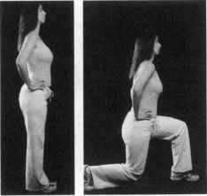

###### THE EXERCISE {.h6}

From the standing position, inhale and step forward with your left leg,
landing on your heel. With your left foot flat against the ground, bend
your left knee until it is at a 90 degree angle. Keep the torso straight
and allow the right heel to rise as you lower your body until you can
almost touch the ground with your right knee. Exhale and return to
standing, pressing through the left heel. When your legs are fully
extended, bring the feet together and repeat with your right leg.
Perform the prescribed number of paces, alternating legs, and stretch
after each set.

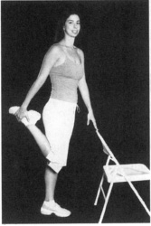

###### FRONT STRETCH {.h6}

Standing with your feet together, lift your right heel back toward your
buttocks. If you need to, you may use your left hand to balance or brace
yourself against something sturdy. Holding your right ankle with your
right hand, bring the heel closer toward the buttocks. Continue
stretching for 30 seconds. Repeat on the left side.

#### []{#chapter06.html#page_94}Hollywood Reverse Lunge {.h4}

###### GET READY {.h6}

Stand upright, with your feet about hip-width apart.

###### THE EXERCISE {.h6}

From the standing position, inhale, and step back with your right leg so
that only the ball of the right foot is touching the floor. Bend your
left knee, lowering yourself down as far as you can without touching, so
that your left knee is bent at a 90-degree angle, the knee should not
extend beyond the toes. Exhale and come back up into the starting
position and repeat with the left leg. Repeat the prescribed number of
repetitions, alternating legs, and stretch after each set using the
front stretch.

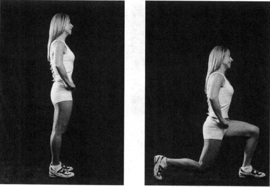

###### FRONT STRETCH {.h6}

Standing with your feet together, lift your right heel back toward your
buttocks (see photo on [page 93](#chapter06.html#page_93)). If you need
to, you may use your left hand to balance or brace yourself against
something sturdy. Holding your right ankle with your right hand, bring
the heel closer toward the buttocks. Continue stretching for 30 seconds.
Repeat on the left side.

#### []{#chapter06.html#page_95}Hollywood Arrow {.h4}

###### GET READY {.h6}

As you first begin doing this exercise, place a chair 2 to 3 feet in
front of you. Turn the chair to the side so that you can use the back or
seat for support. As you become more advanced, the goal will be to
perform this exercise without any support.

Stand up tall and lock your knees. Your feet should be separated
slightly, no farther than hip-width apart. Your left hand is on the
chair, your right hand holds a dumbbell. Allow your right arm to relax
and hang toward the floor throughout the exercise.

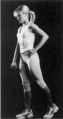

###### THE EXERCISE {.h6}

Exhale and reach backward with your left heel. Keep your left leg and
torso completely straight and rigid. You are one straight line from your
foot to your head. Tilt forward slowly until you are parallel to the
floor and perpendicular to your right leg. Stop and hold for one count
as you finish your exhalation. Inhale and slowly return to the starting
position on a count of three ... two ... one. Switch legs and repeat.
Repeat for the prescribed number of repetitions. Stretch after each set
using the ragdoll stretch.

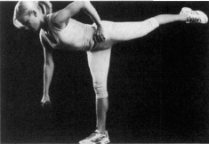

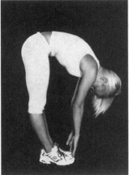

###### RAGDOLL STRETCH {.h6}

Stand up tall with your arms at your sides. Drop your chin to your
chest. Let the weight of your head pull you down vertebra by vertebra.
Allow your arms to hang down so that your fingers are pointing toward
your toes. Touch your toes, or come as close as your hamstrings will
allow you to. If you can easily touch your toes, try to touch the palms
of your hands against the floor. If you are especially limber, cross
your arms and try to touch your elbows to the floor. Above all, keep the
motion constant and avoid bouncing. Maintain this continuous stretch and
try to deepen it for at least 30 seconds.

#### []{#chapter06.html#page_96}Hollywood Inner Thigh {.h4}

###### GET READY {.h6}

Using ankle weights, lie down on your left side. Bend your right knee
and place your foot firmly on the floor in front of your left knee. You
should be in one straight line from your head to your left foot. Flex
your left foot and lock your left knee.

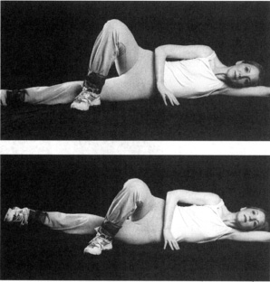

###### THE EXERCISE {.h6}

Exhale and lift your left leg up as high as you possibly can on a one
count. Hold at the top of the movement as you finish your exhalation.
With your knee still locked, lower your ankle to the ground slowly on a
count of two ... one. Do the prescribed number of repetitions on each
leg and stretch after each set using the butterfly stretch.

###### BUTTERFLY STRETCH {.h6}

Come up into a sitting position, and bring the soles of your feet
together. Pull your heels toward you as far as you comfortably can. Push
down on your knees and hold for 20 seconds. Spread your legs as wide as
you comfortably can. With your back straight, hold this stretch for 20
seconds.

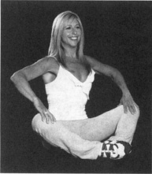

#### []{#chapter06.html#page_97}Hollywood Leg Curl {.h4}

###### GET READY {.h6}

With weights on each of your ankles, stand behind a chair. Place one of
your hands on top of the chair back for support.

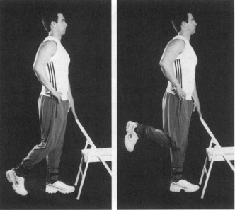

###### THE EXERCISE {.h6}

Exhale and lift your right heel up toward your buttocks slowly on a
count of three ... two ... one. Do not let your knee move forward as you
lift. Hold at the top of the movement as you finish your exhalation
while you contract the thigh muscle as much as possible. Inhale and
slowly release your foot back down to the starting position on a count
of three ... two ... one. Repeat the prescribed number of repetitions
and stretch after each set using the ragdoll stretch.

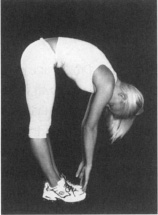

###### RAGDOLL STRETCH {.h6}

Stand up tall with your arms at your sides. Drop your chin to your
chest. Let the weight of your head pull you down vertebra by vertebra.
Allow your arms to hang down so that your fingers are pointing toward
your toes. Touch your toes, or come as close as your hamstrings will
allow you to. If you can easily touch your toes, try to touch the palms
of your hands against the floor. If you are especially limber, cross
your arms and try to touch your elbows to the floor. Above all, keep the
motion constant and avoid bouncing. Maintain this continuous stretch and
try to deepen it for at least 30 seconds.

#### []{#chapter06.html#page_98}Hollywood Ball Squat {.h4}

###### GET READY {.h6}

Find a sturdy wall. Stand with your back to the wall and position your
exercise ball behind the small of your back. Walk your feet out
slightly. Your legs should be shoulder-width apart and your feet should
be turned out. Plant your feet firmly on the floor.

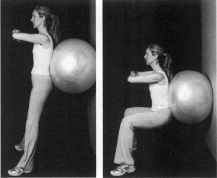

###### THE EXERCISE {.h6}

Inhale and slowly lower your buttocks toward the floor until your legs
are at a 90-degree angle, allowing the exercise ball to roll up your
spine as your pelvis tilts back toward the wall. Do not allow your knees
to extend over your toes. Exhale, and in an explosive movement, come
back to your starting position. Repeat the prescribed number of
repetitions and stretch after each set using the ragdoll stretch.

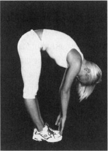

###### RAGDOLL STRETCH {.h6}

Stand up tall with your arms at your sides. Drop your chin to your
chest. Let the weight of your head pull you down vertebra by vertebra.
Allow your arms to hang down so that your fingers are pointing toward
your toes. Touch your toes, or come as close as your hamstrings will
allow you to. If you can easily touch your toes, try to touch the palms
of your hands against the floor. If you are especially limber, cross
your arms and try to touch your elbows to the floor. Above all, keep the
motion constant and avoid bouncing. Maintain this continuous stretch and
try to deepen it for at least 30 seconds.

#### []{#chapter06.html#page_99}Hollywood Calf Raise {.h4}

###### GET READY {.h6}

Find a raised object such as a stair, a step used for aerobics, a
platform without a lip, or even a low bench. Stand on top of the object
in such a way that your heels are unimpeded. Move back so that the only
contact point between your foot and the object you are standing on are
the balls of your feet and your toes. Allow the heels to lower as far as
possible, and feel the stretch through the back of your calves. Hold
onto something for balance, but do not support your weight with that
object.

###### THE EXERCISE {.h6}

Allow your heels to sink as far as they possibly can. Exhale and drive
up until you are standing tippy-toed on the balls of your feet. Inhale
and lower yourself down on a count of three ... two ... one as your
heels reach toward the floor. Hold at the bottom for one count and feel
the stretch through the back of your calves as you finish your
exhalation. Exhale and repeat the movement for the prescribed number of
repetitions, and stretch after each set using the calf stretch.

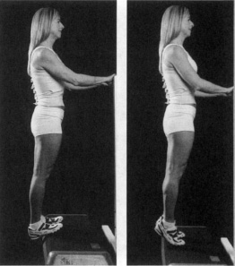

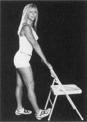

###### CALF STRETCH {.h6}

Stand facing the back of a chair. Place your hands on top of the chair
for balance, and stand up straight. Lean back slightly while you place
your right heel near the rear right leg of the chair. Tilt back farther
and place your right foot on the leg of the chair. Stand up straight and
stretch for 15 seconds. Repeat on the left side.

::: box
##### []{#chapter06.html#page_100}Hollywood Hips {.h5}

No longer do Hollywood bodies have the waiflike hips and unattainable
buttocks of runway models. Today's stars have shapely, rounded buttocks
that closely resemble those of an athlete. Look at the backside of
Jessica Simpson, watch *Charlie's Angels: Full Throttle* (where Cameron
Diaz's derriere should have had a costar credit), or check out Jennifer
Lopez's caboose to see that size truly does not matter. What is of major
concern is the shape, firmness, and form of your posterior.

A teardrop booty is not just for women. For men and women alike, shapely
buttocks truly finish the look and line of the legs, complement the way
the lower half of the body looks, and set the stage for creating a
complete and balanced look with the upper half of the body. What you are
looking to achieve here is the delineation between the uppermost thigh
and the bottom of the buttock, and a more athletically rounded buttock
with a dimple on each side.

When seen in profile, the well-developed buttock will have an almost
teardrop-like shape. This more prominent look can help camouflage many
other areas of concern. Some people have wide hips. Developing the shape
of these muscles will not only eliminate the flatter backside but will
also make wide hips appear to be better proportioned, consequently
deemphasizing size-related issues.
:::

#### []{#chapter06.html#page_101}Hollywood Ball Lunge {.h4}

###### GET READY {.h6}

With a chair in front of you and your exercise ball 2 to 3 feet behind
you, stand upright and place your right foot on top of the ball. Bend
your knees, lean forward, and hold onto the chair. Keep your knees soft.
Position the ball on your shin between your right knee and ankle.
Balance yourself so that you feel stable.

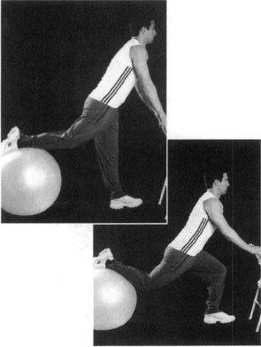

###### THE EXERCISE {.h6}

Inhale and bend your left knee to a 90-degree angle. Do not let your
bent knee extend over your toes. Hold for a brief moment. Exhale, and
with an explosive movement, return to your starting position. Repeat the
prescribed number of repetitions, and repeat on the other side. Stretch
after each set using the front stretch.

###### FRONT STRETCH {.h6}

Standing with your feet together, lift your right heel back toward your
buttocks. If you need to, you may use your left hand to balance or brace
yourself against something sturdy. Holding your right ankle with your
right hand, bring the heel closer toward the buttocks. Continue
stretching for 30 seconds. Repeat on the left side.

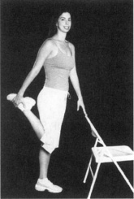

#### []{#chapter06.html#page_102}Hollywood Side Kick {.h4}

###### GET READY {.h6}

You may want to use a mat, a carpeted floor, or a rug. Lie down on your
left side. Extend your left arm so your head is resting against it. You
should be in one straight line from your fingers to your toes. Lift your
right leg up 12 to 18 inches. You may place your right hand on the floor
for support.

###### THE EXERCISE {.h6}

Inhale, bend your right knee, and bring it up toward or into your chest.
Hold for a brief moment. Exhale, and pushing through your heel, extend
your right leg until it is straight. Then lift it up until it is at a
45-degree angle. Repeat the prescribed number of repetitions, then
repeat on the other side and stretch after each set using the hip
stretch.

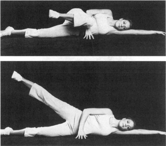

###### HIP STRETCH {.h6}

Sit on the floor with your legs in front of you. Bend your right knee,
lift it up and over the left, and place your foot just outside your left
knee (see photo on [page 103](#chapter06.html#page_103)). Place your
left hand on the outside of your right knee and pull it toward your left
shoulder. Try to deepen the stretch for at least 20 seconds. Repeat on
the other side.

#### []{#chapter06.html#page_103}Hollywood Butt Lift {.h4}

This exercise is a fantastic tool to create separation and delineation
between the hamstring muscles and the buttocks.

###### GET READY {.h6}

Place your exercise ball against the wall. Lie on your back, and with
your buttocks about a foot in front of the ball, place your left heel
near the top of the ball. Cross your right leg over your left so that
your right ankle is on top of or just below your left knee. Your hands
are at your sides with your palms against the floor.

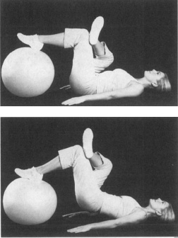

###### THE EXERCISE {.h6}

Exhale, and pushing through your left heel, lift your buttocks 6 to 10
inches off the ground. Inhale and come back down to the starting
position on a count of three ... two ... one. Perform the prescribed
number of repetitions and repeat on the other side, stretching after
each set using the hip stretch.

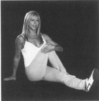

###### HIP STRETCH {.h6}

Sit on the floor with your legs in front of you. Bend your right knee,
lift it up and over the left, and place your foot just outside your left
knee. Place your left hand on the outside of your right knee and pull it
toward your left shoulder. Try to deepen the stretch for at least 20
seconds. Repeat on the other side.

::: box
##### []{#chapter06.html#page_104}Hollywood Back {.h5}

The development of back muscles is very important. For both men and
women, a well-defined back contributes to a sexy and sensuous allure.

A well-developed back is the key to appearing longer through the torso,
which will enable you to camouflage many areas of the body that you are
less than pleased with. To deemphasize a thick waist, wide hips, or a
square physique, particular attention must be paid to the back,
especially the lateral muscles, which are the winglike muscles of your
back that start below your armpits and reach down to the middle of your
ribs. If you can increase the tone or even the size of these muscles,
you can do much to create a sensually athletic hourglass curve.
:::

#### []{#chapter06.html#page_105}Hollywood Bent-Over Row {.h4}

###### GET READY {.h6}

This exercise is performed in two movements that are designed to work
the shoulder blades and the middle portion of your back. Flexing the
muscles in your back is the first and most important part of the
exercise. This is not a workout for your arms. The point is to depend
more on back muscles. To maximize the muscles in the upper back, you
will engage the shoulder blades by flexing the back or squeezing the
shoulder blades together.

Standing with your feet shoulder-width apart and a dumbbell in each
hand, bend your knees and squat slightly, as if you were beginning to
sit down in a chair. With your back straight, lean forward slightly.

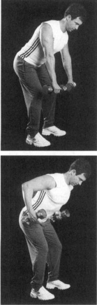

###### THE EXERCISE {.h6}

First, exhale as you engage the shoulder blades by flexing the back, or
squeezing the shoulder blades together. Then, bring the dumbbells up as
high as you possibly can so that your elbows are pointed toward the
ceiling. Hold for a count of one. Inhale on a count of three ... two ...
one, easing the weight back toward your starting position until your
arms are fully extended. Release the flex in your back muscles and let
the weight pull your torso forward until you are enjoying a nice stretch
along your back. Exhale and repeat for the prescribed number of
repetitions, and stretch after each set using the back stretch.

###### BACK STRETCH {.h6}

Find a pole that is solid enough to support your weight. Facing the
pole, place your feet on either side of its base. Interlock your fingers
around the pole and place your hands above your head. Let the weight of
your buttocks and torso fall away from the pole and allow your body to
form the shape of an archer's bow. Feel the stretch between your
shoulder blades and along the length of your back. Perform this stretch
for 40 seconds after each set.

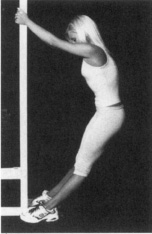

#### []{#chapter06.html#page_106}Hollywood One-Arm Row {.h4}

This exercise will develop your back and promote a muscular balance
between your right and left sides. As in the bent-over row, particular
attention should be paid to engaging the shoulder blades.

###### GET READY {.h6}

This exercise is performed using one dumbbell. With your exercise ball
approximately 2 feet in front of you, bend at the waist until your back
is flat. Place your left hand on top of the ball for stability. Extend
your right hand and grip the dumbbell. Feel the weight gently stretch
the muscles along your right shoulder blade. Keeping your right arm
straight and long, engage the right shoulder.

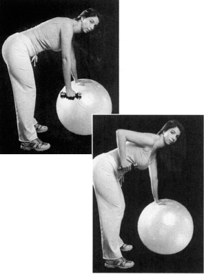

###### THE EXERCISE {.h6}

Exhale, and with an explosive motion, bring the right elbow up and above
your back until it is pointed straight at the ceiling. The motion is
like sawing a piece of wood. Hold this position for one count. Inhale
and lower the weight toward the floor on a count of three ... two ...
one. Feel the stretch through your back and shoulder as you finish your
inhalation. Repeat the prescribed number of repetitions, and repeat the
same number on your left side. Remember to work to the weak side for
muscular balance. Stretch after each set using the back stretch.

###### BACK STRETCH {.h6}

Find a pole that is solid enough to support your weight. Facing the
pole, place your feet on either side of its base. Interlock your fingers
around the pole and place your hands above your head. Let the weight of
your buttocks and torso fall away from the pole and allow your body to
form the shape of an archer's bow (see photo on [page
107](#chapter06.html#page_107)). Feel the stretch between your shoulder
blades and along the length of your back. Perform this stretch for 40
seconds after each set.

#### []{#chapter06.html#page_107}Hollywood Pull-Over {.h4}

###### GET READY {.h6}

With a dumbbell in each hand, lie back on your exercise ball,
positioning the ball in the middle of your back underneath your shoulder
blades. Press the dumbbells up toward the ceiling so that your arms are
straight but the elbows are not locked.

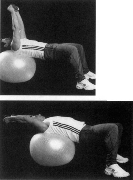

###### THE EXERCISE {.h6}

Inhale and slowly bring the dumbbells over your head as far as you can
on a count of three ... two ... one. Hold for a moment as you finish
your inhalation. Exhale and pull your arms back up to the starting
position on a count of one ... two. Hold, and finish your exhalation.
Perform the prescribed number of repetitions, and stretch after each set
using the back stretch.

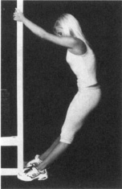

###### BACK STRETCH {.h6}

Find a pole that is solid enough to support your weight. Facing the
pole, place your feet on either side of its base. Interlock your fingers
around the pole and place your hands above your head. Let the weight of
your buttocks and torso fall away from the pole and allow your body to
form the shape of an archer's bow. Feel the stretch between your
shoulder blades and along the length of your back. Perform this stretch
for 40 seconds after each set.

#### []{#chapter06.html#page_108}Hollywood Hyperextension {.h4}

The hyperextension is one of the most fantastic exercises for the lower
back. It will improve your posture. It is a fantastic exercise for those
with back problems, those with weakness in the lower back, and those who
have suffered a back injury. The hyperextension could also prevent
injury and improve the strength and appearance of your abdominal
muscles.

The movement for this exercise is not an explosive one. Maintain a slow
and even pace. The motion should be fluid and without jerking movements.

###### GET READY {.h6}

With your exercise ball on the floor, kneel beside it and place your
tummy on the ball. Bring your arms over the ball, and roll forward
slowly until your body is draped over the ball. Bring your knees up off
the ground, and place the soles of your feet against a wall if you need
to. Stay there for several moments, experimenting with the position that
best elongates the spine. Feel the wonderful stretch through the length
of your back. Perform this stretch for 30 seconds before and after this
exercise.

###### THE EXERCISE {.h6}

Place your hands at the base of your skull, elbows extended. With your
torso erect and your spine straight, inhale and slowly let the weight of
your arms pull you toward the floor on a count of three ... two ... one.
Exhale and slowly bring your elbows and torso up on a count of three ...
two ... one, until your spine is straight and your head is aligned with
your feet. Hold this position for one count. Repeat the prescribed
number of repetitions. Stretch after each set by staying in the down or
starting position.

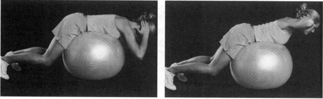

#### []{#chapter06.html#page_109}Hollywood Pull-In {.h4}

###### GET READY {.h6}

Kneel on the floor and place your exercise ball directly in front of
you. Lean your torso forward slightly, placing your forearms on the
ball. Interlock your fingers. You are now in a position that
approximates a bedtime prayer.

###### THE EXERCISE {.h6}

Inhale and lean forward, pointing your hands forward as you go, allowing
the ball to roll forward until it is between your elbows and wrists.
Exhale and come back to the starting position. Inhale and repeat the
prescribed number of repetitions. Stretch after each set using the back
stretch.

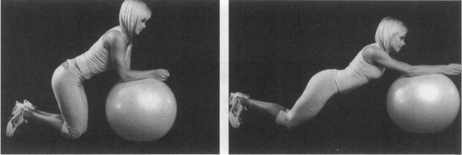

###### BACK STRETCH {.h6}

Find a pole that is solid enough to support your weight. Facing the
pole, place your feet on either side of its base. Interlock your fingers
around the pole and place your hands above your head. Let the weight of
your buttocks and torso fall away from the pole and allow your body to
form the shape of an archer's bow. Feel the stretch between your
shoulder blades and along the length of your back. Perform this stretch
for 40 seconds after each set.

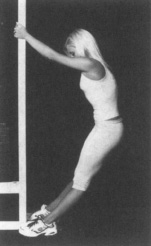

#### []{#chapter06.html#page_110}Hollywood Shrug {.h4}

The shrugs are ideal for working the trapezius muscles (traps), which
are the muscles that connect the shoulders with the neck and the
shoulder blades. For men, this exercise has two benefits. First, as seen
from behind, developing the traps finishes the look of your back and
complements the shoulder blades. Second, the weights effectively stretch
these muscles and reduce tension. For women, developing the trapezius
muscles gives the neck a longer and more elegant appearance. These
muscles also accentuate the muscles of the shoulder blades, making
backless dresses all the more flattering.

###### GET READY {.h6}

Stand facing a mirror with your feet together. Your knees should not be
locked but should be slightly bent. With a dumbbell in each hand, your
palms should be facing your hips. Your back should be straight, and you
should be looking directly in the eyes of your image in the mirror.

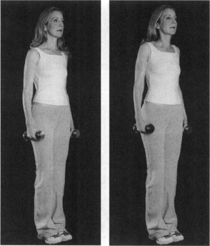

###### THE EXERCISE {.h6}

Exhale and lift your shoulders toward your ears as if your body language
could read: "I don't know." Hold for one count. Inhale and ease the
dumbbells toward the floor on a count of three ... two ... one. Feel the
stretch as you finish the inhalation. Exhale and repeat the prescribed
number of repetitions. The stretch is built into this exercise, so rest
for 15 seconds between each set.

::: box
##### []{#chapter06.html#page_111}Hollywood Shoulders {.h5}

Think of your shoulders as the cherry on top of a sundae: without the
cherry, it just isn't a sundae. Your shoulders are the key to completing
your look. Development of these muscles will dramatically improve your
posture and positively enhance the appearance of many other body parts.

There are three distinct areas of the deltoid or shoulder muscle: front,
middle, and rear. Almost all of us have an overdeveloped front deltoid
and an underdeveloped rear deltoid. Developing the rear deltoid will
help pull your shoulders back, consequently lifting your chest, allowing
the spine to become elongated, and enabling the abdominal muscles to
better support your weight. In addition, the development of the rear
deltoid will delineate where your shoulders end and the triceps begin,
accentuate the bicep muscles, and best complement a total look for your
arms and back.
:::

#### []{#chapter06.html#page_112}Hollywood W Shoulders {.h4}

The Hollywood W shoulders is an exercise of my own design, and it is
tailored to work all three areas of the deltoid muscle. It is performed
with a pair of dumbbells and is the most effective exercise for working
the muscle to 100 percent of its ability. Even if you work out
regularly, you will want to use fairly light weights for this exercise;
this exercise will make you feel as if your shoulders are on fire.

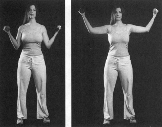

###### GET READY {.h6}

With a dumbbell in each hand, stand up tall with your feet hip-width
apart. With your palms facing front, bring the dumbbells to shoulder
level, as if the weights were an extension of the shoulders. Your elbows
should be pointed straight toward the floor. When you look in the
mirror, you should be in the shape of a W.

###### THE EXERCISE {.h6}

Exhale and drive your hands straight up toward the ceiling until the
shape of your arms look likes a U or a goalpost. Hold this position for
one count as you finish your exhalation. Inhale, and release back into
the shape of a W on a count of three ... two ... one. Exhale and repeat
for the prescribed number of repetitions. Stretch after each set using
the shoulder stretch.

###### SHOULDER STRETCH {.h6}

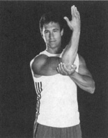

Standing up tall, extend your right arm straight out in front of you.
Bend your elbow in a 90-degree angle, and turn your palm toward your
face. Place your left hand on the right elbow and relax the right
shoulder, letting it drop down. Use the left hand to gently hug the
right arm to your chest. As you breathe in and out, allow this stretch
to deepen. Maintain this stretch for at least 30 seconds before
repeating on the left side.

#### []{#chapter06.html#page_113}Hollywood Twisting W {.h4}

This is another unique exercise I have created to work all three areas
of the deltoid muscles. It is performed with a pair of dumbbells and is
effective for working the muscle to 100 percent of its ability. As you
did in the W Shoulders, you will want to use fairly light weights for
this exercise. This is another exercise that makes your shoulders feel
like they are on fire.

###### GET READY {.h6}

With a dumbbell in each hand, stand up tall with your feet hip-width
apart. With your palms facing front, bring the dumbbells to shoulder
level, as if the weights were an extension of your shoulders. Your
elbows should be pointed toward the floor. If you look in a mirror, you
should be in the shape of a W.

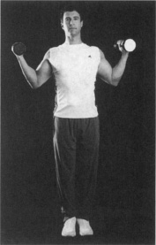

###### THE EXERCISE {.h6}

Exhale, and push the dumbbells up toward the ceiling, turning your
wrists in a corkscrew-like motion until your arms are in the shape of a
U and your palms are facing away from you. Hold for one count as you
finish your exhalation. Release your arms back into the starting
position on a count of three ... two ... one, turning your wrists back
to their original position as you go. Perform the prescribed number of
repetitions and stretch after each set using the shoulder stretch.

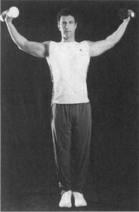

###### SHOULDER STRETCH {.h6}

Standing up tall, extend your right arm straight out in front of you.
Bend your elbow in a 90-degree angle, and turn your palm toward your
face. Place your left hand on the right elbow and relax the right
shoulder, letting it drop down (see photo on [page
112](#chapter06.html#page_112)). Use the left hand to gently hug the
right arm to your chest. As you breathe in and out, allow this stretch
to deepen. Maintain this stretch for at least 30 seconds before
repeating on the left side.

#### []{#chapter06.html#page_114}Hollywood Rear Delt {.h4}

This is the most basic exercise for the rear portion of the deltoid. It
is performed using two dumbbells. Low weight and proper technique are
the keys.

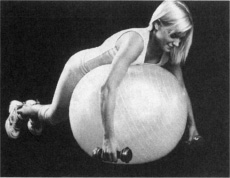

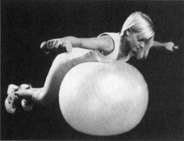

###### GET READY {.h6}

With a dumbbell in each hand, kneel on the floor, and lower yourself
onto your exercise ball so that it is against your lower chest and
sternum. Push forward, let your knees come off the ground, and let your
arms dangle straight down from your shoulders.

###### THE EXERCISE {.h6}

Exhale, and leading with your elbows, lift the weights straight out to
the sides so that your elbows are pointed toward the ceiling and the
dumbbells are almost even with your shoulders. Inhale on a count of
three ... two ... one, and bring the weights back down until they are in
the starting position. Exhale, lock your elbows, and press the dumbbells
back as far as you possibly can, squeezing the shoulder blades together
and holding for a brief moment at the top of the movement as you finish
your exhalation. Inhale and release back down into the starting
position. (This is one repetition.) Complete the prescribed number of
repetitions. Stretch after each set using the shoulder stretch.

###### SHOULDER STRETCH {.h6}

Standing up tall, extend your right arm straight out in front of you.
Bend your elbow in a 90-degree angle, and turn your palm toward your
face. Place your left hand on the right elbow and relax the right
shoulder, letting it drop down. Use the left hand to gently hug the
right arm to your chest. As you breathe in and out, allow this stretch
to deepen. Maintain this stretch for at least 30 seconds before
repeating on the left side.

#### []{#chapter06.html#page_115}Hollywood Cheer {.h4}

###### GET READY {.h6}

With a dumbbell in each hand, stand with your feet planted firmly on the
floor about hip-width apart. Bend your knees slightly so that they are
not locked. The dumbbells are perpendicular to your body.

###### THE EXERCISE {.h6}

This exercise is performed on a six-count. Exhale on a count of one and
bring your arms up, knuckles toward the ceiling, until your arms are
shoulder level and you are in the crucifix position. Hold for a moment
as you finish your exhalation. Inhale on a count of two, and using only
your shoulder joint, bring the heads of the dumbbells together in front
of you (thumbs toward each other) until you are in the sleepwalking
position. Exhale on a count of three, and on a count of four ... five
... six, reverse the steps until you are in the starting position.
Perform the prescribed number of repetitions and stretch after each set
using the shoulder stretch.

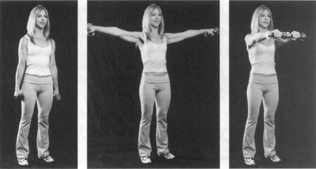

###### SHOULDER STRETCH {.h6}

Standing up tall, extend your right arm straight out in front of you.
Bend your elbow in a 90-degree angle, and turn your palm toward your
face. Place your left hand on the right elbow and relax the right
shoulder, letting it drop down (see photo on [page
114](#chapter06.html#page_114)). Use the left hand to gently hug the
right arm to your chest. As you breathe in and out, allow this stretch
to deepen. Maintain this stretch for at least 30 seconds before
repeating on the left side.

#### []{#chapter06.html#page_116}Hollywood Wings {.h4}

Little wings are designed to completely exhaust the muscle to the point
of fatigue. As your shoulder muscles reach this critical point, they
will experience a significant burn. The range of motion is quite small
here, and you will move the weights no more than 10 inches.

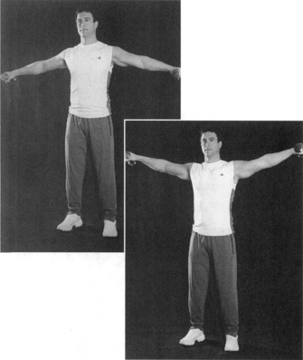

###### GET READY {.h6}

Stand with a dumbbell in each hand. Plant your feet firmly on the floor
shoulder-width apart. Raise your hands out to the sides until your arms
are parallel to your shoulders and your knuckles are pointed toward the
ceiling. Keeping your arms straight and your elbows locked, lower your
arms 10 inches.

###### THE EXERCISE {.h6}

Exhaling a puff of air, raise your arms toward the ceiling on a one
count until your arms are just above your shoulders. Inhale and lower
them 10 inches, on a count of two ... three. Repeat the prescribed
number of repetitions and stretch after each set using the shoulder
stretch.

###### SHOULDER STRETCH {.h6}

Standing up tall, extend your right arm straight out in front of you.
Bend your elbow in a 90-degree angle, and turn your palm toward your
face. Place your left hand on the right elbow and relax the right
shoulder, letting it drop down. Use the left hand to gently hug the
right arm to your chest. As you breathe in and out, allow this stretch
to deepen. Maintain this stretch for at least 30 seconds before
repeating on the left side.

#### []{#chapter06.html#page_117}Hollywood Wave {.h4}

This exercise involves the entire shoulder, with an emphasis on the rear
part of the deltoid to balance muscular strength.

###### GET READY {.h6}

Stand with a dumbbell in each hand, with your feet together and your
knees bent slightly. Position the dumbbells on your thighs, so that your
knuckles are facing forward.

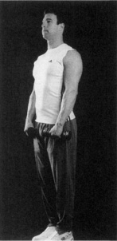

###### THE EXERCISE {.h6}

Exhale, and leading with your knuckles, lift the dumbbells straight up
in front of you until they are even with your shoulders and you are in
the sleepwalking position. Leading with your elbows, bring the dumbbells
straight back to your shoulders so that you are in a rowing position.
Hold and finish your exhalation. Inhale and push the dumbbells straight
out into the sleepwalking position. Release the dumbbells back down to
the starting position on a count of three ... two ... one. Repeat the
prescribed number of repetitions and stretch after each set using the
shoulder stretch.

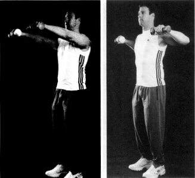

###### SHOULDER STRETCH {.h6}

Standing up tall, extend your right arm straight out in front of you.
Bend your elbow in a 90-degree angle, and turn your palm toward your
face. Place your left hand on the right elbow and relax the right
shoulder, letting it drop down (see photo on [page
116](#chapter06.html#page_116)). Use the left hand to gently hug the
right arm to your chest. As you breathe in and out, allow this stretch
to deepen. Maintain this stretch for at least 30 seconds before
repeating on the left side.

::: box
##### []{#chapter06.html#page_118}Hollywood Chest {.h5}

Your chest is a barometer of age. It is an indicator of firmness,
fitness, and health. It is a key to attraction and sex appeal. For both
men and women, it is a primary erogenous zone.

You are unique. Your look should be your own, and what you are striving
for is the best that your individual body can be. The Hollywood look
that is in right now has more to do with definition than size. Jennifer
Lopez is not particularly well endowed, but she is extremely toned.
Remember the infamous green dress she wore to the Grammys? Developing
your chest in a very specific way can heighten your allure, regardless
of your size.

Transforming your chest into the best that it can be is a three-part
process. The following unique chest exercises have been designed to work
in conjunction with the way in which the chest muscles are attached to
your bones. The muscles of the chest have connection points at each
shoulder, drape in a horseshoe or U shape, and attach along the length
of the breastbone. Together each side of the chest forms a shape that
would ideally look like a rounded W. To achieve a Hollywood chest, your
primary objective will be to develop and define the edges of this muscle
group. Then you will begin developing mass or filling in each horseshoe.
The finishing touch will focus on building up the underdeveloped areas
of this muscle group. These areas normally include the uppermost point
where the muscle connects at the shoulder, the connection point alone
the breastbone, and the highest points of each horseshoe along the
collarbone.

By developing this muscle group, both men and women will achieve a
finely toned chest that is as pleasing to the eye as it is to the touch.
For women, this development may equate with the look of reconstructive
surgery, lifting, separating, and firming the breasts, giving you a
perkier, more sensual, and youthful-looking body.
:::

#### []{#chapter06.html#page_119}Hollywood Fly {.h4}

This exercise is designed to primarily work the inside and outside of
the pectoral muscles. At the top of this exercise, I will ask you to
squeeze your chest. You may ask, "Squeeze what?" In just a few short
weeks, you will see and feel exactly what I am referring to. On either
side of your breastbone, the musculature will develop, creating sort of
a valley that rises up to each side of the chest. If the muscles in your
chest were large and highly developed, you would actually be attempting
to squeeze these muscles together.

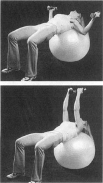

###### GET READY {.h6}

With a dumbbell in each hand, position your exercise ball under the
upper half of your back. Position your hands so that your knuckles are
facing the ceiling, and bring your elbows down so that they are below
you pointed toward the floor. Extend your arms to the side until they
are almost fully extended. You should be feeling a deep stretch across
your chest. Your arms stay in this position to start the exercise.

###### THE EXERCISE {.h6}

Exhale and drive the weights up as if you were wrapping your arms over a
barrel or a beach ball. When you are about halfway up, begin to
straighten your arms and let the dumbbells come as close together as
possible without touching as you reach the top of the movement. Hold
this position for one count as you squeeze the chest muscles. Inhale and
come down to the starting position on a count of three ... two ... one
as you deepen the stretch across your chest. Really expose the chest. Do
not bounce when you are in this position. Exhale and repeat for the
prescribed number of repetitions. Stretch after each set using the chest
stretch.

###### CHEST STRETCH {.h6}

Find a pole or bar that is immovable and at least 6 feet tall, stand in
a doorway, or lean against the end of a wall. With your right arm raised
and at a 90-degree angle, place the forearm along this immovable object.
Turn your torso away from your raised arm until you feel an incredible
stretch across half of your chest. Hold this stretch for at least 30
seconds. Switch arms and perform this stretch on your left side for the
same amount of time.

#### []{#chapter06.html#page_120}Hollywood Incline Fly {.h4}

Although this exercise is similar to the Hollywood fly, the angle of
attack is changed to target the middle and uppermost regions of the
pectoral muscles. To get the fullest possible benefit from this
exercise, hold at the bottom of the movement and squeeze the chest
muscles together at the top of the movement.

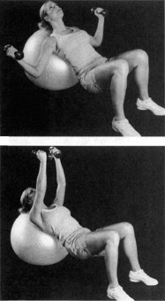

###### GET READY {.h6}

With a dumbbell in each hand, sit down on your exercise ball. Roll down
the ball so that it is positioned just below your shoulder blades and
you are almost on a 45-degree angle. Plant your feet firmly on the floor
with your legs a comfortable distance apart. Bring the weights up so
that your upper arms are at a 90-degree angle to your torso and the
dumbbells are pointed in the same direction as your shoulders. Your
upper arms are at a 90-degree angle with your forearms. Breathe in and
allow the elbows to reach backward as you lower your hands until they
are almost even with the middle of your chest. (If you were doing this
exercise with a barbell, the bar would be just above your collarbone.)
Feel the stretch across your upper chest.

###### THE EXERCISE {.h6}

Exhale and drive the weights up as if you were wrapping your arms over a
barrel or a beach ball. When you are about halfway up, begin to
straighten your arms and let the dumbbells come as close together as
possible without touching as you reach the top of the movement. Hold
this position for one count as you squeeze the chest muscles. Inhale and
come down to your starting position on a count of three ... two ... one
as you deepen the stretch across your chest. Really expose the chest. Do
not bounce when you are in this position. Exhale and repeat for the
prescribed number of repetitions. Stretch after each set using the chest
stretch.

###### CHEST STRETCH {.h6}

Find a pole or bar that is immovable and at least 6 feet tall, stand in
a doorway, or lean against the end of a wall. With your right arm raised
and at a 90-degree angle, place the forearm along this immovable object
(see photo on [page 121](#chapter06.html#page_121)). Turn your torso
away from your raised arm until you feel an incredible stretch across
half of your chest. Hold this stretch for at least 30 seconds. Switch
arms and perform this stretch on your left side for the same amount of
time.

#### []{#chapter06.html#page_121}Hollywood Decline Push-Up {.h4}

This exercise works the uppermost portion of the pectoral muscles and is
ideal for providing definition just under your collarbone.

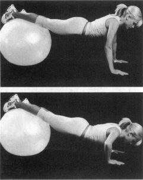

###### GET READY {.h6}

Drape yourself over your exercise ball. Place your hands on the floor
and walk yourself forward until the exercise ball is under your knees.
Situate yourself so that your hands are on the floor just wider than
shoulder-width apart and you feel stabilized. Make sure your legs are
evenly spaced on either side of the exercise ball. You should be in the
push-up position.

###### THE EXERCISE {.h6}

Inhale and slowly lower your chest toward the floor on a count of three
... two ... one. Hold at the bottom for a moment while you finish your
inhalation. With an explosive motion, exhale and push yourself back up
until your arms are straight and you have returned to your starting
position. Hold at the top as you finish your exhalation. (As you become
stronger and more advanced, move the ball toward your feet.) Repeat and
perform the prescribed number of repetitions, stretching after each set
using the chest stretch.

###### CHEST STRETCH {.h6}

Find a pole or bar that is immovable and at least 6 feet tall, stand in
a doorway, or lean against the end of a wall. With your right arm raised
and at a 90-degree angle, place the forearm along this immovable object.
Turn your torso away from your raised arm until you feel an incredible
stretch across half of your chest. Hold this stretch for at least 30
seconds. Switch arms and perform this stretch on your left side for the
same amount of time.

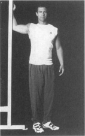

#### []{#chapter06.html#page_122}Hollywood Frankenstein {.h4}

This exercise is designed to work the upper third of your pectoral
muscles and to enhance separation on either side of your sternum.

###### GET READY {.h6}

Stand up tall with your feet about hip-width apart. Your legs should be
straight but your knees should not be locked. Each hand should hold the
head of one dumbbell. Let your arms relax.

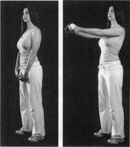

###### THE EXERCISE {.h6}

Exhale and slowly raise the dumbbell toward the ceiling on a one-count,
until your arms are at shoulder level and you look like Frankenstein
making an offering. Inhale and release the dumbbell back down to the
starting position on a count of three ... two ... one. Repeat the
prescribed number of repetitions and stretch after each set using the
chest stretch.

###### CHEST STRETCH {.h6}

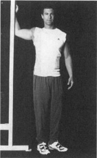

Find a pole or bar that is immovable and at least 6 feet tall, stand in
a doorway, or lean against the end of a wall. With your right arm raised
and at a 90-degree angle, place the forearm along this immovable object.
Turn your torso away from your raised arm until you feel an incredible
stretch across half of your chest. Hold this stretch for at least 30
seconds. Switch arms and perform this stretch on your left side for the
same amount of time.

#### []{#chapter06.html#page_123}Hollywood C Sweep {.h4}

This exercise is performed with dumbbells on the exercise ball and is
designed to work the entire pectoral muscle. The basic movement is to
trace a C around your torso with each hand. The key is to maximize the
movement at the starting and ending points of the C sweep. The exercise
begins with a deep stretch to hit the top of the pecs with pinpoint
accuracy. Throughout the movement you will work the entire edge of the
muscle. The exercise ends by flexing the chest muscles to develop their
bottom portion.

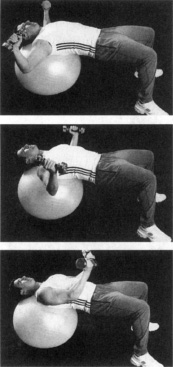

###### GET READY {.h6}

With a dumbbell in each hand, lie back on your exercise ball,
positioning the ball at the bottom of your shoulder blades. With your
elbows pointed toward the ground, bring your hands slightly higher than
the shoulders so that the dumbbells are even with your ears and your
knuckles are facing the ceiling. You will now trace a C shape with each
hand.

###### THE EXERCISE {.h6}

Exhale, and without raising your hands any higher, use the chest muscles
to sweep the dumbbells to the level of your waist in the pattern of an
arc. Continuing the exhalation and the arc-movement, gradually turn your
wrists as your arms pass the waist, proceeding to trace the bottom of
the C. During the last portion of this movement where you are finishing
the C, raise your hands slightly. With the palms facing in the direction
of your head, hold this position as you feel the bottom of the pectoral
muscles flex. Inhale and reverse the C on a count of three ... two ...
one. Feel the deep stretch across your chest as you finish your
inhalation. Exhale and repeat the prescribed number of repetitions.
Stretch after each set using the chest stretch.

###### CHEST STRETCH {.h6}

Find a pole or bar that is immovable and at least 6 feet tall, stand in
a doorway, or lean against the end of a wall. With your right arm raised
and at a 90-degree angle, place the forearm along this immovable object
(see photo on [page 122](#chapter06.html#page_122)). Turn your torso
away from your raised arm until you feel an incredible stretch across
half of your chest. Hold this stretch for at least 30 seconds. Switch
arms and perform this stretch on your left side for the same amount of
time.

#### []{#chapter06.html#page_124}Beginner Push-Up {.h4}

###### THE EXERCISE {.h6}

Lie facedown on the floor, preferably on a thick carpet or a mat. Cross
your ankles, bend your knees, and lift your feet off the ground. Place
your hands, palms down, just beyond your shoulders. Exhale and push your
body away from the floor so that you are balancing on your hands and
knees. Do not let the buttocks go too high, but rather let your body
form a straight line from your knees to your head. Inhale and come down
on a count of three ... two ... one until you almost touch the floor.
Hold this position for one count as you finish your inhalation. Exhale
and repeat for the prescribed number of repetitions. Stretch after each
set using the chest stretch.

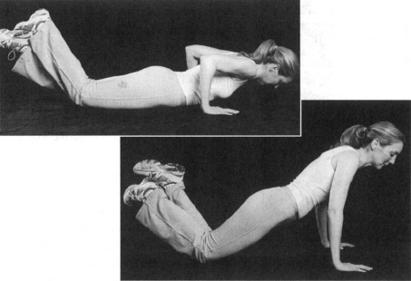

###### CHEST STRETCH {.h6}

Find a pole or bar that is immovable and at least 6 feet tall, stand in
a doorway, or lean against the end of a wall. With your right arm raised
and at a 90-degree angle, place the forearm along this immovable object
(see photo on [page 125](#chapter06.html#page_125)). Turn your torso
away from your raised arm until you feel this incredible stretch across
half of your chest. Hold this stretch for at least 30 seconds. Switch
arms and perform this stretch on your left side for the same amount of
time.

#### []{#chapter06.html#page_125}Advanced Push-Up {.h4}

###### THE EXERCISE {.h6}

Lie facedown on the floor. Curl your toes under your feet so that you
are resting on the balls of your feet, and place your hands, palms down,
just beyond your shoulders. Exhale and push away from the floor, keeping
your body in a straight line from your head to your toes. Inhale and
ease the body down on a count of three ... two ... one until your chest
almost touches the floor. Hold this position for one count as you finish
your inhalation. Exhale and repeat for the prescribed number of
repetitions. Stretch after each set using the chest stretch.

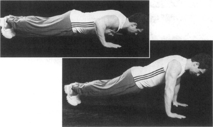

###### CHEST STRETCH {.h6}

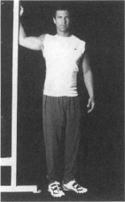

Find a pole or bar that is immovable and at least 6 feet tall, stand in
a doorway, or lean against the end of a wall. With your right arm raised
and at a 90-degree angle, place the forearm along this immovable object.
Turn your torso away from your raised arm until you feel an incredible
stretch across half of your chest. Hold this stretch for at least 30
seconds. Switch arms and perform this stretch on your left side for the
same amount of time.

#### []{#chapter06.html#page_126}Hollywood Ball Push-Up {.h4}

This exercise is an excellent way to determine if one pectoral muscle is
stronger than the other, and it will help create symmetry and balance.
It is an advanced exercise, so if it is too difficult right now, simply
replace it with the Beginner Push Up (women) or the Advanced Push-Up
(men). Try again the next time you see this exercise in your prescribed
routine.

###### GET READY {.h6}

Spread your legs just wider than shoulder-width apart as you drape
yourself over your exercise ball. Your face should be pointed toward the
floor. Walk yourself back carefully, allowing yourself to remain on top
of the ball as it rolls toward your chin. When the ball is positioned in
the middle of your chest, curl your toes under your feet so that you are
resting on the balls of your feet. Place your hands on either side of
the ball.

###### THE EXERCISE {.h6}

Exhale and push away from the floor, keeping your body in a straight
line from your head to your toes. Inhale and ease the body down on a
count of three ... two ... one until your chest almost touches the ball.
Hold this position for one count. Exhale and repeat for the prescribed
number of repetitions. Stretch after each set using the chest stretch.

###### CHEST STRETCH {.h6}

Find a pole or bar that is immovable and at least 6 feet tall, stand in
a doorway, or lean against the end of a wall. With your right arm raised
and at a 90-degree angle, place the forearm along this immovable object.
Turn your torso away from your raised arm until you feel an incredible
stretch across half of your chest. Hold this stretch for at least 30
seconds. Switch arms and perform this stretch on your left side for the
same amount of time.

::: box
##### []{#chapter06.html#page_127}Hollywood Arms {.h5}

For most men, the arms are a reflection of virility and machismo. For
women, the arms symbolize an image and attitude that combines strength
and femininity. Particularly for women, the arms are a common area of
concern. Puffy biceps or flabby underarms are unflattering. Here's the
good news: these muscles are some of the easiest to completely
transform.

In Hollywood, bodybuilder bulk is no longer the rage. Today you will see
definition, muscle separation or cut, and highly developed biceps and
triceps. The sleeveless dresses of starlets on the red carpet, the love
scenes of leading men, and the action pictures featuring favorite actors
and actresses all highlight these symbols of strength.

There are two distinct areas that you will focus on when working your
arms: the back of the arm (triceps) and the front area (biceps). Because
we all lift many objects every day, our biceps are more developed than
our triceps. To achieve a balance, make the triceps your primary focus.
To create a stunning arm, you will work on improving the development,
tone, and cut of the triceps. There is an altogether different strategy
for developing your biceps. This particular muscle is simple in
function: it can only contract. To prevent the formation of a short and
tight muscle, you will spend as much time stretching this muscle as you
do working it. The goal is to create beautifully elongated bicep
muscles.
:::

##### []{#chapter06.html#page_128}Hollywood Tricep Exercises {.h5}

#### Hollywood Tricep Extension {.h4}

The tricep extension is designed to work all three areas of the muscle.
The only portion of your body that will actually move is the elbow
joint. Think of this joint as if it were a hinge on a door. The door
does not wobble, and the wall does not weave back and forth; only the
hinge moves.

###### GET READY {.h6}

With a dumbbell in each hand, sit on top of your exercise ball so that
you feel stable. Slowly walk your feet out, and lean back until you are
lying back on the ball. Position the ball underneath your head and
shoulder blades. Your feet should be a comfortable distance apart,
planted firmly and flat against the floor for stability. Bring the
dumbbells just above the very top of your forehead, and turn your wrists
slightly so that the ends of the dumbbells nearest your head almost
touch. Your elbows should be pointed toward the ceiling. Your thumbs
should be nearest to your head, and the heels of your hands should be
pointed away from your face. Bring your elbows close together so that
they are no wider than shoulder-width apart.

###### THE EXERCISE {.h6}

Exhale and drive the weights up, turning your wrists so that your palms
are pointed to the place where the wall meets the ceiling. Do not fully
extend the arms, as it would take all the pressure off the triceps.
Inhale on a count of three ... two ... one as you turn the wrists back
to the starting position, and slowly bring the weights to the top of
your forehead. This negative movement should remain very controlled.
Come back too quickly and you will learn how this exercise got the
nickname "brain crusher." Exhale and perform the prescribed number of
repetitions. Stretch after each set using the tricep stretch.

###### TRICEP STRETCH {.h6}

Either stand or sit at the end of a bench. Lift your right arm over your
head and place your right hand between your shoulder blades. Place your
left hand on your right elbow, and come as close as you can to pointing
your elbow straight up toward the ceiling. Continue this stretch for at
least 15 seconds. Repeat on the left side.

#### []{#chapter06.html#page_129}Hollywood Kickout {.h4}

This exercise is designed to work both the inside and the outside of the
tricep muscle, and it has been created to confuse the muscle with each
repetition. It demands that the triceps be isolated, meaning that you
will not swing your body to move the weight. Your elbows and wrists will
be the only joints that actually move.

###### GET READY {.h6}

With a dumbbell in each hand, stand with your feet slightly wider than
hip-width apart. With your back straight and knees bent, lean forward
until your torso is parallel with the ground. Raise your elbows until
they are perpendicular to your torso, and bring the dumbbells to your
chest with your palms facing toward you. You are now in the position of
a football blocker. Using only your elbow hinge to move, release your
forearms so that your arms are in a 90-degree angle and the dumbbells
are perpendicular to your body.

###### THE EXERCISE {.h6}

Using only your elbow as a hinge, exhale and drive the weights out to
the sides until your arms are fully extended. As you finish your
exhalation, twist your wrists so that your palms are facing toward the
floor. Twist back, inhale, and release back down to the starting
position on a count of three ... two ... one.

Exhale and drive the weights out to the sides until your arms are fully
extended. As you finish your exhalation, twist your wrists so that your
palms are facing toward the ceiling. Twist back, inhale, and release
back down to the starting position on a count of three ... two ... one.
Perform the prescribed number of repetitions, alternating the wrist
twist on each rep. Stretch after each set using the tricep stretch.

###### TRICEP STRETCH {.h6}

Either stand or sit at the end of a bench. Lift your right arm over your
head and place your right hand between your shoulder blades. Place your
left hand on your right elbow, and come as close as you can to pointing
your elbow straight up toward the ceiling (see photo on [page
128](#chapter06.html#page_128)). Continue this stretch for at least 15
seconds. Repeat on the left side.

#### []{#chapter06.html#page_130}Hollywood Kickback {.h4}

This exercise works both the inside and the outside of the tricep
muscle, and it has been created to confuse the muscle with each
repetition. It demands that the triceps be isolated, meaning that you
will not swing your body to move the weight. Your elbows and wrists will
be the only joints that actually move. This exercise is a stellar
example of momentumless training since it isolates the tricep and works
the entirety of the muscle; it is perhaps the finest all-around exercise
you could perform for this muscle group.

###### GET READY {.h6}

With a dumbbell in each hand, stand with your feet slightly wider than
hip-width apart. With your back straight and knees bent, lean forward
until your torso is parallel with the ground. Raise your elbows until
they are parallel with your torso so that your arms are at a 90-degree
angle and your knuckles are facing the floor. You are now in the
position of a skier headed downhill. The basic movement in this exercise
would be that used in propelling yourself downhill with ski poles. Press
your upper arms tightly against the rib cage and do not let them move
for the duration of the exercise. This will promote the isolation of the
tricep muscles.

###### THE EXERCISE {.h6}

From this skiing position, use the elbows as hinges. Exhale and drive
the weights behind you until your arms are fully extended. Hold this
position for one count as you rotate your wrists so that your thumbs are
facing each other and your palms are facing the ceiling. Finish your
exhalation and rotate the wrists back to the neutral position. Inhale
and slowly release your hands back to the starting position on a count
of three ... two ... one.

Exhale to drive the weights back. Hold for one count. Turn the wrists so
that your thumbs are pointing away from your body and your palms are
facing the floor. Inhale to come back down to your starting point on a
count of three ... two ... one. With each repetition, alternate between
turning the wrists in and out. Repeat for the prescribed number of sets.
Stretch after each set using the tricep stretch.

###### TRICEP STRETCH {.h6}

Either stand or sit at the end of a bench. Lift your right arm over your
head and place your right hand between your shoulder blades. Place your
left hand on your right elbow, and come as close as you can to pointing
your elbow straight up toward the ceiling (see photo on [page
131](#chapter06.html#page_131)). Continue this stretch for at least 15
seconds. Repeat on the left side.

#### []{#chapter06.html#page_131}Hollywood Ball Press {.h4}

###### GET READY {.h6}

Drape yourself over the exercise ball. Roll forward and place your
hands, then your forearms, on the floor. Walk yourself forward until the
ball is underneath your knees. Place your hands flat on the floor. Your
forearms should be shoulder-width apart, parallel to your body.

###### THE EXERCISE {.h6}

Exhale, and with an explosive movement, push up with your hands until
your arms are fully extended. Hold as you finish your exhalation.
Inhale, and using only your elbows as hinges, slowly lower yourself back
down to the starting position on a count of three ... two ... one.
Repeat for the prescribed number of repetitions. Stretch after each set
using the tricep stretch.

###### TRICEP STRETCH {.h6}

Either stand or sit at the end of a bench. Lift your right arm over your
head and place your right hand between your shoulder blades. Place your
left hand on your right elbow, and come as close as you can to pointing
your elbow straight up toward the ceiling. Continue this stretch for at
least 15 seconds. Repeat on the left side.

#### []{#chapter06.html#page_132}Hollywood Overhead Tri {.h4}

The overhead tricep extension can be an awkward exercise. It is
performed with dumbbells and is designed to totally isolate the tricep
muscle. It is important not to be overly macho in choosing your weight.
Start light on this exercise and work your way up over time.

###### GET READY {.h6}

Stand up tall with your feet hip-width apart. With a dumbbell in your
right hand, bring the weight directly behind your head and position the
dumbbell so that it is parallel with your spine. Your right elbow should
be pointed toward the ceiling, and your right bicep should be in a
direct line with your right shoulder. The only joint that will move is
your elbow. The shoulders, torso, and upper arms should remain in a
fixed position throughout the exercise. The point is to isolate the
triceps as much as possible.

###### THE EXERCISE {.h6}

Exhale and drive the weight up, extending your palms three-quarters of
the way toward the ceiling. On the way up, the handle of the dumbbell
should be in a direct line with your spine. Inhale and release the elbow
joint back to the starting position on a count of three ... two ... one.
Inhale and regroup as you feel the stretch.

Exhale and repeat for the specified number of repetitions. Switch to the
left side and complete the specified number of repetitions, and you will
have completed one set. Stretch the triceps after each set using the
tricep stretch.

###### TRICEP STRETCH {.h6}

Either stand or sit at the end of a bench. Lift your right arm over your
head and place your right hand between your shoulder blades. Place your
left hand on your right elbow, and come as close as you can to pointing
your elbow straight up toward the ceiling (see photo on [page
131](#chapter06.html#page_131)). Continue this stretch for at least 15
seconds. Repeat on the left side.

#### []{#chapter06.html#page_133}Hollywood Dip {.h4}

This exercise uses the weight of your body rather than weights to target
all three areas of your triceps.

###### GET READY {.h6}

You can use a bench, a ledge, or a sturdy chair.

  --------------------------------- --------------------------------------------------------------------------------------------------------------------------------------------------------------------------------------
  L[EDGE]{.small}/B[ENCH]{.small}   Sit on a flat ledge or bench with both of your legs on one side. Bring your hands close to your buttocks and grip the edge of the bench so that your elbows are pointing behind you.
  C[HAIR]{.small}                   Sit in the chair. Slide your buttocks forward until you almost slide off. Grasp the sides of the chair with each hand.
  --------------------------------- --------------------------------------------------------------------------------------------------------------------------------------------------------------------------------------

Position your feet about hip-width apart. Walk your feet out slightly
and plant them firmly on the floor. Slide off the bench or chair until
your legs are in a 90-degree angle and you are supporting your weight
with your arms. Keep your back straight and your shoulders pressed down,
and do not let your elbows point out to the sides.

###### THE EXERCISE {.h6}

Inhale and lower your butt toward the floor on a count of three ... two
... one until your upper arms are parallel to the floor. Exhale and
drive your body up, pressing your elbows toward each other to maintain
their proper position. Straighten your arms until your elbows lock.
Inhale and repeat for the prescribed number of repetitions. Stretch
after each set using the tricep stretch.

###### TRICEP STRETCH {.h6}

Either stand or sit at the end of a bench. Lift your right arm over your
head and place your right hand between your shoulder blades. Place your
left hand on your right elbow, and come as close as you can to pointing
your elbow straight up toward the ceiling (see photo on [page
131](#chapter06.html#page_131)). Continue this stretch for at least 15
seconds. Repeat on the left side.

##### []{#chapter06.html#page_134}Hollywood Bicep Exercises {.h5}

#### Hollywood Squat Curl {.h4}

The curl and the squat are the most basic leg and bicep exercises.
Combined, you will discover that this particular exercise will take you
into the aerobic and anaerobic levels rapidly. This exercise is
performed with two dumbbells. There are two important factors to the
movement. The first is correct elbow placement. Second, the bicep muscle
must be isolated to ensure that only this muscle is involved in the
movement of your arms.

###### GET READY {.h6}

Your elbows should be at your sides, tucked into the ribs. Make certain
that the elbows do not move from this fixed position. Do not swing the
body to get the weights up. Use only the bicep muscles. When most people
perform this exercise, they do not fully develop the entire muscle. You
must make certain that you bring the weights all the way down so that
you can totally stretch this muscle out. Failing to bring the weights
down completely means that you are working only a small portion of the
bicep, or about 35 percent of the entire muscle, making for an uneven,
bulky, and malformed muscle. If you have proper technique, you can
create a well-defined and elongated arm. Stand up tall with a dumbbell
in each hand, palms facing forward. Your feet should be slightly wider
than shoulder-width apart, turned out slightly and planted firmly on the
floor.

###### THE EXERCISE {.h6}

Keeping your head and spine in alignment, inhale, bend your knees, and
allow your butt to go back as if you were going to sit on a bench or
chair on a count of three ... two ... one. Just as you would begin to
make contact with the chair, exhale and drive up through the heels,
simultaneously bringing the dumbbells up about three-quarters of the way
toward your shoulders, turning your wrists so that the heels of your
hands are pointing toward your chin. Straighten your legs, and hold this
hand []{#chapter06.html#page_135}position for one count as you finish
your exhalation and get the fullest possible contraction in the biceps.

Inhale and go down into your squat, releasing the weight all the way
down on a count of three ... two ... one as your buttocks lower to sit
on the imaginary chair. Feel the biceps stretch at the bottom of the
exercise. Exhale while driving up and curling, turning the heels of your
hands toward your chin as you finish your exhalation. Repeat for the
prescribed number of repetitions. Stretch after each set using the bicep
stretch.

###### BICEP STRETCH {.h6}

Stand up tall in front of a mirror. Extend your arms straight out from
your shoulders with your fingers pointing toward the ceiling as if you
were standing in the middle of the street stopping traffic in both
directions. With your elbows and hands locked in this position, rotate
the arms so that your fingers are now pointing down. Lock your arms in
this position and rotate only the wrists so that your hands are now in
the traffic-stopping position. Hold for 20 seconds.

#### []{#chapter06.html#page_136}Hollywood Hammer Curl {.h4}

The hammer curl is performed with a dumbbell in each hand. This exercise
is designed to work the outside portion of the biceps and will have
secondary benefits for the upper portion of your forearms.

###### GET READY {.h6}

Stand up tall, arms at your sides, with a dumbbell in each hand so that
your knuckles are facing the floor. Press your elbows into your torso,
and keep them fixed throughout the exercise. This elbow placement will
ensure the necessary isolation for the muscles you are working.

###### THE EXERCISE {.h6}

Keeping the wrists and upper arms in a fixed position, exhale and bring
both dumbbells three-quarters of the way toward the shoulders. The
knuckles of the index fingers and thumbs are now facing your shoulders,
and you are in the position of a ready boxer. Hold for one count as you
reach the top. Moving only with your elbow joints, inhale and release
the dumbbells back down to the starting position on a count of three ...
two ... one. Fully extend the arms to feel the stretch through your
biceps. Repeat for the specified number of repetitions. Stretch after
each set for at least 20 seconds using the bicep stretch.

###### BICEP STRETCH {.h6}

Stand up tall in front of a mirror. Extend your arms straight out from
your shoulders with your fingers pointing toward the ceiling as if you
were standing in the middle of the street stopping traffic in both
directions. With your elbows and hands locked in this position, rotate
the arms so that your fingers are now pointing down. (See photos on
[page 135](#chapter06.html#page_135).) Lock your arms in this position
and rotate only the wrists so that your hands are now in the
traffic-stopping position. Hold for 20 seconds.

#### []{#chapter06.html#page_137}Hollywood Cross-Curl {.h4}

I find this to be one of the most intense exercises for the biceps, and
you just may find that it will exhaust your muscles.

###### GET READY {.h6}

Hold a pair of dumbbells and stand tall with your spine straight and
your head upright. Your feet should be about hip-width apart. With a
dumbbell in each hand, extend your arms out to the sides in the crucifix
position.

###### THE EXERCISE {.h6}

Exhale and bring your fists three-quarters of the way toward your ears.
Hold this position for one count as the biceps flex. Inhale and allow
the hands to go back into the starting position on a count of three ...
two ... one. Exhale and repeat for the prescribed number of repetitions,
stretching with the bicep stretch after every set.

###### BICEP STRETCH {.h6}

Stand up tall in front of a mirror. Extend your arms straight out from
your shoulders with your fingers pointing toward the ceiling as if you
were standing in the middle of the street stopping traffic in both
directions. With your elbows and hands locked in this position, rotate
the arms so that your fingers are now pointing down. Lock your arms in
this position and rotate only the wrists so that your hands are now in
the traffic-stopping position. Hold for 20 seconds.

#### []{#chapter06.html#page_138}Hollywood Ball Curl {.h4}

This exercise is performed with two dumbbells and is ideal for
completely isolating the biceps. You should get a full contraction from
the entire bicep muscle. Do not swing the weights or use your back
muscles to move the weights; isolation is the key to success.

###### GET READY {.h6}

Drape yourself over your exercise ball. Position the ball so that it is
at the top of your chest. Your arms should hang over the top, with your
triceps resting against the ball. (If you are a woman and find this
uncomfortable, position the ball just under your breasts and let your
elbows rest against the ball.) Extend your arms fully and grip the
dumbbells.

###### THE EXERCISE {.h6}

Keeping your elbows in a fixed position, exhale and bring the weights up
three-quarters of the way toward your head. When the weights reach this
point, twist your wrists so that your thumbs are pointing away from you
and the heels of your hands are turned toward your face. Finish your
exhalation, holding this position for one count. Feel the entire biceps
in full contraction. Inhale, and release the wrists and lower the
weights on a count of three ... two ... one until your arms are fully
extended. Feel the stretch throughout the biceps. Perform the designated
number of repetitions. Stretch after each set for at least 20 seconds
using the bicep stretch.

###### BICEP STRETCH {.h6}

Stand up tall in front of a mirror. Extend your arms straight out from
your shoulders with your fingers pointing toward the ceiling as if you
were standing in the middle of the street stopping traffic in both
directions. With your elbows and hands locked in this position, rotate
the arms so that your fingers are now pointing down. (See photo on [page
139](#chapter06.html#page_139).) Lock your arms in this position and
rotate only the wrists so that your hands are now in the
traffic-stopping position. Hold for 20 seconds.

#### []{#chapter06.html#page_139}Hollywood Karate Curl {.h4}

###### GET READY {.h6}

With a dumbbell in each hand, stand up tall with your feet hip-width
apart.

###### THE EXERCISE {.h6}

Sweep your right hand toward your left shoulder, then across your chest
(passing below your chin) and into the curl position with an explosive
motion on a count of one. (This move is typical of a martial arts block,
a "ward off," or a parry.) Using only the hinge of your elbow, inhale,
and slowly lower the dumbbell down into the starting position on a count
of three ... two ... one. Turn your palms back toward your body, and
repeat this exercise using your left arm. This is one rep. Perform the
prescribed number of repetitions, and stretch after each set using the
bicep stretch.

###### BICEP STRETCH {.h6}

Stand up tall in front of a mirror. Extend your arms straight out from
your shoulders with your fingers pointing toward the ceiling as if you
were standing in the middle of the street stopping traffic in both
directions. With your elbows and hands locked in this position, rotate
the arms so that your fingers are now pointing down. Lock your arms in
this position and rotate only the wrists so that your hands are now in
the traffic-stopping position. Hold for 20 seconds.

::: box
##### []{#chapter06.html#page_140}Hollywood Abs {.h5}

The ever-elusive Hollywood tummy is really a product of leanness rather
than muscular definition. If you watch a Janet Jackson video, look at a
film clip where the leading man takes off his shirt, or page through a
magazine, you will see a washboard stomach. Rest assured, you have a
similar washboard. Even people who are unable to move have these
muscles. The difference is that most people have a layer of fat hiding
them.

The goal is to decrease the amount of body fat and strengthen or develop
this all-important area. By increasing the strength of your abdominal
muscles, you can offset back problems or avoid them altogether. Strong
abdominal muscles are necessary for proper posture and spinal alignment.
Commonly called core muscles, they support the weight of your entire
upper body. Strengthening this area will improve your spinal stability,
providing you with a sense of buoyancy.

The muscles of the abdomen are a checkerboard of blocklike muscles that
start underneath your rib cage and end where your torso connects with
your thighs. There are also oblique muscles that stretch down each side
of the abdomen.

The Hollywood ab routine will always be the last part of your workout
because the abdominal muscles are the strongest of your core muscles.
You must work this section of your body last to avoid muscular weakness
and injuries in other parts of your body, especially your back. You will
work the muscles by contracting them in many different directions and
angles, then doing very specific exercises for the lower abdominals
(below the belly button) and the obliques. To fully develop these
muscles, you will never stretch them.

There is a very specific protocol for developing and strengthening the
abdominal muscles. The lower abdominal muscles will come first in your
ab routine. These muscles are generally weaker and are the most
difficult to develop, so they will require extra attention. Then you
will work the obliques or sides. Finally, you will work the middle and
upper abdominal muscles simultaneously. For exercises that require you
to be on the floor, I recommend using an exercise mat.
:::

#### []{#chapter06.html#page_141}Hollywood Ball Crunch {.h4}

###### GET READY {.h6}

Drape yourself facedown over your exercise ball. Walk your hands forward
until you are in a push-up position with the ball between your thighs
and pelvic bone.

###### THE EXERCISE {.h6}

Exhale, pull your belly button in toward your spine, and bring your
knees toward your chest. Your buttocks will rise up and point toward the
ceiling, and the ball will roll back between your shins and flexed feet.
Inhale and release back down into your starting position on a count of
three ... two ... one. Perform the prescribed number of repetitions.

#### []{#chapter06.html#page_142}Hollywood Ball Small Sit-Up {.h4}

This sit-up is performed while lying face up on your exercise ball. You
should position the ball so that it is in the middle of your back,
offering the greatest support for the lumbar area. You may perform this
exercise with your fingers interlocked behind your head, your arms
crossed on your chest with your hands on the opposite shoulders (the "I
Dream of Jeannie" position), or by holding a dumbbell to your chest.

###### GET READY {.h6}

Sit on top of the ball with your feet planted firmly on the floor a
little more than hip-width apart. Roll down, moving your buttocks toward
your feet, so that you have support for your lower back.

###### THE EXERCISE {.h6}

Exhale, and keeping the spine and head straight, slowly raise your torso
up on a count of one as far as you can, until you reach the point where
you just begin to lose tension in the abdominal muscles. (This point
marks the top of the motion.) Hold this position for a count of one.
Inhale and release the torso back down a few inches. (This point marks
the bottom of the movement.) Maintaining the abdominal contraction,
perform the prescribed number of repetitions.

#### []{#chapter06.html#page_143}Hollywood Ball Pike {.h4}

###### GET READY {.h6}

Drape yourself facedown over your exercise ball. Walk your hands forward
until you are in the push-up position with your knees resting on top of
the ball.

###### THE EXERCISE {.h6}

Exhale, and keeping your legs straight and your knees locked, pull your
belly button in toward your spine, lifting your buttocks toward the
ceiling on a count of one, until you are in an inverted V position. (In
yoga, this would be similar to a "downward dog.") As you do this, the
ball will roll back and be caught by your flexed feet. Finish your
exhalation as you gently press your chest toward your knees. Inhale and
slowly release back down into your starting position on a count of two
... one. Perform the prescribed number of repetitions.

#### []{#chapter06.html#page_144}Hollywood Squeeze {.h4}

###### GET READY {.h6}

Lie down on the floor. Plant your feet on the ground with your knees
pointed toward the ceiling. Place your exercise ball between your knees.
Interlock your fingers and place your hands underneath your head.

###### THE EXERCISE {.h6}

Exhale, pull your belly button into your spine, and squeeze the ball
between your knees. Then simultaneously lift your shoulders off the
ground and your hips off the floor, bringing your shoulders toward your
knees and your knees toward your shoulders. Hold at the top of the
movement to intensify the contraction, inhale, and release back down
into the starting position and a count of two ... one. As you become
more advanced, try not to release all the way back down into the
starting position, but only release as far as you can without losing the
abdominal contraction. Repeat for the prescribed number of repetitions.

#### []{#chapter06.html#page_145}Hollywood Crunch {.h4}

The crunch is just an improvement over the most basic form of sit-up.
The goal is to bring your elbows to your knees. The key to getting the
most abdominal work is to get the great majority of your hips off the
ground as you fold your body. It is a fantastic overall abdominal muscle
exercise and is even great for those with back problems. To minimize
neck injuries, do not pull your head up with your hands---let your
stomach muscles do the work. The point is to contract the abdominal
muscles and not let them rest during the exercise. To keep the
contraction going, perform these crunches as slowly as possible.

###### GET READY {.h6}

Either place your hands underneath your head or cross your arms in front
of you with your hands on the opposite shoulders. Begin with your head
and feet on the floor.

###### THE EXERCISE {.h6}

Exhale, simultaneously bringing your knees toward your elbows and
lifting your hips and feet off the ground. Hold at the top of the crunch
as you finish the exhalation. Slowly release and inhale, pulling your
belly button in toward your spine as you unfold on a count of two ...
one. When you feel the point at which you lose the contraction, stop,
inhale, and repeat for the prescribed number of repetitions.

#### []{#chapter06.html#page_146}Hollywood Crossover Crunch {.h4}

This exercise is like the Hollywood Crunch except your leg position is
different. It is designed to strengthen all the areas of the abdominal
group.

###### GET READY {.h6}

Lie flat on your back with the soles of your feet on the floor and your
knees pointed toward the ceiling. Cross your legs, placing the outside
of your left ankle on top of your right knee. The crossed leg remains
stationary throughout the exercise.

###### THE EXERCISE {.h6}

Exhale and simultaneously bring your knees toward your elbows and lift
your hips, feet, and shoulders off the ground, bringing your knees
toward your elbows. Hold at the top of the crunch as you finish the
exhalation. Inhale and come down on a count of two ... one without
letting your shoulder blades rest against the floor. Exhale and repeat
for the prescribed number of repetitions. Repeat on the other side.

#### []{#chapter06.html#page_147}Hollywood Penguin {.h4}

This exercise is designed to create strength and definition along the
edges of the abdominal musculature and is fantastic for the oblique
muscles. The point is to keep your shoulders and torso off the ground
for the entire exercise.

###### GET READY {.h6}

Lie flat on your back with your arms along your sides and your palms
facing you. Bend your knees and bring your feet as close as you can to
your buttocks. Place your feet flat on the floor so that your knees are
pointed toward the ceiling. Exhale and pull your belly button into your
spine. Maintain the contraction and inhale and tuck your chin into your
chest, lifting your head, shoulders, and upper torso off the ground.

###### THE EXERCISE {.h6}

Inhale and exhale evenly throughout the exercise. Touch your right hand
to your right heel. Then touch your left hand to your left heel.
Alternate between the right and the left quickly, and you will soon
discover how this exercise was named.

#### []{#chapter06.html#page_148}Hollywood Leg Lift {.h4}

To perform this exercise safely, find something very sturdy such as the
legs of a heavy table, a pillar of some kind, or a very heavy chair.

###### GET READY {.h6}

Lie on your back with your arms and legs fully extended. Grasp the heavy
(or immovable) object with your hands. Lift your feet up until your body
is shaped like an L.

###### THE EXERCISE {.h6}

Exhale, pulling your belly button in toward your spine, and use your
abdominal muscles to bring your buttocks off the ground. Lift your feet
up toward the ceiling 6 to 10 inches on a one count, hold, and inhale.
Release back down on a count of two ... one. Repeat for the prescribed
number of repetitions. As you become more advanced and your abdominal
musculature becomes stronger, you may add ankle weights.

#### []{#chapter06.html#page_149}Hollywood Corkscrew {.h4}

###### GET READY {.h6}

Drape yourself facedown over your exercise ball. Walk your hands forward
until you are in a push-up position with the ball between your ankles.
Lock your elbows. Your upper body will remain fixed and rigid throughout
this exercise. Your torso, abdomen, and legs will move from side to side
as one unit. The movement is slow and steady. The more controlled this
movement the greater the benefit.

###### THE EXERCISE {.h6}

Exhale and pull your belly button into your spine. Maintain this
contraction throughout the exercise. Inhale and allow the ball to roll
slightly as your left foot lowers and your right hip lifts as much as it
possibly can on a count of two ... one. Exhale and come back into the
starting position. Inhale and allow your right foot to lower and your
left hip to lift as far as it possibly can on a count of two ... one.
This is one repetition. Repeat for the prescribed number of repetitions.

#### []{#chapter06.html#page_150}Hollywood Side Raise {.h4}

This exercise is performed using one heavy dumbbell of a challenging
weight. The key is to stretch throughout the entire length of your
torso, holding that stretch at the bottom of the movement.

###### GET READY {.h6}

This is an excellent exercise to target the obliques. With a dumbbell in
your right hand, stand up tall with your feet about hip-width apart.
Turn your hand so that your palm is facing your hip. Place your left
hand on your left hip.

###### THE EXERCISE {.h6}

Exhale, and bending your waist to your right side, allow the dumbbell to
lower toward the ground on a count of two ... one. Keep your chest open
and feel the stretch along your entire left side. Continue to stretch as
much as you possibly can, maintaining the sensation that you are
lengthening your spine. As you reach the maximum stretch, hold in this
position and finish your exhalation. Inhale and come back to your
starting position on a count of two ... one. Repeat for the prescribed
number of repetitions, then repeat on the other side.

#### []{#chapter06.html#page_151}Hollywood Lying Side Raise {.h4}

###### GET READY {.h6}

Situate yourself on your exercise ball so that your left hip and torso
are pressed against it and your hips are perpendicular to the floor.
Your right foot should be behind the left foot as if you were taking a
walking stride. Interlock your fingers and place them behind your head.
Bend from the waist and allow your left elbow to drop down toward the
floor. Feel the stretch along the entire length of the right side of
your torso.

###### THE EXERCISE {.h6}

Exhale, coming up to a position where your spine is in alignment.
Continue your exhalation, coming up as far as you comfortably can.
Inhale and drop the left elbow toward the floor on a count of two ...
one. Hold this position to feel the stretch. Exhale and repeat for the
prescribed number of repetitions. Repeat on the other side.

### {.middle} Completing Your Initiation {.h3}

------------------------------------------------------------------------

[]{#chapter06.html#page_152}After this initiation phase, you will
increase the duration and difficulty of your workouts so that you can
experience dramatic results in the shortest possible time. I will teach
you exactly what you need to do to reach your goals. You will create and
adjust your own program. Just like every athlete I have ever trained,
just like every celebrity who works out with me, just like every
makeover story I have done in magazines or on television, you too can
have a new lease on life and totally transform your body using the
Hollywood body principles.

By the time you finish these first two weeks, you will have broken
unhealthy eating cycles, short-circuited food addictions, established
new habits of daily exercise, and eliminated 5 to 10 pounds of body fat.
Every muscle in your body will have begun the process of a complete
transformation. Not only will people begin to notice the difference in
your appearance, but you might also become keenly aware that you feel
completely different. You will experience a surge in your energy level.
You will notice that your mindset is much more positive and upbeat. You
might find yourself smiling or laughing more easily. You will sense a
reduction in stress. You will begin to feel much more centered, capable,
and ready for new challenges.

This new set of challenges is coming your way. Over the next four weeks,
you will be on a program that is personalized for your specific needs.
You are about to completely change the way your body looks.

[]{#chapter07.html}

## []{#chapter07.html#page_153}7 {.chnum}

## What's Your Hollywood Body Type?[]{#chapter07.html#page_154} {.h2}

------------------------------------------------------------------------

[]{#chapter07.html#page_155}Congratulations! In many ways, you have
completed the most difficult portion of the process. You have begun. You
are truly on a roll, so I do not want to break your rhythm with lengthy
descriptions of what to do next and how to do it. I'll be as brief as
possible so that you can maintain your momentum.

After completing the initiation, you are fit enough and prepared enough
to do the work that will lead to dramatic physical changes. It is now
time to get very specific about your personal needs, address those
needs, and create a strategy that will allow you to look the way you
want to look.

During the first two weeks of your initiation, the exercise and eating
programs I designed for you were structured in a more generalized way to
break unhealthy eating cycles and food addictions, raise your level of
cardiovascular fitness, and begin the process of strengthening your
muscles while familiarizing you with the revolutionary toning exercises.
Over the next four weeks, the program I create for you will be much more
specific to your personal needs.

[]{#chapter07.html#page_156}Your needs are very much related to the way
your body looks at this very moment. Over time, there has been a
fascination with our physical differences. Beginning with the Greeks,
much attention from the medical community has been paid to our varying
shapes and sizes, and inferences for diagnoses have even been based on
these categorizations. Throughout the twentieth century, physiologists
studied our different shapes further, defined and categorized them, and
even associated differing personality traits with each of these
categories. Today, most professionals in the academic, scientific,
medical, and health fields have adopted these categories of body shape
classifications.

Within the health and fitness community, we generally use three
categories for the human body: the ectomorph, the mesomorph, and the
endomorph. We fashion or create specific training programs to suit these
specific body types. Consequently, it is essential that you know your
type so that you can follow the training regimen that best suits your
personal needs.

### {.middle} The Ectomorph {.h3}

------------------------------------------------------------------------

Do you know people who can eat anything they want, never exercise, and
are still thin? They are ectomorphs. Generally, an ectomorphic body is
extremely lean. The ectomorph usually has a fragile, delicately built
body and finds it difficult to gain weight or add muscle. With long
limbs, small shoulders, and a lightly muscled physique, ectomorphs may
appear taller than they really are. Ectomorphs are usually slight and
small-boned, with a small chest and buttocks, giving them an almost
linear physique.

Hollywood ectomorph bodies include Brad Pitt, Calista Flockhart, Tobey
Maguire, Leelee Sobieski, Edward Norton, Steven Tyler (Aerosmith), Mick
Jagger, Paris Hilton, models who are built like Kate Moss, and virtually
every shooting guard and small forward in the NBA.

### {.middle} The Mesomorph {.h3}

------------------------------------------------------------------------

[]{#chapter07.html#page_157}The mesomorph typically has an athletic,
hard body and gains muscle easily. Endowed with excellent posture, thick
skin, big bones, and mature muscle mass, the mesomorphic body is usually
wider at the shoulders than at the hips. The male mesomorph will
generally have a V or rectangular shape, whereas the female mesomorph
will generally have a fairly chiseled hourglass figure.

Hollywood mesomorph bodies include Elizabeth Hurley, Sylvester Stallone,
Jennifer Garner, Bruce Willis, Angela Bassett, Madonna, Arnold
Schwarzenegger, and virtually every Mr. Universe.

### {.middle} The Endomorph {.h3}

------------------------------------------------------------------------

Like the mesomorph, the endomorph gains muscle easily; however, these
muscles are generally underdeveloped, giving the endomorph a soft and
round physique. Almost the polar opposite of the ectomorph, the
endomorph gains weight easily and finds it difficult to eliminate excess
body fat. This excess weight is generally carried around the belly (men)
or on the hips (women). The endomorph generally has smaller shoulders, a
high waist, and larger hips, sometimes leading to a pear-shaped
physique.

Hollywood endomorph bodies include Jennifer Lopez, John Goodman, Kirstie
Alley, Jack Black, Oprah Winfrey, and every offensive lineman in the
NFL.

### {.middle} Reshaping Your Body Type {.h3}

------------------------------------------------------------------------

Most of us do not fit within these classic body types but have qualities
of at least two. While you may or may not fit an exact definition, you
have many qualities that are more akin to one of these prototypical
bodies. Place yourself in one of the three categories so
[]{#chapter07.html#page_158}that you may create a program to reshape
your body. It is time to take off your clothes and look in the mirror.
What body type best fits your overall physique?

Over the next four weeks, the goal is to move away from the classic
black-and-white definition of your body type into a gray area that is a
more fitting blend of two body types. If you are more ectomorphic in
appearance, the goal is to add muscle in strategic areas so that your
appearance is more mesomorphic. If you are a true mesomorph, the goal is
to become leaner and sculpt your musculature toward stunning definition
so that you can look your absolute best. If you are more of an
endomorph, the goal is to lean out the physique, creating muscle mass in
specific areas so that women will move toward an hourglass figure and
men will move toward a rectangular or tapered physique.

### {.middle} Bumps in the Road {.h3}

------------------------------------------------------------------------

After you have finished [chapters 8](#chapter08.html) through
[10](#chapter10.html), carefully read the opening of [chapter
11](#chapter11.html) to better determine your next step. If you
encounter any difficulty or face a challenge that is hard to navigate,
don't quit! You need to get some support. Drop me a quick line at
[www.atighteru.com](http://www.atighteru.com), and I will try to answer
your question or help you with a solution.

[]{#chapter08.html}

## []{#chapter08.html#page_159}8 {.chnum}

## Four Weeks to an Ectomorph Hollywood Body[]{#chapter08.html#page_160} {.h2}

------------------------------------------------------------------------

[]{#chapter08.html#page_161}The ectomorph is blessed with a very
efficient metabolism. Everyone envies you. You probably burn off
calories by sneezing. All your friends jokingly say that they hate you
and wish they could be exactly like you. However, the grass is always
greener on the other side. You know that having this physique is a
blessing and a curse. Although you may eat almost anything you want, you
know how difficult it is to add muscle or even to gain weight.

Generally, ectomorphs have shoulders that are approximately the width of
their hips, giving the appearance of being thin, long, and wiry.
Ectomorphs are quite linear, tubular, or cylindrical. If women gain
weight, they will probably carry this weight below the belly button
(known as the mound of Venus). Men may get a small paunch. Over the next
four weeks, the goal is to eliminate any belly fat you may be carrying
and create some curves to break up your linear appearance.

You will need to follow a very specific and rigid nutrition program,
tone down cardiovascular exercise to the barest minimum for heart
health, and structure your strength training regimen to add muscle and
create as much size as you can.

### {.middle} Hollywood Nutrition for the Ectomorph {.h3}

------------------------------------------------------------------------

[]{#chapter08.html#page_162}It is definitely time to move out of the
initiation phase and eat your meals with a greater balance of
carbohydrates and protein. If you are eating only five meals per day,
add a sixth meal. Each of these meals must contain a significant portion
of protein, since this additional protein will fuel your muscular
growth. The size of your protein portion should approximate the size of
your entire hand in length, width, and height. If you have difficulty
ingesting this much protein, make certain your portion is at least the
size of your palm and first knuckle.

Your carbohydrate choices may now include simple carbohydrates such as
fruit, bread, rice, pasta, or potatoes, and the portion may be as large
as your protein portion.

### {.middle} Hollywood Heart for the Ectomorph {.h3}

------------------------------------------------------------------------

You will stray from the initiation phase. Because you burn calories so
efficiently, your cardiovascular exercise should be performed only for
heart health. The Centers for Disease Control suggests a minimum of 25
to 30 minutes of exercise three days a week, which you should follow. Be
conscious about what kind of exercise you perform, paying particular
attention to your heart rate. Choose low-intensity exercise such as
walking instead of jogging, aerobics, or a leisurely bike ride instead
of a spinning class. Keep your heart rate at or below 70 percent of its
maximum. Your three sessions can be at any time of the week, but make an
effort to space them out evenly over the week.

### {.middle} Hollywood Sculpt for the Ectomorph {.h3}

------------------------------------------------------------------------

For both men and women, the goal of the workouts is to break up your
linear qualities with some strategic curves. You need to create
[]{#chapter08.html#page_163}muscular density, size, and mass in some
specific areas to give your body a more shapely appearance. If you look
in the mirror today, you may indeed be very linear. After following my
prescription for the next four weeks, you will begin to notice three
distinct curves when you look head-on in the mirror. There will be a V
from your shoulders to your waist, a slight bow from the lower hips to
the knees, and another bow from the knees to the ankles. Increase your
workout to four days per week, and on those days use fairly heavy
weights. You will move that weight slowly and have fewer repetitions in
each set.

The next four weeks of workouts for women begin on [page
164](#chapter08.html#page_164). The goal of these workouts is to develop
the shoulders, the lateral muscles, the deltoids, the upper legs, and
the buttocks. By developing these muscle groups in the upper body, you
will achieve a tapering effect from the (wider) shoulders down to the
waist. Building size in your upper legs and buttocks will give your body
more feminine curves.

The next four weeks of workouts for men begin on [page
165](#chapter08.html#page_165). The goal of these workouts is to quickly
provide you with a V shape. You will be working very hard to create size
and bulk in your shoulders, deltoids, back, thighs, and calves. Use the
heaviest weights you can move.

##### Supersets {.h5}

On some days, you will utilize supersets. When a superset is prescribed,
it indicates you are targeting two muscles or muscle groups. By using
two exercises you will completely exhaust these muscles and stimulate
particular muscles for growth and shape. When a superset is indicated,
you will perform one set of exercise A, then a set of exercise B, and
*then* stretch the muscle. For example, you might do one set of squat
curls, then immediately perform one set of side kicks before stretching.
By using alternating sets of two exercises, you will build size and
shape in specific areas.

[]{#chapter08.html#page_164}**SHAPING AND SCULPTING WORKOUTS FOR THE
FEMALE ECTOMORPH**

Perform three sets of ten repetitions. Stretch after each set.

WEEK ONE

  ----------------------------- ------------------- ---------------
                                [DAY 1]{.sans}        [Page]{.sans}
                                Incline Fly                     120
                                Beginner Push-Up                124
                                Pull-In                         109
                                Hyperextension                  108
                                Hammer Curl                     136
                                Ball Crunch                     141
                                Crossover Crunch                146
                                Penguin                         147
                                                                   
                                [DAY 2]{.sans}        [Page]{.sans}
  [[SUPERSET]{.sans}]{.small}   Rear Delt                       114
                                Wave                            117
                                Ball Squat                       98
                                Arrow                            95
                                Overhead Tri                    132
                                Leg Lift                        148
                                Crunch                          145
                                Ball Crunch                     141
                                                                   
                                [DAY 3]{.sans}        [Page]{.sans}
                                Frankenstein                    122
                                Beginner Push-Up                124
                                Pull-Over                       107
                                Bent-Over Row                   105
                                Squat Curl                      134
                                Ball Pike                       143
                                Side Raise                      150
                                Ball Small Sit-Up               142
                                                                   
                                [DAY 4]{.sans}        [Page]{.sans}
                                Side Kick                       102
                                Inner Thigh                      96
  [[SUPERSET]{.sans}]{.small}   Kickout                         129
                                Tricep Extension                128
                                W Shoulders                     112
                                Ball Crunch                     141
                                Lying Side Raise                151
                                Ball Small Sit-Up               142
  ----------------------------- ------------------- ---------------

WEEK TWO

  ----------------------------- ------------------- ---------------
                                [DAY 5]{.sans}        [Page]{.sans}
                                Fly                             119
                                C Sweep                         123
                                Pull-In                         109
                                One-Arm Row                     106
                                Karate Curl                     139
                                Squeeze                         144
                                Lying Side Raise                151
                                Ball Small Sit-Up               142
                                                                   
                                [DAY 6]{.sans}        [Page]{.sans}
                                Lunge                            93
                                Leg Curl                         97
                                Wings                           116
  [[SUPERSET]{.sans}]{.small}   Kickback                        130
                                Dip                             133
                                Leg Lift                        148
                                Side Raise                      150
                                Penguin                         147
                                                                   
                                [DAY 7]{.sans}        [Page]{.sans}
                                Beginner Push-Up                124
                                Incline Fly                     120
                                Shrug                           110
                                Ball Curl                       138
                                Squat Curl                      134
                                Ball Pike                       143
                                Lying Side Raise                151
                                Crunch                          145
                                                                   
                                                                   
                                [DAY 8]{.sans}        [Page]{.sans}
  [[SUPERSET]{.sans}]{.small}   Butt Lift                       103
                                Reverse Lunge                    94
                                Calf Raise                       99
                                Hyperextension                  108
                                Cross-Curl                      137
                                Crossover Crunch                146
                                Penguin                         147
                                Ball Small Sit-Up               142
                                                                   
  ----------------------------- ------------------- ---------------

WEEK THREE

  ----------------------------- ------------------- ---------------
                                [DAY 9]{.sans}        [Page]{.sans}
                                Incline Fly                     120
                                Frankenstein                    122
                                Cheer                           115
                                Twisting W                      113
                                Ball Press                      131
                                Ball Crunch                     141
                                Corkscrew                       149
                                Side Raise                      150
                                                                   
                                [DAY 10]{.sans}       [Page]{.sans}
                                Ball Lunge                      101
                                Arrow                            95
                                One-Arm Row                     106
                                Pull-In                         109
                                Hammer Curl                     136
                                Leg Lift                        148
                                Lying Side Raise                151
                                Squeeze                         144
                                                                   
                                [DAY 11]{.sans}       [Page]{.sans}
  [[SUPERSET]{.sans}]{.small}   Tricep Extension                128
                                Overhead Tri                    132
                                Rear Delt                       114
                                W Shoulders                     112
                                C Sweep                         123
                                Corkscrew                       149
                                Ball Pike                       143
                                Ball Small Sit-Up               142
                                                                   
                                [DAY 12]{.sans}       [Page]{.sans}
                                Bent-Over Row                   105
                                Pull-Over                       107
                                Squat Curl                      134
                                Lee Curl                         97
                                Side Kick                       102
                                Inner Thigh                      96
                                Crossover Crunch                146
                                Crunch                          145
                                Penguin                         147
  ----------------------------- ------------------- ---------------

[]{#chapter08.html#page_165}WEEK FOUR

  ----------------------------- ------------------- ---------------
                                [DAY 13]{.sans}       [Page]{.sans}
                                Wave                            117
  [[SUPERSET]{.sans}]{.small}   Wings                           116
                                Decline Push-Up                 121
                                Kickout                         129
                                Dip                             133
                                Ball Crunch                     141
                                Leg Lift                        148
                                Squeeze                         144
                                                                   
                                [DAY 14]{.sans}       [Page]{.sans}
                                Shrug                           110
                                One-Arm Row                     106
                                Karate Curl                     139
                                Butt Lift                       103
                                Ball Squat                       98
                                Corkscrew                       149
                                Side Raise                      150
                                Ball Small Sit-Up               142
                                                                   
                                [DAY 15]{.sans}       [Page]{.sans}
  [[SUPERSET]{.sans}]{.small}   Incline Fly                     120
                                Ball Push-Up                    126
                                Twisting W                      113
                                Frankenstein                    122
                                Kickback                        130
                                Ball Pike                       143
                                Penguin                         147
                                Crossover Crunch                146
                                                                   
                                                                   
                                [DAY 16]{.sans}       [Page]{.sans}
                                Lunge                            93
                                Side Kick                       102
                                Arrow                            95
                                Pull-In                         109
                                Ball Curl                       138
                                Crunch                          145
                                Lying Side Raise                151
                                Ball Small Sit-Up               142
  ----------------------------- ------------------- ---------------

**SHAPING AND SCULPTING WORKOUTS FOR THE MALE ECTOMORPH**

Perform three sets of ten repetitions. Stretch after each set.

WEEK ONE

  ----------------------------- ------------------- ---------------
                                [DAY 1]{.sans}        [Page]{.sans}
                                Fly                             119
                                Decline Push-Up                 121
                                W Shoulders                     112
                                Frankenstein                    122
                                Dip                             133
                                Leg Lift                        148
                                Crunch                          145
                                Penguin                         147
                                                                   
                                [DAY 2]{.sans}                 Page
                                Ball Squat                       98
                                Leg Curl                         97
                                Lunge                            93
  [[SUPERSET]{.sans}]{.small}   Bent-Over Row                   105
                                Karate Curl                     139
                                Ball Crunch                     141
                                Corkscrew                       149
                                Ball Small Sit-Up               142
                                                                   
                                [DAY 3]{.sans}        [Page]{.sans}
                                Tricep Extension                128
                                Kickback                        130
                                Incline Fly                     120
                                Frankenstein                    122
                                Twisting W                      113
                                Crossover Crunch                146
                                Squeeze                         144
                                Lying Side Raise                151
                                                                   
                                [DAY 4]{.sans}        [Page]{.sans}
                                Ball Lunge                      101
                                Calf Raise                       99
                                One-Arm Row                     106
  [[SUPERSET]{.sans}]{.small}   Pull-Over                       107
                                Ball Curl                       138
                                Ball Pike                       143
                                Side Raise                      150
                                Ball Small Sit-Up               142
  ----------------------------- ------------------- ---------------

WEEK TWO

  ----------------------------- ------------------ ---------------
                                [DAY 5]{.sans}       [Page]{.sans}
                                C Sweep                        123
                                Rear Delt                      114
                                Wings                          116
                                Kickout                        129
                                Ball Press                     131
                                Leg Lift                       148
                                Penguin                        147
                                Crunch                         145
                                                                  
                                [DAY 6]{.sans}       [Page]{.sans}
                                Reverse Lunge                   94
                                Arrow                           95
                                Squat Curl                     134
  [[SUPERSET]{.sans}]{.small}   Pull-in                        109
                                Hyperextension                 108
                                Ball Crunch                    141
                                Lying Side Raise               151
                                Squeeze                        144
                                                                  
                                [DAY 7]{.sans}       [Page]{.sans}
                                Wave                           117
                                Ball Push-Up                   126
                                Fly                            119
                                Overhead Tri                   132
                                Dip                            133
                                Leg Lift                       148
                                Corkscrew                      149
                                Squeeze                        144
                                                                  
                                [DAY 8]{.sans}       [Page]{.sans}
                                Bent-Over Row                  105
                                Shrug                          110
                                Hammer Curl                    136
                                Karate Curl                    139
                                Leg Curl                        97
                                Ball Pike                      143
                                Penguin                        147
                                Crunch                         145
  ----------------------------- ------------------ ---------------

[]{#chapter08.html#page_166}WEEK THREE

  ----------------------------- ------------------- ---------------
                                [DAY 9]{.sans}        [Page]{.sans}
                                C Sweep                         123
                                Advanced Push-Up                125
                                W Shoulders                     112
                                Cheer                           115
                                Tricep Extension                128
                                Crossover Crunch                146
                                Side Raise                      150
                                Squeeze                         144
                                                                   
                                [DAY 10]{.sans}       [Page]{.sans}
  [[SUPERSET]{.sans}]{.small}   Ball Lunge                      101
                                Reverse Lunge                    94
                                One-Arm Row                     106
                                Pull-Over                       107
                                Ball Curl                       138
                                Ball Crunch                     141
                                Lying Side Raise                151
                                Ball Small Sit-Up               142
                                                                   
                                [DAY 11]{.sans}       [Page]{.sans}
                                Decline Push-Up                 121
                                Frankenstein                    122
                                Twisting W                      113
                                Kickback                        130
                                Ball Press                      131
                                Squeeze                         144
                                Crunch                          145
                                Penguin                         147
                                                                   
                                [DAY 12]{.sans}       [Page]{.sans}
                                Ball Squat                       98
                                Leg Curl                         97
                                Pull-in                         109
                                Karate Curl                     139
                                Crunch                          145
                                Corkscrew                       149
                                Ball Small Sit-Up               142
  ----------------------------- ------------------- ---------------

WEEK FOUR

  ----------------------------- ------------------- ---------------
                                [DAY 13]{.sans}       [Page]{.sans}
  [[SUPERSET]{.sans}]{.small}   Kickout                         129
                                Wings                           116
                                Rear Delt                       114
                                Ball Push-Up                    126
                                Incline Fly                     120
                                Leg Lift                        148
                                Ball Pike                       143
                                Squeeze                         144
                                                                   
                                [DAY 14]{.sans}       [Page]{.sans}
                                Ball Squat                       98
                                Leg Curl                         97
                                Pull-In                         109
                                Karate Curl                     139
                                Ball Curl                       138
                                Crossover Crunch                146
                                Penguin                         147
                                Ball Small Sit-Up               142
                                                                   
                                [DAY 15]{.sans}       [Page]{.sans}
                                W Shoulders                     112
                                Decline Push-Up                 121
                                C Sweep                         123
                                Overhead Tri                    132
                                Kickback                        130
                                Squeeze                         144
                                Lying Side Raise                151
                                Crunch                          145
                                                                   
                                [DAY 16]{.sans}       [Page]{.sans}
  [[SUPERSET]{.sans}]{.small}   One-Arm Row                     106
                                Pull-Over                       107
                                Hammer Curl                     136
                                Squat Curl                      134
                                Calf Raise                       99
                                Ball Crunch                     141
                                Corkscrew                       149
                                Side Raise                      150
  ----------------------------- ------------------- ---------------

[]{#chapter09.html}

## []{#chapter09.html#page_167}9 {.chnum}

## Four Weeks to a Mesomorph Hollywood Body[]{#chapter09.html#page_168} {.h2}

------------------------------------------------------------------------

[]{#chapter09.html#page_169}If you have a mesomorphic body, you are
indeed quite lucky. The physique you have been endowed with has provided
you with a very nice foundation from which to work. Because the
mesomorph is able to gain muscle mass quickly and is typically wider at
the shoulders than at the hips, the possibilities for creating
outstanding definition and shape are almost limitless. If you gain fat,
your thick frame enables you to disguise it better than most people;
however, if you do gain weight, it tends to gather around or above your
belt line, giving you a "spare tire" emphasis.

Your toning program focuses on reducing your waistline, then simply
shaping and contouring what you already have. The goal is to create a
lot of shape. For women, the ideal is to have a very taut and chiseled
hourglass figure. For men, the goal is to achieve a tapered physique.
You are going to slowly alter your nutrition program, increase the
intensity and perhaps the length of your cardiovascular workouts, and
mix heavy strength-training days to stimulate muscular growth with light
days to create tone.

### {.middle} Hollywood Nutrition for the Mesomorph {.h3}

------------------------------------------------------------------------

[]{#chapter09.html#page_170}You are predisposed to gain muscle easily,
so simply follow my prescription for toning and shaping and let nature
take its course. The goal is to slenderize your body so that you can see
the magic happen. You must keep your eating under control.

During the initiation, you set up new eating habits and did away with
most of the poor ones. Be especially vigilant about the protein and
carbohydrate choices on [page 37](#chapter03.html#page_37). For the next
month, try to limit your food choices to primary choices. Allow yourself
to eat secondary carbohydrate choices one day per week, but make sure to
adhere to the appropriate ratios. This will help you avoid
uncontrollable carbohydrate cravings.

### {.middle} Hollywood Heart for the Mesomorph {.h3}

------------------------------------------------------------------------

Since the primary focus is to become more lean, increase the intensity
and duration of your cardiovascular workouts. You will be exercising
more intensely five days per week (rather than six). During your first
week postinitiation, exercise for at least 30 minutes, striving to keep
your heart rate between 70 and 80 percent of your maximum. During the
second week, increase the duration of these sessions by 5 minutes. In
week three, increase the duration of the session by another 5 minutes,
and during each session insert three 2-minute bursts where you take your
heart rate to 85 percent of your maximum. In week four, do not increase
the duration of your cardiovascular session, but do try the interval
training system (see [page 200](#chapter11.html#page_200)). You will
exercise for specific blocks of time, alternating between a pace where
your heart rate is in the 70 percent range and an interval where you
sustain a heart rate in the 85 to 90 percent range. One day you will do
a 2-minute interval, the []{#chapter09.html#page_171}next day you will
do a 3-minute interval, and you will continue to alternate between the
two so that you can achieve greater results by constantly surprising
your body

### {.middle} Hollywood Sculpt for the Mesomorph {.h3}

------------------------------------------------------------------------

The only downside of having a mesomorphic body is that you are thickly
muscled. This thickness is especially noticeable in your waist. Although
you can become lean, most mesomorphs will never be truly thin. You need
to consciously shape and tone your muscles as a sort of camouflage to
give the appearance of thinness. You will pay particular attention to
specific areas of muscular development to create a tapered line from
your shoulders to your hips.

Your program is designed specifically to be a total-body workout. Each
time you tone, you will work every muscle group in your body. You will
target specific areas and attempt to get the cut or definition described
in [chapter 5](#chapter05.html). You will also target the lateral
muscles, shoulders, and deltoids to provide a tapering effect and to
"lower" your waist.

Women will notice a great deal of shapeliness over the next four weeks.
Your workouts are detailed on [page 173](#chapter09.html#page_173). The
objective is to further accentuate a full hourglass figure. You will
strive to shape and contour your physique. Begin by strength training
three days per week. Alternate between heavy and light days. On heavy
days, move more weight and use fewer repetitions to stimulate muscular
growth. On light days, move less weight but do many more repetitions to
cut, tone, and shape the muscular structure.

For men, the secret to success depends on your ability to decrease the
size of your inner tube and/or love handles. Your waist will probably
never be much smaller than 32 inches. But when your body fat drops below
15 percent, you will see some amazing
[]{#chapter09.html#page_172}changes to your physique. You will be
creating a very definite shape, and these workouts are all laid out for
you on [page 174](#chapter09.html#page_174).

Over these next four weeks, you will consciously strive to create a
tapered physique. While your exercise regimen has been designed as a
total-body workout to define and cut the musculature in the most
flattering way, you will concentrate on creating a chiseled V from your
shoulders to your hips.

##### Supersets {.h5}

On some days, you will utilize supersets. When a superset is prescribed,
it indicates you are targeting two muscles or muscle groups. By using
two exercises you will completely exhaust these muscles and stimulate
particular muscles for growth and shape. When a superset is indicated,
you will perform one set of exercise A, then a set of exercise B, and
*then* stretch the muscle. For example, you might do one set of squat
curls, then immediately perform one set of side kicks before stretching.
By using alternating sets of two exercises, you will build size and
shape in specific areas.

##### Giant Sets {.h5}

A giant set combines three exercises to build stamina and to make you
work out to an anerobic level. When indicated, you will perform one set
of exercise A, immediately followed by exercise B, then a set of
exercise C, before stretching the muscle out. For instance, you might
perform a set of beginner push-ups, immediately followed by a set of W
shoulders, immediately followed by a set of ball curls, and *then*
stretch the muscles out. By using combinations of exercises to target
certain muscles, you will stimulate the greatest possible results in the
quickest possible time.

[]{#chapter09.html#page_173}**SHAPING AND SCULPTING WORKOUTS FOR THE
FEMALE MESOMORPH**

Perform two sets of fifteen repetitions. Stretch after each set or
superset.

WEEK ONE

  ----------------------------- ------------------------ ---------------
                                [DAY 1 (light)]{.sans}     [Page]{.sans}
  [[SUPERSET]{.sans}]{.small}   Fly                                  119
                                Kickback                             130
  [[SUPERSET]{.sans}]{.small}   Bent-Over Row                        105
                                Squat Curl                           134
                                W Shoulders                          112
                                Crunch                               145
                                Leg Lift                             148
                                Ball Small Sit-Up                    142
                                                                        
                                [DAY 2 (heavy)]{.sans}     [Page]{.sans}
                                Side Kick                            102
                                Butt Lift                            103
  [[SUPERSET]{.sans}]{.small}   Beginner Push-Up                     124
                                Dip                                  133
  [[SUPERSET]{.sans}]{.small}   Wings                                116
                                Cross-Curl                           137
                                Ball Crunch                          141
                                Lying Side Raise                     151
                                Squeeze                              144
                                                                        
                                [DAY 3 (light)]{.sans}     [Page]{.sans}
  [[SUPERSET]{.sans}]{.small}   One-Arm Row                          106
                                Rear Delt                            114
  [[SUPERSET]{.sans}]{.small}   Ball Squat                            98
                                Arrow                                 95
                                C Sweep                              123
                                Karate Curl                          139
                                Corkscrew                            149
                                Ball Crunch                          141
                                Ball Small Sit-Up                    142
  ----------------------------- ------------------------ ---------------

WEEK TWO

  ----------------------------- ------------------------ ---------------
                                [DAY 4 (heavy)]{.sans}     [Page]{.sans}
                                Twisting W                           113
  [[SUPERSET]{.sans}]{.small}   Frankenstein                         122
                                Overhead Tri                         132
  [[SUPERSET]{.sans}]{.small}   Pull-In                              109
                                Ball Curl                            138
                                Lunge                                 93
                                Corkscrew                            149
                                Ball Crunch                          141
                                Ball Small Sit-Up                    142
                                                                        
                                [DAY 5 (light)]{.sans}     [Page]{.sans}
  [[SUPERSET]{.sans}]{.small}   Reverse Lunge                         94
                                Butt Lift                            103
                                Pull-Over                            107
  [[SUPERSET]{.sans}]{.small}   Wave                                 117
                                Cross-Curl                           137
                                Tricep Extension                     128
                                Leg Lift                             148
                                Lying Side Raise                     151
                                Crunch                               145
                                                                        
                                [DAY 6 (heavy)]{.sans}     [Page]{.sans}
  [[SUPERSET]{.sans}]{.small}   Incline Fly                          120
                                Ball Press                           131
  [[SUPERSET]{.sans}]{.small}   Hyperextension                       108
                                Shrug                                110
                                Inner Thigh                           96
                                Leg Curl                              97
                                Ball Pike                            143
                                Side Raise                           150
                                Squeeze                              144
  ----------------------------- ------------------------ ---------------

WEEK THREE

  ----------------------------- ------------------------ ---------------
                                [DAY 7 (light)]{.sans}     [Page]{.sans}
                                Ball Lunge                           101
                                Side Kick                            102
  [[SUPERSET]{.sans}]{.small}   Ball Push-Lip                        126
                                Kickback                             130
  [[SUPERSET]{.sans}]{.small}   Wings                                116
                                Hammer Curl                          136
                                Ball Crunch                          138
                                Penguin                              147
                                Side Raise                           150
                                                                        
                                [DAY 8 (heavy)]{.sans}     [Page]{.sans}
                                Decline Push-Up                      121
                                Rear Delt                            114
  [[SUPERSET]{.sans}]{.small}   Bent-Over Row                        105
                                Squat Curl                           134
                                Arrow                                 95
                                Leg Curl                              97
                                Crossover Crunch                     146
                                Lying Side Raise                     151
                                Crunch                               145
                                                                        
                                [DAY 9 (light)]{.sans}     [Page]{.sans}
                                Inner Thigh                           96
                                Butt Lift                            103
                                Calf Raise                            99
  [[SUPERSET]{.sans}]{.small}   Dip                                  133
                                Fly                                  119
                                One-Arm Row                          106
                                Cross-Curl                           137
                                Corkscrew                            149
                                Ball Pike                            143
                                Penguin                              147
  ----------------------------- ------------------------ ---------------

[]{#chapter09.html#page_174}WEEK FOUR

  ----------------------------- ------------------------- ---------------
                                [DAY 10 (heavy)]{.sans}     [Page]{.sans}
  [[SUPERSET]{.sans}]{.small}   Ball Squat                             98
                                Side Kick                             102
  [[SUPERSET]{.sans}]{.small}   Wave                                  117
                                Karate Curl                           139
                                Frankenstein                          122
                                Kickout                               129
                                Squeeze                               144
                                Ball Crunch                           141
                                Ball Small Sit-Up                     142
                                                                         
                                [DAY 11 (light)]{.sans}     [Page]{.sans}
                                Pull-In                               109
                                Pull-Over                             107
  [[SUPERSET]{.sans}]{.small}   Ball Curl                             138
                                Incline Fly                           120
                                Tricep Extension                      128
                                Reverse Lunge                          94
                                Leg Lift                              148
                                Side Raise                            150
                                Crossover Crunch                      146
                                                                         
                                [DAY 12 (heavy)]{.sans}     [Page]{.sans}
  [[SUPERSET]{.sans}]{.small}   Arrow                                  95
                                Butt Lift                             103
  [[SUPERSET]{.sans}]{.small}   C Sweep                               123
                                Overhead Tri                          132
  [[SUPERSET]{.sans}]{.small}   Twisting W                            113
                                Hammer Curl                           136
                                Ball Pike                             143
                                Corkscrew                             149
                                Lying Side Raise                      151
  ----------------------------- ------------------------- ---------------

**SHAPING AND SCULPTING WORKOUTS FOR THE MALE MESOMORPH**

Perform two sets of fifteen repetitions. Stretch after each set,
superset, or giant set.

WEEK ONE

  ----------------------------- ------------------------ ---------------
                                [DAY 1 (light)]{.sans}     [Page]{.sans}
  [[SUPERSET]{.sans}]{.small}   Ball Lunge                           101
                                Lunge                                 93
  [[SUPERSET]{.sans}]{.small}   Decline Push-Up                      121
                                Kickback                             130
                                W Shoulders                          112
                                Karate Curl                          139
                                Ball Crunch                          141
                                Leg Lift                             148
                                Side Raise                           150
                                                                        
                                [DAY 2 (heavy)]{.sans}     [Page]{.sans}
  [[SUPERSET]{.sans}]{.small}   One-Arm Row                          106
                                Hyperextension                       108
                                Squat Curl                           134
                                Leg Curl                              97
  [[SUPERSET]{.sans}]{.small}   Ball Press                           131
                                C Sweep                              123
                                Corkscrew                            149
                                Squeeze                              144
                                Penguin                              147
                                                                        
                                [DAY 3 (light)]{.sans}     [Page]{.sans}
                                Ball Push-Up                         126
                                Incline Fly                          120
  [[SUPERSET]{.sans}]{.small}   Rear Delt                            114
                                Ball Curl                            138
                                Pull-Over                            107
                                Dip                                  133
                                Crunch                               145
                                Crossover Crunch                     146
                                Lying Side Raise                     151
  ----------------------------- ------------------------ ---------------

WEEK TWO

  ----------------------------- ------------------------ ---------------
                                [DAY 4 (heavy)]{.sans}     [Page]{.sans}
                                Ball Squat                            98
                                Arrow                                 95
  [[SUPERSET]{.sans}]{.small}   Twisting W                           113
                                Wings                                116
  [[SUPERSET]{.sans}]{.small}   Tricep Extension                     128
                                Hammer Curl                          136
                                Squeeze                              144
                                Leg Lift                             148
                                Corkscrew                            149
                                                                        
                                [DAY 5 (light)]{.sans}     [Page]{.sans}
  [[SUPERSET]{.sans}]{.small}   Fly                                  119
                                Overhead Tri                         132
                                Advanced Push-Up                     125
                                Wave                                 117
                                Reverse Lunge                         94
                                Squat Curl                           134
                                Ball Pike                            143
                                Penguin                              147
                                Ball Small Sit-Up                    142
                                                                        
                                [DAY 6 (heavy)]{.sans}     [Page]{.sans}
                                Pull-In                              109
  [[SUPERSET]{.sans}]{.small}   Bent-Over Row                        105
                                Cheer                                115
                                Frankenstein                         122
                                Kickout                              129
                                Calf Raise                            99
                                Crunch                               145
                                Leg Lift                             148
                                Lying Side Raise                     151
  ----------------------------- ------------------------ ---------------

[]{#chapter09.html#page_175}WEEK THREE

  ----------------------------- ------------------------ ---------------
                                [DAY 7 (light)]{.sans}     [Page]{.sans}
                                Leg Curl                              97
                                Lunge                                 93
  [[SUPERSET]{.sans}]{.small}   Decline Push-Up                      121
                                Ball Press                           131
  [[SUPERSET]{.sans}]{.small}   W Shoulders                          112
                                Karate Curl                          139
                                Ball Crunch                          141
                                Side Raise                           150
                                Squeeze                              144
                                                                        
                                [DAY 8 (heavy)]{.sans}     [Page]{.sans}
                                One-Arm Row                          106
                                C Sweep                              123
  [[SUPERSET]{.sans}]{.small}   Rear Delt                            114
                                Kickback                             130
                                Ball Lunge                           101
                                Cross-Curl                           137
                                Ball Pike                            143
                                Crunch                               145
                                Ball Small Sit-Up                    142
                                                                        
                                [DAY 9 (light)]{.sans}     [Page]{.sans}
                                Incline Fly                          120
                                Ball Push-Up                         126
  [[SUPERSET]{.sans}]{.small}   Dip                                  133
                                Twisting W                           113
                                Pull-Over                            107
                                Reverse Lunge                         94
                                Calf Raise                            99
                                Leg Lift                             148
                                Leg Curl                              97
                                Corkscrew                            149
  ----------------------------- ------------------------ ---------------

WEEK FOUR

  ------------------------------ ------------------------- ---------------
                                 [DAY 10 (heavy)]{.sans}     [Page]{.sans}
                                 Ball Squat                             98
  [[SUPERSET]{.sans}]{.small}    Fly                                   119
                                 Tricep Extension                      128
  [[GIANT SET]{.sans}]{.small}   Shrug                                 110
                                 Pull-In                               109
                                 Ball Curl                             138
                                 Crunch                                145
                                 Squeeze                               144
                                 Side Raise                            150
                                                                          
                                 [DAY 11 (light)]{.sans}     [Page]{.sans}
  [[SUPERSET]{.sans}]{.small}    Wings                                 116
                                 Wave                                  117
                                 Overhead Tri                          132
                                 Frankenstein                          122
                                 Bent-Over Row                         105
                                 Squat Curl                            134
                                 Ball Pike                             143
                                 Ball Crunch                           141
                                 Side Raise                            150
                                                                          
                                 [DAY 12 (heavy)]{.sans}     [Page]{.sans}
                                 Arrow                                  95
                                 Lunge                                  93
  [[GIANT SET]{.sans}]{.small}   One-Arm Row                           106
                                 Shrug                                 110
                                 Kickout                               129
                                 Karate Curl                           139
                                 Leg Lift                              148
                                 Corkscrew                             149
                                 Ball Small Sit-Up                     142
  ------------------------------ ------------------------- ---------------

[]{#chapter10.html}

## []{#chapter10.html#page_176}[]{#chapter10.html#page_177}10 {.chnum}

## **Four Weeks to an Endomorph Hollywood Body**[]{#chapter10.html#page_178} {.h2}

------------------------------------------------------------------------

[]{#chapter10.html#page_179}If you are a true endomorph, I do not have
to tell you how difficult it is to lose weight or make dramatic changes
to your appearance. You will never look like Paris Hilton or Edward
Norton. Even wanting to look like these people is destructive because it
is an unattainable goal. The trick, however, is to whittle away at your
present physique and melt enough body fat to become more of a mesomorph.

Not all endomorphs look like NFL linemen. Take a close look at Oprah
today and compare this look with her 1995 look---there is a big
difference. Check out Jennifer Lopez. There are some very fit,
high-profile endomorphs out there.

I have had many endomorph clients. For whatever reason, people who fit
within this group are predominantly women. When I first meet them for a
consultation, most endomorphs are truly puzzled by their bodies, feeling
that they are one body type above the belly button and quite another
type below. In fact, there are some significant challenges for the
endomorphic physique, and many of these challenges stem from addressing
the upper and lower halves []{#chapter10.html#page_180}of the body while
maintaining an all-inclusive program. For you, this physical
transformation is going to be a process.

The good news is you have already begun. Just by completing the
initiation, you have made great strides to create the foundation for
your transformation. You have set up excellent eating and exercise
habits. This will be the focus of your work for the next four weeks.
Your goal is to continue the process of shrinking your fat cells. You
will begin to structure your toning workouts to develop muscle groups
that will create balance for your hips. The focus of these new workout
sessions will be on your shoulders and back. The objective is to become
an ectomorph/mesomorph combination. Women will strive to contour their
physiques into hourglass figures, and men will sculpt their bodies to
appear more rectangular or square.

### {.middle} Hollywood Nutrition for the Endomorph {.h3}

------------------------------------------------------------------------

You have done some terrific work over the last two weeks to break
unhealthy habits and create a new metabolic rhythm. In moving forward,
it may be necessary to experiment with your nutritional program so that
you experience greater results. If you haven't already done so, find out
your body fat percentage.

For the next two weeks, continue doing exactly what you have been doing
but with one significant exception. Your protein portion should still be
no larger than the height, length, and width of your palm; however, your
protein choices may now include secondary options. If you choose a
secondary protein choice, you must adjust your carbohydrate portion
accordingly (see [page 35](#chapter03.html#page_35)). Continue to
refrain from secondary carbohydrate choices, but allow yourself one day
a week for a secondary choice so that your body does not develop
cravings. Make sensible choices, and combine these carbohydrates with
the correct amount of protein (see [page 39](#chapter03.html#page_39)).

Try this nutritional format for two weeks, then retake your body
[]{#chapter10.html#page_181}fat measurement. If you eliminate 1 to 2
pounds of body fat per week, you are doing extremely well and should
continue. If you haven't experienced this success, if this is not a
comfortable way of eating, or if your results begin to taper off, it is
time to try something new. Monitor your food intake with the caloric
guidelines on [page 192](#chapter11.html#page_192).

### {.middle} Hollywood Heart for the Endomorph {.h3}

------------------------------------------------------------------------

The goal is to continue shrinking fat cells. You have set the stage for
some serious results, and over these next four weeks you will build on
the foundation you created. With a winning nutritional strategy firmly
in place, the second and equally important part of shedding body fat is
rooted in your cardiovascular program. During your initiation, you were
engaging in cardiovascular exercise six times per week. Continue this
frequency. You are going to increase the intensity by elevating your
heart rate level. If you are presently exercising at 65 percent of your
maximum heart rate, I want you to exercise at 70 percent of your maximum
during the first week postinitiation. The second week, strive to
maintain your heart rate between 70 percent and 75 percent. In week
three postinitiation, maintain the same levels, but insert three
2-minute bursts where you elevate your heart rate to 85 percent of your
maximum. In week four, try the interval program described on [page
200](#chapter11.html#page_200).

### {.middle} Hollywood Sculpt for the Endomorph {.h3}

------------------------------------------------------------------------

In general, the strategies for the endomorphic male and female are
remarkably similar. As you continue to eliminate body fat, you will
begin to strategically build up specific areas of your body. Women will
create upper body shape to become more of an hourglass, and
[]{#chapter10.html#page_182}men will build mass in the shoulders to
become more rectangular. While these routines are intended to firm up
every muscle group, they are specifically designed to build up your
upper body, especially your back and shoulders. You will be toning and
contouring your body three days each week using relatively light weights
with many repetitions. Both men and women will utilize supersets and
giant sets to target the shoulders and back.

##### Supersets {.h5}

When a superset is prescribed, it indicates you are targeting a
particular muscle group for growth and shape. If a superset is
indicated, you will perform one set of exercise A, then a set of
exercise B, before stretching the muscle out. By using alternating sets
of two exercises, you will stimulate growth and definition.

##### Giant Sets {.h5}

A giant set combines three or more exercises. You will perform one set
of exercise A, immediately followed by exercise B, then a set of
exercise C (then a set of exercises D and E), before stretching the
muscle out. By using combinations of exercises to target certain
muscles, you will stimulate the greatest possible results in the
quickest possible time.

[]{#chapter10.html#page_183}**SHAPING AND SCULPTING WORKOUTS FOR THE
FEMALE ENDOMORPH**

Perform two sets of twenty repetitions. Stretch after each set,
superset, or giant set.

WEEK ONE

  ----------------------------- ------------------- ---------------
                                [DAY 1]{.sans}        [Page]{.sans}
  [[SUPERSET]{.sans}]{.small}   Lying Side Raise                151
                                Inner Thigh                      96
  [[SUPERSET]{.sans}]{.small}   Incline Fly                     120
                                Tricep Extension                128
  [[SUPERSET]{.sans}]{.small}   One-Arm Row                     106
                                Wings                           116
                                Squeeze                         144
                                Penguin                         147
                                Leg Curl                         97
                                                                   
                                [DAY 2]{.sans}        [Page]{.sans}
                                Butt Lift                       103
                                Arrow                            95
  [[SUPERSET]{.sans}]{.small}   Bent-Over Row                   105
                                Karate Curl                     139
                                C Sweep                         123
                                Dip                             133
                                Ball Crunch                     141
                                Penguin                         147
                                Ball Small Sit-Up               142
                                                                   
                                [DAY 3]{.sans}        [Page]{.sans}
  [[SUPERSET]{.sans}]{.small}   Rear Delt                       114
                                Pull-In                         109
  [[SUPERSET]{.sans}]{.small}   Kickback                        130
                                Hammer Curl                     136
  [[SUPERSET]{.sans}]{.small}   Ball Squat                       98
                                Leg Curl                         97
                                Crunch                          145
                                Side Raise                      150
                                Leg Curl                         97
  ----------------------------- ------------------- ---------------

WEEK TWO

  ------------------------------ ------------------- ---------------
                                 [DAY 4]{.sans}        [Page]{.sans}
  [[SUPERSET]{.sans}]{.small}    Reverse Lunge                    94
                                 Side Kick                       102
  [[SUPERSET]{.sans}]{.small}    Frankenstein                    122
                                 W Shoulders                     112
  [[SUPERSET]{.sans}]{.small}    Pull-Over                       107
                                 Overhead Tri                    132
                                 Leg Lift                        148
                                 Corkscrew                       149
                                 Lying Side Raise                151
                                 Crunch                          145
                                                                    
                                 [DAY 5]{.sans}        [Page]{.sans}
  [[GIANT SET]{.sans}]{.small}   Beginner Push-Up                124
                                 Wave                            117
                                 Kickout                         129
  [[SUPERSET]{.sans}]{.small}    Ball Curl                       138
                                 Hyperextension                  108
                                 Ball Lunge                      101
                                 Squeeze                         144
                                 Side Raise                      150
                                 Ball Small Sit-Up               142
                                                                    
                                 [DAY 6]{.sans}        [Page]{.sans}
  [[SUPERSET]{.sans}]{.small}    Inner Thigh                      96
                                 Leg Curl                         97
                                 Butt Lift                       103
  [[GIANT SET]{.sans}]{.small}   Twisting W                      113
                                 Dip                             133
                                 Cross-Curl                      137
                                 Ball Crunch                     141
                                 Penguin                         147
                                 Crossover Crunch                146
                                                                    
                                 [DAY 7]{.sans}        [Page]{.sans}
  [[SUPERSET]{.sans}]{.small}    Arrow                            95
                                 Calf Raise                       99
  [[SUPERSET]{.sans}]{.small}    Squat Curl                      134
                                 Fly                             119
  [[SUPERSET]{.sans}]{.small}    Shrug                           110
                                 Ball Press                      131
                                 Ball Pike                       143
                                 Ball Crunch                     141
                                 Lying Side Raise                151
                                                                    
                                 [DAY 8]{.sans}        [Page]{.sans}
  [[SUPERSET]{.sans}]{.small}    Cheer                           115
                                 Tricep Extension                120
  [[SUPERSET]{.sans}]{.small}    Decline Push-Up                 121
                                 One-Arm Row                     106
  [[SUPERSET]{.sans}]{.small}    Karate Curl                     139
                                 Lunge                            93
                                 Corkscrew                       149
                                 Leg Lift                        148
                                 Crunch                          145
                                                                    
                                 [DAY 9]{.sans}        [Page]{.sans}
  [[SUPERSET]{.sans}]{.small}    Reverse Lunge                    94
                                 Side Kick                       102
  [[SUPERSET]{.sans}]{.small}    Wings                           116
                                 Kickback                        130
  [[SUPERSET]{.sans}]{.small}    Bent-Over Row                   105
                                 Hammer Curl                     136
                                 Ball Pike                       143
                                 Side Raise                      150
                                 Squeeze                         144
  ------------------------------ ------------------- ---------------

[]{#chapter10.html#page_184}WEEK FOUR

  ------------------------------ ------------------- ---------------
                                 [DAY 10]{.sans}       [Page]{.sans}
  [[SUPERSET]{.sans}]{.small}    Ball Push-Up                    126
                                 Pull-In                         109
  [[SUPERSET]{.sans}]{.small}    Dip                             133
                                 Squat Curl                      134
  [[SUPERSET]{.sans}]{.small}    Inner Thigh                      96
                                 Arrow                            95
                                 Leg Lift                        148
                                 Penguin                         147
                                 Lying Side Raise                151
                                                                    
                                 [DAY 11]{.sans}       [Page]{.sans}
  [[SUPERSET]{.sans}]{.small}    Rear Delt                       114
                                 Ball Press                      131
  [[SUPERSET]{.sans}]{.small}    Incline Fly                     120
                                 Pull-Over                       107
  [[SUPERSET]{.sans}]{.small}    Butt Lift                       103
                                 Leg Curl                         97
                                 Ball Crunch                     141
                                 Corkscrew                       129
                                 Ball Small Sit-Up               142
                                                                    
                                 [DAY 12]{.sans}       [Page]{.sans}
  [[SUPERSET]{.sans}]{.small}    Frankenstein                    122
                                 Kickout                         129
  [[GIANT SET]{.sans}]{.small}   One-Arm Row                     106
                                 Wave                            117
                                 Squat Curl                      134
                                 Side Kick                       102
                                 Ball Pike                       143
                                 Side Raise                      150
                                 Squeeze                         144
  ------------------------------ ------------------- ---------------

**SHAPING AND SCULPTING WORKOUTS FOR THE MALE ENDOMORPH**

Perform two sets of twenty repetitions. Stretch after each set, superset
or giant set.

WEEK ONE

  ------------------------------ ------------------- ---------------
                                 [DAY 1]{.sans}        [Page]{.sans}
  [[SUPERSET]{.sans}]{.small}    Ball Squat                       98
                                 Lunge                            93
  [[GIANT SET]{.sans}]{.small}   Fly                             119
                                 W Shoulders                     112
                                 Dip                             133
                                 One-Arm Row                     106
                                 Corkscrew                       149
                                 Crossover Crunch                146
                                 Ball Small Sit-Up               142
                                                                    
                                 [DAY 2]{.sans}        [Page]{.sans}
  [[SUPERSET]{.sans}]{.small}    Reverse Lunge                    94
                                 Calf Raise                       99
  [[SUPERSET]{.sans}]{.small}    Bent-Over Row                   105
                                 Hammer Curl                     136
  [[SUPERSET]{.sans}]{.small}    Rear Delt                       114
                                 Ball Press                      134
                                 Ball Crunch                     141
                                 Penguin                         147
                                 Crunch                          145
                                                                    
                                 [DAY 3]{.sans}        [Page]{.sans}
  [[SUPERSET]{.sans}]{.small}    Decline Push-Up                 121
                                 Tricep Extension                120
  [[SUPERSET]{.sans}]{.small}    Pull-In                         109
                                 Ball Curl                       138
  [[SUPERSET]{.sans}]{.small}    Ball Lunge                      101
                                 Arrow                            95
                                 Ball Pike                       143
                                 Side Raise                      150
                                 Squeeze                         144
  ------------------------------ ------------------- ---------------

WEEK TWO

  ------------------------------ ------------------ ---------------
                                 [DAY 4]{.sans}       [Page]{.sans}
                                 Leg Curl                        97
  [[SUPERSET]{.sans}]{.small}    C Sweep                        123
                                 Kickback                       130
  [[GIANT SET]{.sans}]{.small}   W Shoulders                    112
                                 Shrug                          110
                                 Karate Curl                    139
                                 Leg Lift                       148
                                 Lying Side Raise               151
                                 Crossover Crunch               146
                                                                   
                                 [DAY 5]{.sans}       [Page]{.sans}
  [[SUPERSET]{.sans}]{.small}    Ball Squat                      98
                                 Arrow                           95
  [[SUPERSET]{.sans}]{.small}    Incline Fly                    120
                                 Kickout                        129
  [[SUPERSET]{.sans}]{.small}    Wings                          116
                                 Cross-Curl                     137
                                 Ball Pike                      143
                                 Corkscrew                      149
                                 Crunch                         145
                                                                   
                                 [DAY 6]{.sans}       [Page]{.sans}
  [[SUPERSET]{.sans}]{.small}    One-Arm Row                    106
                                 Squat Curl                     134
  [[SUPERSET]{.sans}]{.small}    Lunge                           93
                                 Cheer                          115
  [[SUPERSET]{.sans}]{.small}    Ball Push-Up                   126
                                 Overhead Tri                   132
                                 Ball Crunch                    141
                                 Side Raise                     150
                                 Penguin                        147
  ------------------------------ ------------------ ---------------

[]{#chapter10.html#page_185}WEEK THREE

  ----------------------------- ------------------- ---------------
                                [DAY 7]{.sans}        [Page]{.sans}
  [[SUPERSET]{.sans}]{.small}   Frankenstein                    122
                                Bent-Over Row                   105
  [[SUPERSET]{.sans}]{.small}   Wave                            117
                                Hammer Curl                     136
  [[SUPERSET]{.sans}]{.small}   Leg Curl                         97
                                Calf Raise                       99
                                Leg Lift                        148
                                Corkscrew                       149
                                Ball Small Sit-Up               142
                                                                   
                                [DAY 8]{.sans}        [Page]{.sans}
  [[SUPERSET]{.sans}]{.small}   Advanced Push-Up                125
                                Dip                             133
  [[SUPERSET]{.sans}]{.small}   W Shoulders                     112
                                Pull-Over                       107
  [[SUPERSET]{.sans}]{.small}   Squat Curl                      134
                                Reverse Lunge                    94
                                Squeeze                         144
                                Ball Pike                       143
                                Lying Side Raise                151
                                                                   
                                [DAY 9]{.sans}        [Page]{.sans}
  [[SUPERSET]{.sans}]{.small}   Ball Lunge                      101
                                Fly                             119
  [[SUPERSET]{.sans}]{.small}   Pull-In                         109
                                Rear Delt                       114
  [[SUPERSET]{.sans}]{.small}   Ball Press                      131
                                Ball Curl                       138
                                Corkscrew                       149
                                Ball Pike                       143
                                Ball Small Sit-Up               142
  ----------------------------- ------------------- ---------------

WEEK FOUR

  ----------------------------- ------------------ ---------------
                                [DAY 10]{.sans}      [Page]{.sans}
  [[SUPERSET]{.sans}]{.small}   Tricep Extension               128
                                Karate Curl                    139
  [[SUPERSET]{.sans}]{.small}   Twisting W                     113
                                Hyperextension                 108
  [[SUPERSET]{.sans}]{.small}   Arrow                           95
                                Ball Squat                      98
                                Ball Crunch                    141
                                Crunch                         145
                                Penguin                        147
                                                                  
                                [DAY 11]{.sans}      [Page]{.sans}
  [[SUPERSET]{.sans}]{.small}   Reverse Lunge                   94
                                Decline Push-Up                121
  [[SUPERSET]{.sans}]{.small}   Wings                          116
                                Ball Press                     131
  [[SUPERSET]{.sans}]{.small}   One-Arm Row                    106
                                Hammer Curl                    136
                                Ball Pike                      143
                                Squeeze                        144
                                Corkscrew                      149
                                                                  
                                [DAY 12]{.sans}      [Page]{.sans}
  [[SUPERSET]{.sans}]{.small}   Leg Curl                        97
                                Calf Raise                      99
  [[SUPERSET]{.sans}]{.small}   C Sweep                        123
                                Tricep Extension               120
  [[SUPERSET]{.sans}]{.small}   One-Arm Row                    106
                                Ball Curl                      138
                                Crunch                         145
                                Ball Crunch                    141
                                Lying Side Raise               151
  ----------------------------- ------------------ ---------------

[]{#chapter11.html}

## []{#chapter11.html#page_186}[]{#chapter11.html#page_187}11 {.chnum}

## The Final Cut: The Hollywood Body Lifestyle {.h2}

------------------------------------------------------------------------

[]{#chapter11.html#page_188}[]{#chapter11.html#page_189}Congratulations!
You have put in the effort and the sweat. Six weeks ago, I asked you to
make a commitment and a promise to yourself. Now I want you to pause for
a brief moment and reflect on that promise and what it has meant to you.

You should feel changes in your energy level, stress level, self-esteem,
commitment, focus, drive, and confidence. Analyze your results so far. I
am confident that you have made improvements to your overall health. If
you continue to eat and exercise as you have in the past six weeks, you
will offset or prevent some very serious illnesses, and at the very
least ensure that your cardiovascular health is the very best it can be.
But I know you are looking for more results, so let's take a look at
that.

### {.middle} Your Body Type Final Cut {.h3}

------------------------------------------------------------------------

If you are an ectomorph or an endomorph, chances are that your body has
not undergone a complete transformation. Gaining weight is tremendously
challenging for the ectomorph; so is losing
[]{#chapter11.html#page_190}fat for the endomorph. The postinitiation
goal was to create enough shape to move into a comfortable combination
of your body type and the mesomorph. This may not have happened yet.

Even if you are a mesomorph and would like to lose a substantial amount
of fat, chances are you haven't yet. No matter what your body type, if
you would like to lose more body fat, don't continue yet. Instead,
repeat the last four weeks. This is not like flunking a grade. You have
not failed in any way. Your body simply needs more time to make the kind
of dramatic changes you would like to see.

##### Ectomorphs {.h5}

If you are an ectomorph trying to add more muscle mass or shape, simply
repeat the course of action you used for the last four weeks. Keep your
cardiovascular activity limited to the barest minimum for heart health.
Consider adding more protein to your nutritional regimen. Perhaps you
could eat a protein portion the size of your entire hand at every meal.
If you are already doing this, perhaps you could decrease the time
between meals and add one more meal consisting of a protein shake. Your
strength-training regimen is to repeat the cycle of workout routines and
push yourself to use heavier weights. The amount of weight you are able
to move will be the best indicator of your progress. Over the next four
weeks, you might be able to double the amount of weight you are
currently using. After you have finished this next cycle, determine if
you have created your desired shape. If not, chances are high that you
will have made some amazing progress. You may consider repeating the
cycle again. In fact, this program might suit your particular needs
better than the six-week program outlined in the remainder of this
chapter. You could repeat this cycle indefinitely, experiencing greater
results with each passing month.

##### []{#chapter11.html#page_191}Endomorphs {.h5}

If you are an endomorph who would like to lose more body fat, repeat the
last four weeks of exercises while striving to reduce the lower half of
your body and increase muscular mass and density throughout your upper
body to create an hourglass figure (women) or a more rectangular shape
(men). Give yourself time. Be very honest about what you have been
eating. If you have followed the guidelines and your success rate has
been high, that's great. However, your discipline might not be enough to
stimulate the rapid changes I would like you to experience over the next
four weeks. It may be time to be more exact with how much protein and
how many calories your body actually needs to make the changes you
desire. If you haven't already done so, you may want to consider using
the most stringent nutritional guidelines (see [page
192](#chapter11.html#page_192)).

Your cardiovascular program can really help you achieve change. Add at
least 5 minutes to your cardiovascular sessions every week (if not every
session). Work your way up to 1-hour cardiovascular sessions. After one
week of 1-hour cardiovascular sessions, add another session. Try doing a
45-minute walk first thing in the morning and another 45-minute walk in
the evening. If you are inserting anaerobic bursts, continue to do this
on your walks. If you are doing intervals, continue to do so during both
of these sessions. Continue your toning and strengthening workouts. This
is the only way to create upper body mass to balance your body. Simply
repeat the workouts. You may repeat this cycle indefinitely until you
come to a point where you feel confident that your shape is either an
hourglass or a rectangle. Then continue this chapter.

##### Mesomorphs {.h5}

If you are a mesomorph who would like to eliminate more body fat, repeat
the four-week program you just finished. Add another
[]{#chapter11.html#page_192}day of cardiovascular exercise. Then begin
increasing each of these sessions by 5 minutes. After two weeks, you
might consider only eating foods from the primary choice lists. Then
continue this chapter.

### {.middle} The Hollywood Nutrition Final Cut {.h3}

------------------------------------------------------------------------

Some people do not follow a certain diet or nutritional plan. For them,
following the Hollywood nutrition principles would be a breakthrough in
itself, and there is no doubt that they will come closer to reaching
their goals. But for some people to get results, they must make their
nutritional program exact. Most of my celebrity and pro-athlete clients
are so focused on and dedicated to their fitness program that they
actually need a strict eating regimen. Some other clients are so
motivated to attain their goals that they want to do anything and
everything they can. Here is all the information you'll need to create a
nutritional program that is absolutely perfect for you. Whereas the
Hollywood nutrition principles were simple and straightforward, this
next step is fairly complex, requiring you to measure your food and
count your caloric intake for each meal.

##### How Much Should You Eat? {.h5}

For this program, 40 percent of your calories should be derived from
protein, 40 percent from carbohydrates, and 20 percent from fat. To
determine what and how much you should eat, get out your body fat
measurements and your calculator.

You need to determine what your total caloric intake should be per day.
The first numbers you want to determine are your weight, your body fat
percentage, the number of pounds you have in fat, and the amount of your
total weight that is lean muscle mass.

::: bor1
::: blist
[]{#chapter11.html#page_193}1.[To determine the number of pounds you
have in fat, multiply your weight by your body fat percentage (place the
decimal point in front of this number):]{.space}

::: {style="margin-top:0.5em;"}
:::

::: {style="margin-top:0.5em;"}
:::

2.[Subtract your weight from the number of pounds of fat:]{.space}

::: {style="margin-top:0.5em;"}
:::

:::
:::

Your lean muscle mass is a very important number that includes your
bones, organs, hair, and nails. Your lean muscle mass requires protein
for fuel. The amount of protein you actually need will depend on your
activity level. If you want to lose fat (and are doing weight-bearing
exercises three days a week), you need 1 gram of protein per pound of
lean muscle mass. If you are performing the body type--specific
exercises and are looking to tone or shape your muscles, you need 1.25
grams of protein per pound of lean muscle mass. If you are looking to
create size or mass, you need 1.5 grams of protein per pound of lean
muscle mass. Determine how many grams of protein you need each day using
the following calculations:

::: {style="margin-top:0.5em;"}
:::

::: list-m
{.middle}[To lose fat: Lean muscle mass
\_\_\_\_\_\_\_ × 1.00 \_\_\_\_\_\_\_ grams of protein per day]{.space}

{.middle}[To tone: Lean muscle mass
\_\_\_\_\_\_\_ × 1.25 = \_\_\_\_\_\_\_ grams of protein per day]{.space}

{.middle}[To gain mass: Lean muscle mass
\_\_\_\_\_\_\_ × 1.50 = \_\_\_\_\_\_\_ grams of protein per day]{.space}
:::

How much protein should you have with each meal?

::: {style="margin-top:0.5em;"}
:::

::: hang
Would you prefer to eat five times per day or six times per day?
\_\_\_\_\_\_\_

::: {style="margin-top:0.5em;"}
:::

Divide the grams of protein you need \_\_\_\_\_\_\_ ÷ \_\_\_\_\_\_\_
number of meals = \_\_\_\_\_\_\_
:::

[]{#chapter11.html#page_194}The result is the number of grams of protein
you should have with each meal.

How many calories should you have each day?

::: {style="margin-top:0.5em;"}
:::

::: hang
Grams of protein I need per meal \_\_\_\_\_\_\_ × 4 (calories in one
gram of protein) = \_\_\_\_\_\_\_
:::

This is the amount of calories you need to derive from protein each time
you eat. Multiply this number by 2, because you will want the same
number of calories from carbohydrates.

::: {style="margin-top:0.5em;"}
:::

::: hang
Protein calories \_\_\_\_\_\_\_ × 2 = \_\_\_\_\_\_\_
:::

This is the total number of calories from proteins and carbohydrates,
which leaves fat. Carry over the last number, and divide that number by
0.8 (fat calories).

::: {style="margin-top:0.5em;"}
:::

::: hang
Calories from protein and carbs \_\_\_\_\_\_\_ ÷ 0.8 = \_\_\_\_\_\_\_
(calories per meal)

::: {style="margin-top:0.5em;"}
:::

Multiply by the number of meals \_\_\_\_\_\_\_ (5 or 6) × \_\_\_\_\_\_\_
(calories per meal) = \_\_\_\_\_\_\_.
:::

This is the total number of calories you want to ingest every day.

You now know what and how much you need to be eating, how many times per
day you should be eating, and how many calories you should have with
each meal. You just saved yourself hundreds of dollars in nutritionist's
bills. Counting calories may not be the most exciting task, but it will
get you results. Most packaged foods have this information on their
labels. When you eat out, however, you will need to be familiar with
caloric values so that you can stay within your program. I have provided
a list of foods with a corresponding caloric value. Although it is by no
means complete, the list does represent the foods that will probably be
your primary meal choices. If you find that many of the foods you eat
are not on this list, you should either consider changing your eating
habits slightly or pick up a book that contains a complete list of foods
and their caloric content.

[]{#chapter11.html#page_195}Remember these rules:

::: {style="margin-top:0.5em;"}
:::

::: list
1.[Never have less than 1,000 calories per day or your body will go into
starvation mode.]{.space}

2.[Never have more than 50 grams of protein in one sitting.]{.space}
:::

Unfortunately, this ruins the equation for some of you. If you have less
than 100 pounds of lean muscle mass or more than 200 pounds of lean
muscle mass and want to add more, you will need to make some
adjustments. If you have less than 100 pounds of lean muscle mass, you
will need to eat seven meals per day instead of six. You will need this
extra meal to maintain your lean muscle mass and the proper functioning
of your vital organs. This should bring you above 1,000 calories and
should prevent your body from shifting into starvation mode. If you have
more than 200 pounds of lean muscle mass, you need to make a slight
adjustment so that you are not consuming over 50 grams of protein per
meal. Add an extra meal so that you eat seven meals per day instead of
six. Your body needs the protein to be spread out more evenly throughout
the day.

##### Keeping Track of Your Meals {.h5}

For the first two weeks you are using the caloric method, weigh and
measure almost everything you eat. Soon you will know by sight what
something weighs, or in the case of liquids, their volume. You will have
an idea of your caloric intake when you eat in a restaurant.

Keep a daily journal, noting everything you put in your mouth and what
time you ate. This may sound a little obsessive, but you will
automatically become more regular and consistent in your eating pattern.
You will find it easier to stay within the caloric boundaries of your
nutritional program. The table beginning on [page
196](#chapter11.html#page_196) provides a list of foods with their
corresponding caloric values.

  -------------------------------------------------- -------------------------------------------------- -----------------------
                                                     []{#chapter11.html#page_196}**[PORTION]{.sans}**     **[CALORIES]{.sans}**
  **[PROTEIN]{.sans}**                                                                                  
  Beef                                                  4 oz.                                                               300
  Chicken breast                                        4 oz.                                                               195
  Dried beans                                           ¼ cup                                                               160
  Eggs                                                  1 large                                                              75
  Fish                                                  4 oz.                                                               160
  Ham                                                   4 oz.                                                               330
  Lamb                                                  4 oz.                                                               300
  Lunch meats                                           2 oz.                                                               160
  Nuts and seeds                                        1 oz.                                                               160
  Peanut butter                                         2 tbsp.                                                             200
  Pork                                                  4 oz.                                                               325
  Sausage                                               1 link                                                              120
  Shellfish                                             4 oz.                                                               112
  Tofu                                                  3 oz.                                                                60
  Turkey                                                4 oz.                                                               178
  Veal                                                  4 oz.                                                               213
  **[CARBOHYDRATES]{.sans}**                                                                            
  **Vegetables**                                                                                        
  ***Dark Leafy Green***                                                                                
  Broccoli                                              ½ cup                                                                10
  Collard greens                                        ½ cup                                                                 5
  Endive                                                ½ cup                                                                 4
  Escarole                                              ½ cup                                                                 4
  Kale                                                  ½ cup                                                                15
  Mixed greens                                          ½ cup                                                                30
  Mustard greens                                        ½ cup                                                                 7
  Romaine lettuce                                       ½ cup                                                                 5
  Spinach                                               ½ cup                                                                 5
  Turnip greens                                         ½ cup                                                                 5
  Watercress                                            ½ cup                                                                 2
  ***Deep Yellow***                                                                                     
  Carrots                                               ½ cup                                                                25
  Pumpkin                                               ½ cup                                                                15
  Sweet potato                                          ½ cup                                                                80
  Winter squash                                         ½ cup                                                                50
  ***Starchy***                                                                                         
  Corn                                                  ½ cup                                                                90
  Green peas                                            ½ cup                                                                60
  Hominy (grits)                                        ¼ cup                                                               140
  Potato                                                ½ cup                                                                70
  Rutabaga                                              ½ cup                                                                25
  Taro                                                  ½ cup                                                                30
  ***Dry Beans and Peas (Legumes)***                                                                    
  Black beans                                           ½ cup                                                               115
  Black-eyed peas                                       ½ cup                                                               100
  Chickpeas                                             ½ cup                                                               135
  Kidney beans                                          ½ cup                                                               110
  Lentils                                               ½ cup                                                               115
  Lima beans                                            ½ cup                                                               105
  Mung beans                                            ½ cup                                                               105
  Navy beans                                            ½ cup                                                               130
  Pinto beans                                           ½ cup                                                               120
  Split peas                                            ½ cup                                                               115
  ***Other Vegetables***                                                                                
  Artichoke                                             Whole                                                                60
  Asparagus                                             4 spears                                                             15
  Bean and alfalfa sprouts                              1 cup                                                                10
  Beets                                                 ½ cup                                                                30
  Cabbage                                               ½ cup                                                                10
  Cauliflower                                           ½ cup                                                                10
  Celery                                                ½ cup                                                                10
  Cucumber                                              Whole                                                                35
  Eggplant                                              ½ cup                                                                15
  Green beans                                           ½ cup                                                                20
  Green pepper                                          Whole                                                                20
  Lettuce                                               1 head                                                               20
  Mushrooms                                             ½ cup                                                                10
  Okra                                                  ½ cup                                                                20
  Onions                                                ½ cup                                                                30
  Radishes                                              ½ cup                                                                 5
  Snow peas                                             ½ cup                                                                70
  Tomato                                                ½ cup                                                                20
  Turnips                                               ½ cup                                                                15
  Vegetable juices                                      8 fl. oz.                                                            60
  Zucchini                                              ½ cup                                                                15
  []{#chapter11.html#page_197}**Fruits**                                                                
  Apple                                                 1 medium                                                             80
  Apricot                                               3 medium                                                             50
  Asian pear                                            1 medium                                                            100
  Blueberries                                           ½ cup                                                                40
  Cantaloupe                                            ½ melon                                                              95
  Citrus juices                                         8 fl. oz.                                                           140
  Cherries                                              10 medium                                                            50
  Cranberries                                           ½ cup                                                                30
  Dates                                                 10 whole                                                            230
  Figs                                                  1 large                                                              50
  Grapefruit                                            ½ medium                                                             45
  Grapes                                                10 medium                                                            15
  Guava                                                 1 medium                                                             45
  Honeydew                                              ½ cup                                                                30
  Kiwi                                                  1 medium                                                             45
  Lemon                                                 1 medium                                                             25
  Mango                                                 ½ cup                                                                55
  Nectarine                                             1 medium                                                             70
  Orange                                                1 medium                                                             70
  Papaya                                                ½ cup                                                                35
  Passion fruit                                         1 medium                                                             25
  Peach                                                 1 medium                                                             40
  Pear                                                  1 medium                                                            100
  Pineapple                                             ½ cup                                                                40
  Plantain                                              3 oz.                                                               100
  Plum                                                  1 medium                                                             40
  Prunes                                                10 whole                                                            200
  Raisins                                               ½ cup                                                               110
  Raspberries                                           ½ cup                                                                30
  Rhubarb                                               ½ cup                                                                10
  Strawberries                                          ½ cup                                                                25
  Tangerine                                             1 medium                                                             40
  Watermelon                                            ½ cup                                                                25
  **[GRAINS]{.sans}**                                                                                   
  **Whole Grain**                                                                                       
  Brown rice                                            ¼ cup                                                               150
  Buckwheat                                             ¼ cup                                                               145
  Bulgur                                                ¼ cup                                                               150
  Corn tortillas                                        3 whole                                                             140
  Graham crackers                                       8 pieces                                                            130
  Granola                                               ½ cup                                                               190
  Oatmeal                                               1 cup                                                               110
  Popcorn                                               2 tbsp. (unpopped)                                                  150
  Pumpernickel bread                                    1 slice                                                              80
  Ready-to-eat cereals                                  ¾ cup                                                               130
  Rye bread                                             1 slice                                                              80
  Whole wheat bread                                     1 slice                                                              70
  Whole wheat cereals                                   1 cup                                                               180
  Whole wheat pasta                                     1 cup (cooked)                                                      175
  **Enriched Grain**                                                                                    
  Bagels                                                ½ bagel                                                             100
  Cornmeal                                              ½ cup                                                               130
  Crackers                                              5 pieces                                                             70
  English muffin                                        1 piece                                                             140
  Farina                                                1 cup                                                               115
  Flour tortillas                                       1 piece                                                             130
  French bread                                          1 slice                                                             140
  Hamburger and hot dog buns                            1 roll                                                              135
  Italian bread                                         2 slices                                                            120
  Macaroni                                              1 cup (cooked)                                                      200
  Noodles                                               1 cup                                                               215
  []{#chapter11.html#page_198}Pancakes and waffles      2 pieces                                                            200
  Pretzels                                              1 oz.                                                               110
  Spaghetti                                             1 cup (cooked)                                                      200
  White bread                                           1 slice                                                              80
  White rice                                            ¼ cup                                                               150
  **Grain Products with More Fat or Sugar**                                                             
  Biscuits                                              1 piece                                                             140
  Cake (unfrosted)                                      {.middle} cake                           200
  Cookie                                                1 cookie                                                             80
  Cornbread                                             {.middle} pan                            160
  Croissant                                             1 piece                                                             140
  Danish                                                1 piece                                                             130
  Doughnuts (plain)                                     1 piece                                                             170
  Muffin                                                1 piece                                                             160
  Tortilla chips                                        1 oz.                                                               150
  **[FAT]{.sans}**                                                                                      
  **Fats and Oils**                                                                                     
  Bacon, salt pork                                      2 slices                                                             60
  Butter                                                1 tbsp.                                                             100
  Cream cheese                                          2 tbsp.                                                             100
  Margarine                                             1 tbsp.                                                             100
  Mayonnaise                                            1 tbsp.                                                             100
  Olive oil                                             1 tbsp.                                                             120
  Salad dressing                                        2 tbsp.                                                             130
  Sour cream                                            2 tbsp.                                                              60
  Vegetable oil                                         1 tbsp.                                                             120
  **Dairy**                                                                                             
  Lowfat milk(1%)                                       8 fl. oz.                                                           105
  Lowfat milk (2%)                                      8 fl. oz.                                                           120
  Skim milk                                             8 fl. oz.                                                            85
  Whole milk                                            8 fl. oz.                                                           150
  Half and half                                         1 tbsp.                                                              20
  Nondairy creamer                                      1 tbsp.                                                              20
  Nondairy creamer with flavor                          1 tbsp.                                                              40
  Buttermilk                                            1 tbsp.                                                              25
  Lowfat cottage cheese                                 ½ cup                                                               120
  Cheddar cheese                                        1 oz.                                                               110
  Swiss cheese                                          1 oz.                                                                90
  Cheese spreads                                        2 tbsp.                                                             100
  Lowfat plain yogurt                                   8 oz.                                                               150
  Fat-free yogurt                                       8 oz.                                                               110
  Nonfat frozen yogurt                                  ½ cup                                                               100
  Fruited yogurt                                        6 oz.                                                               180
  Ice cream                                             ½ cup                                                               150
  Puddings made with milk                               4 oz.                                                               160
  **Sweets**                                                                                            
  Frozen fruit bar                                      1 bar                                                                50
  Fruit drinks                                          8 fl. oz.                                                           125
  Gelatin desserts                                      ½ cup                                                                80
  Hard candy                                            3 pieces                                                             70
  Honey                                                 1 tbsp.                                                              60
  Jam                                                   1 tbsp.                                                              50
  Jelly                                                 1 tbsp.                                                              50
  Maple syrup                                           1/4 cup                                                             210
  Marmalade                                             1 tbsp.                                                              60
  Molasses                                              1 tbsp.                                                              60
  Sherbet                                               ½ cup                                                               120
  Soft drinks and colas                                 8 fl. oz.                                                           100
  Sugar (brown)                                         1 oz.                                                               110
  Sugar (white)                                         1 tbsp.                                                              50
  **Alcoholic Beverages**                                                                               
  Beer                                                  12 fl. oz.                                                          150
  Liquor                                                1 fl. oz.                                                            65
  Wine                                                  1 fl. oz.                                                            25
  -------------------------------------------------- -------------------------------------------------- -----------------------

### []{#chapter11.html#page_199}{.middle} The Hollywood Heart Final Cut {.h3}

------------------------------------------------------------------------

You can do only so much to eliminate fat with nutrition alone. Most of
your fat-loss results will be derived from cardiovascular activity. To
really push this, add one extra day of cardiovascular activity per week
(unless you are an ectomorph). Always remember to take one day off each
week to allow your body to rest and rejuvenate. In addition, increase
the duration and intensity of your cardiovascular sessions. Add at least
5 minutes to each of your sessions. Then increase the duration of each
session by an additional 5 minutes each week. When these sessions build
up to 1 hour, simply continue if you are happy with the results. If you
want to lose even more body fat or have another fitness goal, you may
exercise up to six days per week, and you may also do two cardiovascular
sessions each day. If you add a second session each day, limit each
session to 45 minutes.

### {.middle} The Hollywood Sculpt Final Cut {.h3}

------------------------------------------------------------------------

As more and more body fat is eliminated, the muscles underneath will
begin to appear. The next six weeks of your program will shape and
contour each muscle.

##### Hollywood Heart {.h5}

Here is a finishing program to bring your heart health up to optimal
levels and to dramatically reduce body fat. This program begins with
walking. (Don't forget to buy a heart rate monitor. It is money well
spent.) Always keep in mind that you must surprise your body to get
results. If you perform the exact same routine day after day, your body
will quickly adapt and expend the least amount of
[]{#chapter11.html#page_200}energy possible. If you are walking
outdoors, take a different route every day or every other day. If you
can, choose a route that has varying terrain (hills, inclines, or
steps).

For the first two weeks, increase your heart rate to 70 percent and walk
for at least 25 minutes every day. The more you use your arms when you
walk, the greater your heart rate. This daily walk will become a ritual.
It will be the portion of your day when you allow yourself to think. You
can also share this time---bring along a friend or family member, your
dog, or a colleague from the office. You will be surprised by the
quality and productivity of this time.

In week three, continue to walk for at least 25 consecutive minutes, but
walk only six days this week. Choose three days to do a little more
cardiovascular work so that you elevate your heart rate to 80 to 85
percent for five 1-minute spurts. After the minute is over, decrease
your arm movement and/or slow your pace to reduce your heart rate level
to 70 percent. These bursts should quickly increase your fitness level
so that you are ready for some serious fat-burning cardiovascular
sessions.

In week four, you are going to change your routine ever so slightly. At
the end of this week, you will have formed a positive addiction, a new
behavioral habit of regular exercise. Chances are that you have
experienced an increase in energy level, a reduction of stress,
clear-headedness, and a renewed sense of vitality. During this week,
your cardiovascular session will solidify into a habit that you simply
cannot do without.

Get your heart rate up to 85 percent and keep it there for 2 minutes,
and perform five of these 2-minute bursts every time you do your
cardiovascular exercise. It may take some effort to get your heart rate
to reach 85 percent of your maximum. You may really have to pick up the
pace, maximize the involvement of your arms, bring along a set of light
dumbbells, or jog. In addition to burning more body fat, you will
increase your fitness level and strengthen your heart muscle. During the
entire week, extend your workout session an additional 5 minutes so that
you are performing at least 30 []{#chapter11.html#page_201}minutes of
cardiovascular exercise every day. By the end of this fourth week, you
will be ready for new challenges.

In week five, you will do interval training, varying your heart rate
every 2 minutes. Begin your session by walking at a comfortable pace,
elevating your heart rate to 60 percent of your maximum for 2 minutes.
Then increase your heart rate to 70 percent for 2 minutes. For the next
2 minutes, elevate your heart rate to 80 percent of your maximum. Return
to the 70 percent level for the next 2 minutes, and alternate between
the 70 and 80 percent levels in these 2-minute blocks for at least 30
minutes. During this week, you may choose to increase the duration of
your cardiovascular exercise by another 5 minutes. Even if you feel like
you could increase the duration of your session by 10 minutes, don't
overdo it this week. You can experience burnout, and your body and mind
can begin to resist regular cardiovascular exercise if you push too
hard.

During week six, something miraculous might happen. The more active you
are, the more active you will become, and during this week you just
might discover yourself finding time for even more activity. This could
start small---for example, playing a set or two of tennis, going for a
nature hike, playing ball with the neighborhood kids, or trying some
kind of activity that you have always wanted to try. There will be a
noticeable increase in your desire to become more active, and when you
get the desire, go for it. To support this momentum, increase the
duration of your intervals, and increase the duration of your
cardiovascular sessions. Alternate between 70 and 80 percent of your
maximum heart rate in 3-minute intervals, and increase your sessions by
another 5 minutes so that you are performing at least 40 minutes of
cardiovascular activity. After you complete this week of cardiovascular
training, it is time to reevaluate your goals.

Continue if you feel this level of activity suits your needs and fits
within your schedule. Remember to choose a different route every other
day so that you are not on the same terrain for two consecutive days.
Stay with the 3-minute intervals, and alternate between 70 and 80
percent of your maximum heart rate.

[]{#chapter11.html#page_202}If you want to shake things up or if you
want to increase your heart health and fitness level even further,
occasionally (no more than twice per session) get your heart rate near
the 90 percent range for 10 seconds. You may also increase the duration
of each session, but try to increase it by only 5 minutes, and wait a
full week before bumping it up another 5 minutes. Push yourself to
extend the jogging portion of your interval. In no time at all, you will
be jogging the entire session, and you will have to pick up your pace to
reach that 80 percent rate. You may even set your sights on training for
a 5 k or 10k race. Unless you are training for such an event, you will
have maximized the session after about an hour. After 1½ hours, you will
get no further benefits. If you ever happen to get to the place where
you can do your interval training for 1½ hours, you have indeed become a
healthy addict, and you may consider doing one hour in the morning and
another hour in the evening.

##### Other Cardiovascular Activities {.h5}

If you feel that interval walking is not for you, you may want to look
at doing something that might be more exciting. There are many
activities that will do as much if not more for your heart health and
enable you to burn even more body fat. Sometimes it takes a little
experimentation to discover what activity suits you best. If you would
prefer to exercise indoors, you can go into virtually any gym or sports
club facility to discover many fun and exciting options for
cardiovascular activity. If you like to exercise outdoors, the options
are almost limitless.

If you choose an outdoor activity, the only rule is to do 40 consecutive
minutes of exercise six days per week. Continue to interval train,
alternating between 70 and 80 percent of your maximum heart rate in
3-minute intervals. You may want to jump rope outdoors and take in the
sun, or ride your bike, varying terrain so that your body does not
become used to the workout. You may live near a river where people row
in skulls (an amazingly fun and challenging workout). Swimming is a very
beneficial choice because you truly work
[]{#chapter11.html#page_203}every muscle group to elevate your heart
rate, and you use resistance and stretching techniques with every
stroke. Swimming does not put stress on the joints, limiting the
possibility of injury.

At the gym you will find many options to complete your cardiovascular
exercise. Many gyms offer aerobics classes. These are not what they used
to be; they have gone through a significant evolution and have adapted
many disciplines. There are classes that stress high impact, low impact,
jazzercise, hip-hop, country western, resistance aerobics, kickboxing,
aerobics using an elevated step, spinning (aerobics performed on a
stationary bike), and even water aerobics. In addition to being a lot of
fun, these classes are supervised and are offered frequently to fit into
your schedule. Most gyms are equipped with stationary bikes, rowing
machines, step machines, ski machines, treadmills, climbers, and
elliptical trainers.

###### The Rowing Machine {.h6}

The rowing machine is a fantastic device to achieve a cardiovascular
workout. It requires you to use many if not all of your body's muscle
groups. Although rowing is one of the most effective forms of
cardiovascular exercise, it is the least likely to sustain your interest
for long.

For the best results on this machine, you should vary the intensity of
your rowing pace. You may begin at a relatively relaxed pace to bring
your heart rate up to the 60 percent range, and after a few minutes take
it up to 70 percent. At the 10-minute mark, begin to perform your
interval training. Do this by increasing your heart rate to 80 or 85
percent for 2 minutes, and bring it back down to 70 percent for 3
minutes. Five minutes before the end of your exercise session, reduce
your heart rate to 60 percent. Each day you exercise on the rowing
machine, begin the interval training 30 seconds sooner. After only a
short time, you will be starting your interval training at the 1-minute
mark. When you have reached this point, begin extending the intervals at
which you achieve 85 percent of your maximum heart rate by 15 seconds,
and decrease by 15 seconds the []{#chapter11.html#page_204}portion of
the interval where you are at 70 percent of your maximum heart rate.

###### The Stationary Bike {.h6}

The stationary bike is one of the most used machines at the gym, and in
my opinion, one of the least effective at giving you a sufficient
cardiovascular workout, primarily because the entire upper portion of
your body is not in motion. When you are walking or jogging, rowing or
skiing, the arms are swinging or moving. As a result, the heart must be
called upon to pump blood to these limbs, increasing both your
circulation and heart rate.

If you use the stationary bike, you should always create arm movement.
Pump your arms, use 1- or 2-pound dumbbells for curls and an assortment
of tricep exercises, or even try boxinglike motions with your arms to
involve your upper body and increase your heart rate. If you do not
involve your arms with some kind of motion, you will have to pedal
furiously to get your heart rate up, and you may not finish your
cardiovascular workout. If you do involve the arms, it is best to select
a random course setting that will effectively raise and lower the
intensity of resistance. The random course will simulate riding up and
down an assortment of hills and ask you to increase and decrease your
speed. Most computerized stationary bikes have a number of course
selections, and you should use a different course each time you exercise
on this machine. If the stationary bike you are using does not have
computerized controls, simply increase and decrease the resistance level
in specific time intervals, changing those intervals each time you
exercise on that machine.

###### The Treadmill {.h6}

The treadmill is an excellent machine to take you into your aerobic
target zone. This machine is best utilized by not holding onto the
handrails. Like the stationary bike, the treadmill is maximized when you
can involve the upper half of your body. When you walk or jog on the
treadmill and do not hold onto the handrails, your
[]{#chapter11.html#page_205}arms will naturally swing back and forth.
Like many other cardiovascular machines at the gym, a computer often
controls the treadmill. The computer controls will increase the incline
level you are walking or jogging on to simulate the experience of going
up and down hills. There are a number of courses to choose from, with a
wide array of speeds. Make a note of what you did today and do a
different course tomorrow.

###### The Step Machine {.h6}

The step machine, commonly known as the StairMaster, is a fine choice to
give you an excellent cardiovascular workout. While some find this a
difficult workout, it is actually my personal preference. Like the
stationary bike and the treadmill, this machine is most effective when
you can involve your arms. Many people who have used this machine
complain that it is not effective. Many people also use it incorrectly
because they hold onto the handrails and let their arms support most of
their weight. Used correctly, these handrails should only give you
balance. If you can avoid using the handrails altogether, this machine
actually provides a challenging and invigorating cardiovascular workout.

Whereas exercising on the treadmill provides periods when you are
walking or jogging over a flat terrain, the step machine always
simulates the experience of going uphill. Choose a different
computerized course each day to get the greatest results. Aside from
providing a great sweat, this machine can bring definition to the
calves, the thighs, and the gluteal (butt) muscles.

###### The Elliptical Trainer {.h6}

The elliptical trainer is arguably the finest possible choice of gym
equipment to meet your needs. It combines the best attributes of all the
machines into one effective device. The footrests are designed to move
in the shape of a football---that is, in a sort of oval shape. Because
of this design, the machine is low impact, reducing the risk of injury
to the knees and joints.

[]{#chapter11.html#page_206}The elliptical trainer is usually equipped
with the most sophisticated computer, that regulates the incline level
in an almost endless array of courses. Each course selection can be
quite different and ensures that you will not become bored. The
elliptical trainer gives you the low-impact workout you would get on the
stationary bike, simulates the walking or jogging motion that you would
enjoy on the treadmill, and trains over a hilly terrain not unlike the
step machine.

In addition to providing a fantastic workout that eliminates the
possibility of injury, the elliptical trainer develops and defines the
musculature in the thighs, calves, and buttocks. You must consciously
involve the arms when using this machine. The more movement in your
arms, the greater the circulation. And, of course, the greater the
circulation, the greater the health benefits associated with
cardiovascular exercise.

As this program kicks into a higher gear, you will see changes unfold at
a rapid pace. You will continue to lose body fat and should see the
muscles more clearly. You may exceed every expectation that you had for
yourself. If you have not yet reached your goal, it is well within your
attainment.

HOLLYWOOD FINAL CUT FOR WOMEN

Perform two sets of fifteen repetitions. Stretch after each set or
superset.

WEEK ONE

  ----------------------------- ------------------- ---------------
                                [DAY 1]{.sans}        [Page]{.sans}
  [[SUPERSET]{.sans}]{.small}   Incline Fly                     120
                                Rear Delt                       114
                                Kickback                        130
                                Bent-Over Row                   105
                                Squat Curl                      134
                                Crossover Crunch                146
                                Side Raise                      150
                                Ball Small Sit-Up               142
                                                                   
                                [DAY 2]{.sans}        [Page]{.sans}
                                Arrow                            95
  [[SUPERSET]{.sans}]{.small}   Inner Thigh                      96
                                Butt Lift                       103
                                Wave                            117
                                Tricep Extension                128
                                Ball Crunch                     141
                                Lying Side Raise                151
                                Squeeze                         144
                                                                   
                                [DAY 3]{.sans}        [Page]{.sans}
                                Frankenstein                    122
                                Pull-in                         109
  [[SUPERSET]{.sans}]{.small}   Wings                           116
                                Reverse Lunge                    94
                                Leg Curl                         97
                                Leg Lift                        148
                                Corkscrew                       149
                                Crunch                          145
  ----------------------------- ------------------- ---------------

WEEK TWO

  ------------------------------- ------------------- ---------------
  []{#chapter11.html#page_207}    [DAY 4]{.sans}        [Page]{.sans}
                                  Lunge                            93
                                  Arrow                            95
                                  Side Kick                       102
  [[SUPERSET]{.sans}]{.small}     Beginner Push-Up                124
                                  Rear Delt                       114
                                  Overhead Tri                    132
                                  Ball Pike                       143
                                  Penguin                         147
                                  Crunch                          145
                                                                     
                                  [DAY 5]{.sans}        [Page]{.sans}
                                  Fly                             119
                                  Dip                             133
                                  Twisting W                      113
                                  One-Arm Row                     106
                                  Ball Squat                       98
                                  Arrow                            95
                                  Corkscrew                       149
                                  Leg Lift                        148
                                  Squeeze                         144
                                                                     
                                  [DAY 6]{.sans}        [Page]{.sans}
                                  Cheer                           115
                                  Tricep Extension                128
                                  Pull-Over                       107
                                  Butt Lift                       103
  [[SUPERSET]{.sans}]{.small}     Ball Lunge                      101
                                  Calf Raise                       99
                                  Ball Pike                       143
                                  Side Raise                      150
                                  Ball Small Sit-Up               142
  ------------------------------- ------------------- ---------------

WEEK THREE

  ----------------------------- ------------------ ---------------
                                [DAY 7]{.sans}       [Page]{.sans}
                                C Sweep                        123
                                Shrug                          110
                                Wave                           117
                                Side Kick                      102
                                Inner Thigh                     96
                                Leg Curl                        97
                                Ball Crunch                    141
                                Corkscrew                      149
                                Crunch                         145
                                                                  
                                [DAY 8]{.sans}       [Page]{.sans}
                                Lunge                           93
                                Arrow                           95
                                Calf Raise                      99
  [[SUPERSET]{.sans}]{.small}   Wings                          116
                                Ball Press                     131
                                Leg Lift                       148
                                Lying Side Raise               151
                                Crossover Crunch               146
                                                                  
                                [DAY 9]{.sans}       [Page]{.sans}
                                Incline Fly                    120
                                Dip                            133
                                Twisting W                     113
                                Squat Curl                     134
                                Inner Thigh                     96
                                Reverse Lunge                   94
                                Corkscrew                      149
                                Side Raise                     150
                                Ball Crunch                    141
  ----------------------------- ------------------ ---------------

WEEK FOUR

  ----------------------------- ------------------ ---------------
                                [DAY 10]{.sans}      [Page]{.sans}
  [[SUPERSET]{.sans}]{.small}   Ball Squat                      98
                                Side Kick                      102
                                Butt Lift                      103
                                Rear Delt                      114
                                Kickback                       130
                                Cross-Curl                     137
                                Ball Pike                      143
                                Lying Side Raise               151
                                Leg Lift                       148
                                                                  
                                [DAY 11]{.sans}      [Page]{.sans}
                                Frankenstein                   122
                                Hyperextension                 108
                                Bent-Over Row                  105
                                Wave                           117
                                Arrow                           95
                                Leg Curl                        97
                                Crossover Crunch               146
                                Corkscrew                      149
                                Crunch                         145
                                                                  
                                [DAY 12]{.sans}      [Page]{.sans}
                                Butt Lift                      103
                                Lunge                           93
  [[SUPERSET]{.sans}]{.small}   Incline Fly                    120
                                Wings                          116
                                One-Arm Row                    106
                                Overhead Tri                   132
                                Ball Curl                      138
                                Ball Crunch                    141
                                Penguin                        147
                                Squeeze                        144
  ----------------------------- ------------------ ---------------

[]{#chapter11.html#page_208}HOLLYWOOD FINAL CUT FOR MEN

Perform two sets of fifteen repetitions. Stretch after each set or
superset.

WEEK ONE

  ----------------------------- ------------------ ---------------
                                [DAY 1]{.sans}       [Page]{.sans}
                                Advanced Push-Up               125
  [[SUPERSET]{.sans}]{.small}   Bent-Over Row                  105
                                Rear Delt                      114
                                Ball Press                     131
                                Ball Curl                      138
                                Ball Squat                      98
                                Leg Lift                       148
                                Corkscrew                      149
                                Crunch                         145
                                                                  
                                [DAY 2]{.sans}       [Page]{.sans}
                                Lunge                           93
                                Arrow                           95
                                Decline Push-Up                121
  [[SUPERSET]{.sans}]{.small}   W Shoulders                    112
                                Dip                            133
                                Karate Curl                    139
                                Ball Pike                      143
                                Side Raise                     150
                                Corkscrew                      149
                                                                  
                                [DAY 3]{.sans}       [Page]{.sans}
                                Leg Curl                        97
                                Squat Curl                     134
                                Overhead Tri                   132
                                One-Arm Row                    106
  [[SUPERSET]{.sans}]{.small}   Ball Push-Up                   126
                                Wings                          116
                                Ball Crunch                    141
                                Squeeze                        144
                                Crossover Crunch               146
                                                                  
                                [DAY 4]{.sans}       [Page]{.sans}
  [[SUPERSET]{.sans}]{.small}   Dip                            133
                                Frankenstein                   122
                                Pull-In                        109
                                Wave                           117
                                Hammer Curl                    136
                                Lunge                           93
                                Leg Lift                       148
                                Lying Side Raise               151
                                Penguin                        147
                                                                  
                                [DAY 5]{.sans}       [Page]{.sans}
                                Lunge                           93
                                Arrow                           95
  [[SUPERSET]{.sans}]{.small}   C Sweep                        123
                                Twisting W                     113
                                Ball Press                     131
                                Ball Curl                      138
                                Ball Pike                      143
                                Leg Lift                       148
                                Crossover Crunch               146
                                                                  
                                [DAY 6]{.sans}       [Page]{.sans}
  [[SUPERSET]{.sans}]{.small}   Ball Push-Up                   126
                                Pull-Over                      107
                                Shrug                          110
                                Rear Delt                      114
  [[SUPERSET]{.sans}]{.small}   Kickback                       130
                                Karate Curl                    139
                                Ball Squat                      98
                                Corkscrew                      149
                                Side Raise                     150
                                Ball Crunch                    141
  ----------------------------- ------------------ ---------------

WEEK THREE

  ----------------------------- ------------------- ---------------
                                [DAY 7]{.sans}        [Page]{.sans}
                                Reverse Lunge                    94
                                Leg Curl                         97
  [[SUPERSET]{.sans}]{.small}   W Shoulders                     112
                                Bent-Over Row                   105
                                Tricep Extension                128
                                Hammer Curl                     136
                                Crunch                          145
                                Lying Side Raise                151
                                Squeeze                         144
                                                                   
                                [DAY 8]{.sans}        [Page]{.sans}
  [[SUPERSET]{.sans}]{.small}   Fly                             119
                                Kickout                         129
                                Wave                            117
                                Squat Curl                      134
                                Lunge                            93
                                Calf Raise                       99
                                Ball Crunch                     141
                                Corkscrew                       149
                                Penguin                         147
                                                                   
                                [DAY 9]{.sans}        [Page]{.sans}
  [[SUPERSET]{.sans}]{.small}   Twisting W                      113
                                Dip                             133
                                Pull-Over                       107
                                Karate Curl                     139
                                Reverse Lunge                    94
                                Leg Curl                         97
                                Leg Lift                        148
                                Ball Pike                       143
                                Ball Small Sit-Up               142
  ----------------------------- ------------------- ---------------

  ------------------------------- ------------------ ---------------
  []{#chapter11.html#page_209}    [DAY 10]{.sans}      [Page]{.sans}
  [[SUPERSET]{.sans}]{.small}     Arrow                           95
                                  Squat Curl                     134
                                  Decline Push-Up                121
                                  Rear Delt                      114
                                  Overhead Tri                   132
                                  Hyperextension                 108
                                  Ball Crunch                    141
                                  Side Raise                     150
                                  Squeeze                        144
                                                                    
                                  [DAY 11]{.sans}      [Page]{.sans}
                                  Lunge                           93
                                  Leg Curl                        97
                                  One-Arm Row                    106
                                  C Sweep                        123
  [[SUPERSET]{.sans}]{.small}     Cheer                          115
                                  Kickback                       130
                                  Ball Pike                      143
                                  Corkscrew                      149
                                  Crossover Crunch               146
                                                                    
                                  [DAY 12]{.sans}      [Page]{.sans}
  [[SUPERSET]{.sans}]{.small}     Fly                            119
                                  Wave                           117
                                  Tricep Extension               128
                                  Ball Curl                      138
                                  Reverse Lunge                   94
                                  Calf Raise                      99
                                  Leg Lift                       148
                                  Crossover Crunch               146
                                  Squeeze                        144
  ------------------------------- ------------------ ---------------

[]{#chapter12.html}

## []{#chapter12.html#page_210}[]{#chapter12.html#page_211}12 {.chnum}

## **What Next?**[]{#chapter12.html#page_212} {.h2}

------------------------------------------------------------------------

[]{#chapter12.html#page_213}I would like you now to acknowledge exactly
how much you have done for yourself and how far you have come. I want
you to know just how powerful you are. I want you to feel proud, and
completely empowered by what you have done.

Take a deep breath. Relax. Pat yourself on the back. Feel the
satisfaction that comes from a job well done. Take a look around you.
Look at your living environment, your job, and your important
relationships. Do you see the improvements? Take a look at your physical
appearance. Are there any improvements in the way you dress, your
grooming, or the pride you take in your presentation? Take a look at
your life and give credit where credit is due. It wasn't me. I didn't
wave a magic wand over your life. I merely gave you a road map to make
things different. You did all the work. You put in the effort, carved
out the time, and had the focus and discipline.

In changing your body, you may have changed your life. Like throwing a
pebble into a still pond, the changes you have made and your new mindset
will have a ripple effect throughout the rest of your life. Each of
those ripples will become a wave. The more time
[]{#chapter12.html#page_214}passes and the longer you continue on this
path, the greater the momentum, and each of those waves will become
larger. You have done something very significant. You have embarked on a
path that has changed and will continue to change your life. As you
continue on that path, you should now determine your next step.

Truly you have only just begun. My goal is still for you to maintain a
healthy and active lifestyle. Exercising and healthy eating are becoming
second nature to you. I hope you feel so good that you will never
consider reverting to your previous lifestyle patterns. These healthy
new habits have positively addicted you to a great way of living.

What would you like to do next? The choices are limitless. You could
repeat the cycle of workouts over and over again. If you would like to
improve further, you could take another step. By this time, you are fit
enough to do just about anything you choose. You could take up a new
sport or activity. Perhaps you would like to weight train more
extensively to create even more shape, strength, tone, and muscle mass
or density. If so, I have a terrific audio program that is exactly like
having me as your personal trainer at the gym. If you need some ideas,
check out my Web site at [www.atighteru.com](http://www.atighteru.com).
You will see new workout routines and additional exercises, find ideas
to increase fitness and build upon your results, locate trainers or
facilities in your area, or have your questions answered by e-mail.

If you have experienced results and are satisfied with the progress you
have made thus far, my suggestion is to simply continue what you are
doing. If you continue, you are in the top 10 percent of the most active
and fit people in North America!

Above all, my philosophy is to keep it simple. Your nutrition program
should be as easy as you can make it. Using hand measurements to
determine protein portion sizes along with the proper ratio of
carbohydrates will now suit your needs. Continue your cardiovascular
program and continue to do what you are already doing. If you want to
challenge yourself or push yourself toward greater results you can
increase the intensity and duration of your cardiovascular session. At
most, you can do two cardiovascular sessions
[]{#chapter12.html#page_215}per day, and these sessions can last up to
one hour. You can do this up to six days per week. The six-week toning
program you just completed can be used again and again. If you would
like to increase the number of days you work out, by all means do so.
You can strength train up to six days per week, in which case this is a
three-week program, not a six-week program.

I preach the virtues of exercise and proper eating all day, every day.
And I practice what I preach. I watch what I eat and exercise a great
deal because I truly believe that it is the key to living a full life.
The more disciplined I become, the more value I see in the investment of
time and effort. It is what gives my life the greatest meaning and the
greatest purpose. My hope is that it will become this meaningful to you.

It is now time to reward yourself. Maybe you would like to take a
vacation and show off your Hollywood body on some exotic beach. If this
fits the bill, just make sure you purchase something on your trip to
remind you of that place and the purpose of the trip. In the military,
people are given medals for achievement. Some people get a tattoo to
mark a rite of passage. When you graduate from college, you receive a
diploma. You need to give yourself something equally significant to
remind you of your accomplishment.

After doing what you have just done, many people find that their clothes
no longer fit. As a reward and out of necessity, they treat themselves
to new clothing. This is an excellent commemoration of your hard work
and effort. If you choose this as your reward or if you are forced to
choose this reward because your clothes don't fit, start with only the
essentials. Give yourself further motivation to stick with this program
by setting up a reward system. Just as people who are in Alcoholics
Anonymous are awarded a medallion to indicate how many days, months, or
years they have been sober, you should get a new article of clothing to
add to your wardrobe every week.

Set up small goals for yourself. You want to continue eating healthy.
You want to continue your cardiovascular exercise. You want to continue
to tone, shape, and sculpt. After every completed
[]{#chapter12.html#page_216}week, get yourself a little something to add
to your new wardrobe---a shirt, a pair of pants, a skirt. For every
completed month, make it more extensive. Perhaps it could be a stunning
new outfit for the office or evenings out; perhaps an assortment of
casual clothes. Celebrate in a big way every three months, and again
make this shopping excursion something special---perhaps a new and
essential seasonal clothing package, a new set of clothes for work, or a
special suit or dress. After two (three-month) seasons, chances are very
high that you will never again wear the clothes you wore when you
started this program. After your second seasonal shopping spree, take
time to collect all of the clothes that are now too big and find a place
that can use them. To celebrate your new body and your new life, give
your old clothes away to a worthy person, group, or institution. In
doing so, you have said good-bye to your former physique and given your
new self a grand new entrance.
